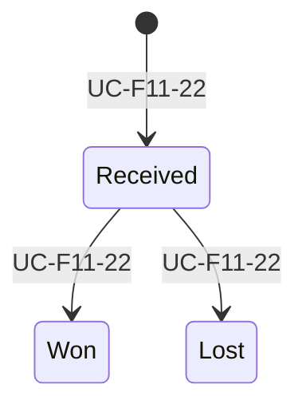

🏠 [Specs](../../../README.md) › 🧩 [Functional capabilities](../../README.md) ›
🛍️ [F11 Online shop (plugin)](../README.md) › 🗃️ [Data](README.md) › 🗃️ E-F11-17 Chargeback

# 🗃️ E-F11-17 Chargeback

**Status:** ✅ specified

## Purpose

A disputed card payment and its evidence.

## Fields

| Name | Type | Required | Validation | Default | Example | Personal data | Custom fields |
|---|---|---|---|---|---|---|---|
| payment | payment | yes | - | - | 640 EUR | no | - |
| reason, deadline | text, date | yes | - | - | not received, 11-26 | no | - |
| evidence | files | no | - | - | tracking, order | no | - |
| result | won, lost | no | - | - | won | no | - |

## Relations

On a payment of an order.

## Lifecycle

Received, answered, won or lost.

## Indexes and search

By deadline.

## Retention

10 years from the end of the fiscal year, as a supporting document of the sale
([CR-FR-002 Accounting records kept 10 years](../../../10-country-packs/france/accounting/cr-fr-002-accounting-records-kept-ten-years.md)).

## Audit

Evidence sent, result.

## Import and export

None.

## Used by

- [UC-F11-22 Handle a chargeback](../use-cases/07-payment-risk/uc-f11-22-handle-a-chargeback.md)

## Open questions

None.

---

⬅️ [E-F11-16 Fraud check](e-f11-16-fraud-check.md) · ⬆️ [Up](README.md) ·
➡️ [E-F11-18 Product content](e-f11-18-product-content.md)
