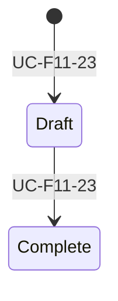

🏠 [Specs](../../../README.md) › 🧩 [Functional capabilities](../../README.md) ›
🛍️ [F11 Online shop (plugin)](../README.md) › 🗃️ [Data](README.md) › 🗃️ E-F11-18 Product content

# 🗃️ E-F11-18 Product content

**Status:** ✅ specified

## Purpose

A product's attributes, media and texts per channel and language.

## Fields

| Name | Type | Required | Validation | Default | Example | Personal data | Custom fields |
|---|---|---|---|---|---|---|---|
| product | online product | yes | - | - | Navy coat | no | - |
| attributes | list | yes per channel | - | - | wool 80 %, sizes 34-46 | no | - |
| media | images, videos | yes | - | - | 6 images | no | - |
| texts | per language | yes | - | - | fr, en | no | - |
| completeness | per channel | no | - | - | shop 100 %, marketplace 90 % | no | - |

## Relations

Extends the Online product (E-F11-03).

## Lifecycle

Draft, complete per channel.

## Indexes and search

By completeness.

## Retention

While the product is sold.

## Audit

Changes.

## Import and export

None.

## Used by

- [UC-F11-23 Enrich product content per channel](../use-cases/08-product-content-and-listings/uc-f11-23-enrich-product-content-per-channel.md)

## Open questions

None.

---

⬅️ [E-F11-17 Chargeback](e-f11-17-chargeback.md) · ⬆️ [Up](README.md) ·
➡️ [E-F11-19 Product feed](e-f11-19-product-feed.md)
