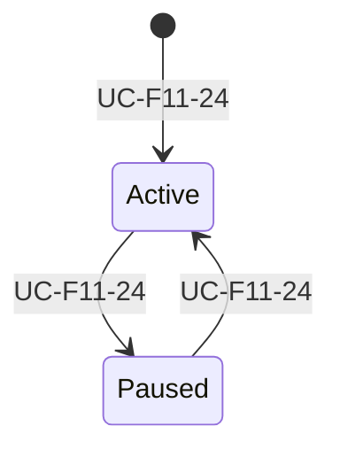

🏠 [Specs](../../../README.md) › 🧩 [Functional capabilities](../../README.md) ›
🛍️ [F11 Online shop (plugin)](../README.md) › 🗃️ [Data](README.md) › 🗃️ E-F11-19 Product feed

# 🗃️ E-F11-19 Product feed

**Status:** ✅ specified

## Purpose

A feed of products to a comparator.

## Fields

| Name | Type | Required | Validation | Default | Example | Personal data | Custom fields |
|---|---|---|---|---|---|---|---|
| destination | text | yes | - | - | Google Shopping FR | no | - |
| products | filter | yes | - | - | all in stock | no | - |
| mapping | attributes | yes | - | - | GTIN, brand | no | - |
| last refresh, refused | date, count | no | - | - | 11-12, 12 | no | - |

## Relations

Reads Product content.

## Lifecycle

Active, paused.

## Indexes and search

By destination.

## Retention

While active.

## Audit

Created, refreshed.

## Import and export

None.

## Used by

- [UC-F11-24 Publish product feeds to shopping comparators](../use-cases/08-product-content-and-listings/uc-f11-24-publish-product-feeds-to-shopping-comparators.md)

## Open questions

None.

---

⬅️ [E-F11-18 Product content](e-f11-18-product-content.md) · ⬆️ [Up](README.md) ·
➡️ [E-F11-20 Product safety information](e-f11-20-product-safety-information.md)
