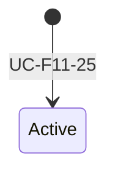

🏠 [Specs](../../../README.md) › 🧩 [Functional capabilities](../../README.md) ›
🛍️ [F11 Online shop (plugin)](../README.md) › 🗃️ [Data](README.md) › 🗃️ E-F11-20 Product safety information

# 🗃️ E-F11-20 Product safety information

**Status:** ✅ specified, ⚖️ lawyer review before launch (D574)

## Purpose

What a listing must show for product safety.

## Fields

| Name | Type | Required | Validation | Default | Example | Personal data | Custom fields |
|---|---|---|---|---|---|---|---|
| manufacturer | name, address | yes | - | - | Toys SA, Lyon | no | - |
| EU responsible person | name, address | yes | - | - | Toys SA | no | - |
| identifiers | type, batch, model | yes | - | - | model T-12 | no | - |
| warnings | text and images per language | no | - | - | Not for under 3 | no | - |

## Relations

One per Online product.

## Lifecycle

Changed with the product.

## Indexes and search

By product.

## Retention

10 years after the product's last sale (⚖️ lawyer review before launch, D574: Regulation (EU) 2023/988, articles 9 and 19; no
France-pack rule reads the retention).

## Audit

Changes.

## Import and export

None.

## Used by

- [UC-F11-25 Show product safety information](../use-cases/08-product-content-and-listings/uc-f11-25-show-product-safety-information.md)

## Open questions

None.

---

⬅️ [E-F11-19 Product feed](e-f11-19-product-feed.md) · ⬆️ [Up](README.md) ·
➡️ [E-F11-21 Pre-order and reservation](e-f11-21-pre-order-and-reservation.md)
