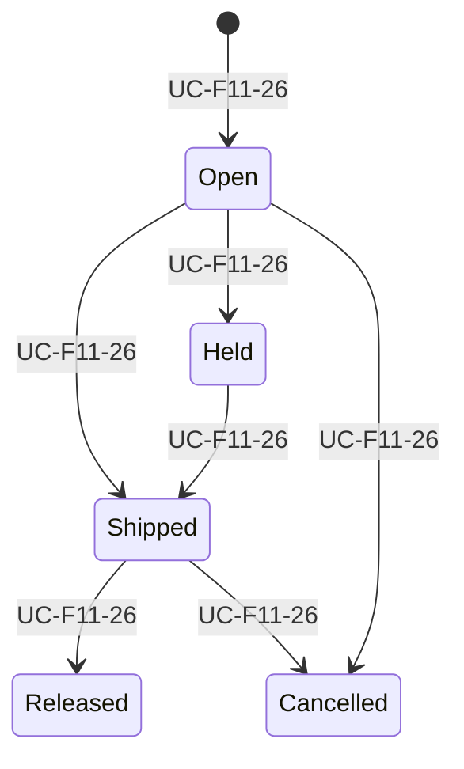

🏠 [Specs](../../../README.md) › 🧩 [Functional capabilities](../../README.md) ›
🛍️ [F11 Online shop (plugin)](../README.md) › 🗃️ [Data](README.md) › 🗃️ E-F11-21 Pre-order and reservation

# 🗃️ E-F11-21 Pre-order and reservation

**Status:** ✅ specified

## Purpose

A pre-order with its date and payment, or a back-in-stock reservation.

## Fields

| Name | Type | Required | Validation | Default | Example | Personal data | Custom fields |
|---|---|---|---|---|---|---|---|
| kind | pre-order, reservation | yes | - | - | pre-order | no | - |
| product | online product | yes | - | - | Spring jacket | no | - |
| shopper | customer or email | yes | - | - | lea@mail.fr | yes | - |
| date and payment | date, full/deposit/at shipping | no | - | - | 02-15, 30 % | no | - |
| status | open, held, shipped, cancelled, released | yes | - | open | open | no | - |

## Relations

Becomes a Checkout or an order.

## Lifecycle

Open, held, shipped or cancelled.

## Indexes and search

By product and status.

## Retention

As orders.

## Audit

Created, changed.

## Import and export

None.

## Used by

- [UC-F11-26 Take pre-orders and back-in-stock reservations](../use-cases/09-pre-orders-and-b2b-buying/uc-f11-26-take-pre-orders-and-back-in-stock-reservations.md)

## Open questions

None.

---

⬅️ [E-F11-20 Product safety information](e-f11-20-product-safety-information.md) · ⬆️ [Up](README.md) ·
➡️ [E-F11-22 Punch-out session](e-f11-22-punch-out-session.md)
