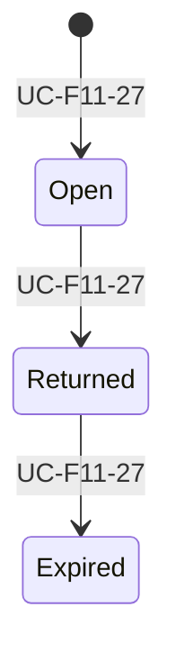

🏠 [Specs](../../../README.md) › 🧩 [Functional capabilities](../../README.md) ›
🛍️ [F11 Online shop (plugin)](../README.md) › 🗃️ [Data](README.md) › 🗃️ E-F11-22 Punch-out session

# 🗃️ E-F11-22 Punch-out session

**Status:** ✅ specified

## Purpose

A buyer's session from their purchasing system.

## Fields

| Name | Type | Required | Validation | Default | Example | Personal data | Custom fields |
|---|---|---|---|---|---|---|---|
| customer | customer | yes | approved B2B | - | Brasserie du Parc | no | - |
| protocol | cXML, OCI | yes | - | - | OCI | no | - |
| cart | lines | no | - | - | 40 cases | no | - |
| status | open, returned, expired | yes | - | open | returned | no | - |

## Relations

Returns a cart; the order comes back as an F6 order.

## Lifecycle

Open, returned, expired.

## Indexes and search

By customer.

## Retention

1 year.

## Audit

Opened, returned.

## Import and export

None.

## Used by

- [UC-F11-27 Request a quote or punch out from a buyer's system](../use-cases/09-pre-orders-and-b2b-buying/uc-f11-27-request-a-quote-or-punch-out-from-a-buyers-system.md)

## Open questions

None.

---

⬅️ [E-F11-21 Pre-order and reservation](e-f11-21-pre-order-and-reservation.md) · ⬆️ [Up](README.md) ·
➡️ [E-F11-23 Store fulfilment](e-f11-23-store-fulfilment.md)
