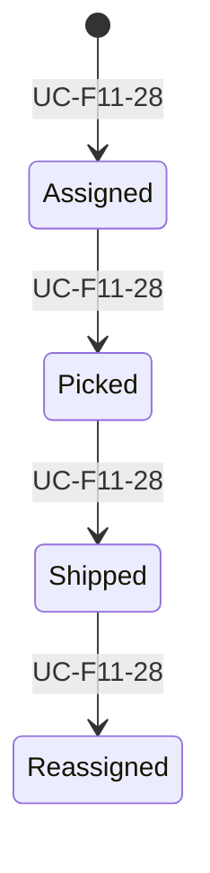

🏠 [Specs](../../../README.md) › 🧩 [Functional capabilities](../../README.md) ›
🛍️ [F11 Online shop (plugin)](../README.md) › 🗃️ [Data](README.md) › 🗃️ E-F11-23 Store fulfilment

# 🗃️ E-F11-23 Store fulfilment

**Status:** ✅ specified

## Purpose

An online order assigned to a store for picking.

## Fields

| Name | Type | Required | Validation | Default | Example | Personal data | Custom fields |
|---|---|---|---|---|---|---|---|
| order | checkout | yes | - | - | W-2026-1201 | no | - |
| store | warehouse | yes | stock and capacity | - | Villeurbanne | no | - |
| deadline | date and time | yes | - | - | 11-12 17:00 | no | - |
| status | assigned, picked, shipped, reassigned | yes | - | assigned | shipped | no | - |

## Relations

Uses a Transfer or delivery of F7.

## Lifecycle

Assigned, picked, shipped.

## Indexes and search

By store.

## Retention

As orders.

## Audit

Each status.

## Import and export

None.

## Used by

- [UC-F11-28 Fulfil online orders from a store](../use-cases/10-fulfil-from-stores-and-report/uc-f11-28-fulfil-online-orders-from-a-store.md)

## Open questions

None.

---

⬅️ [E-F11-22 Punch-out session](e-f11-22-punch-out-session.md) · ⬆️ [Up](README.md) ·
➡️ [E-F11-24 Donation](e-f11-24-donation.md)
