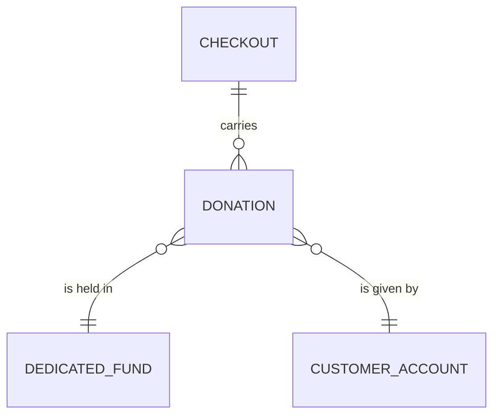
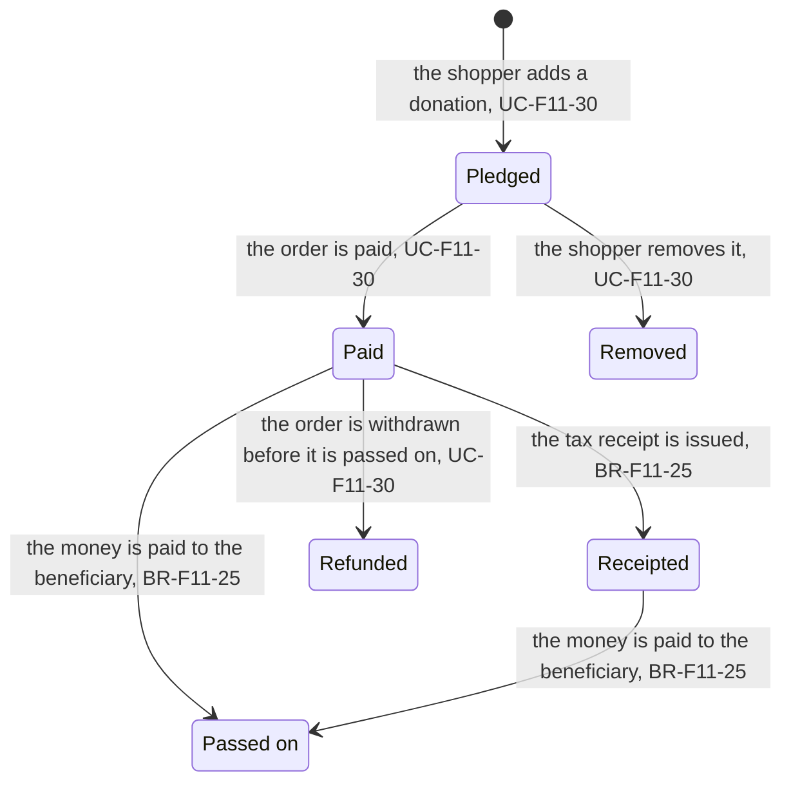

🏠 [Specs](../../../README.md) › 🧩 [Functional capabilities](../../README.md) ›
🛍️ [F11 Online shop (plugin)](../README.md) › 🗃️ [Data](README.md) › 🗃️ E-F11-24 Donation

# 🗃️ E-F11-24 Donation

**Status:** ✅ specified

## Purpose

A gift made at checkout to a stated beneficiary, with its receipt and its payment to the beneficiary
([D530](../../../06-decisions/f11-online-shop/d530-benchmark-gaps-f11-online-shop.md)).

## Fields

| Name | Type | Required | Validation | Default | Example | Personal data | Custom fields |
|---|---|---|---|---|---|---|---|
| order | checkout | yes | - | - | Order 3108 | no | no |
| donor | customer account or name and address | yes | address needed for a receipt | - | Sonia M. | yes | no |
| beneficiary | text | yes | from the campaign | - | Cats Shelter | no | no |
| amount | money | yes | above 0 | - | 2.00 | no | no |
| kind | preset, free amount, round-up | yes | - | preset | round-up | no | no |
| receipt | number | when receipted | - | - | R-2026-0412 | no | no |
| passed on at | date | when passed on | - | - | 2026-11-30 | no | no |
| state | pledged, paid, removed, receipted, passed on, refunded | yes | the lifecycle below | pledged | pledged | no | no |

## Relations

- [E-F11-05 Checkout](e-f11-05-checkout.md)
- [E-F8-19 Dedicated fund](../../f08-accounting/data/e-f08-19-dedicated-fund.md)
- [E-F11-09 Customer account](e-f11-09-customer-account.md)

## Lifecycle

## Indexes and search

By order, donor, beneficiary, campaign and state; the donations to pass on this month.

## Retention

Kept as an accounting record and as the receipt's proof
([CR-FR-002](../../../10-country-packs/france/accounting/cr-fr-002-accounting-records-kept-ten-years.md)).

## Audit

Every state change, receipt and payment to the beneficiary with the amounts.

## Import and export

CSV export of the donations of a campaign and of the yearly list of receipts.

## Used by

- [UC-F11-30 Accept donations at checkout](../use-cases/11-donations-gift-cards-and-cross-border/uc-f11-30-accept-donations-at-checkout.md)

## Open questions

None.

---

⬅️ [E-F11-23 Store fulfilment](e-f11-23-store-fulfilment.md) · ⬆️ [Up](README.md) ·
➡️ [E-F11-25 Wishlist](e-f11-25-wishlist.md)
