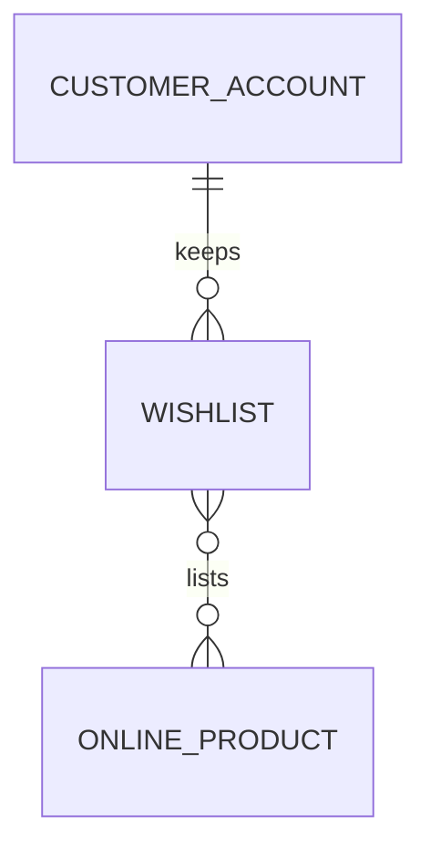
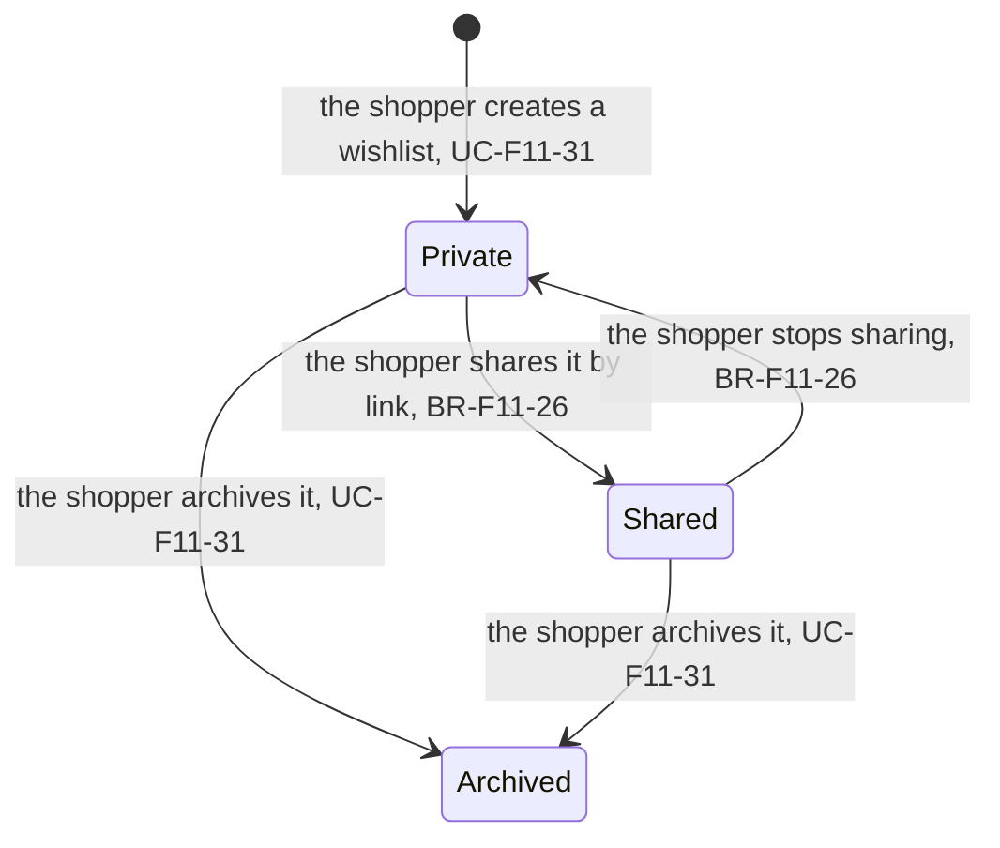

🏠 [Specs](../../../README.md) › 🧩 [Functional capabilities](../../README.md) ›
🛍️ [F11 Online shop (plugin)](../README.md) › 🗃️ [Data](README.md) › 🗃️ E-F11-25 Wishlist

# 🗃️ E-F11-25 Wishlist

**Status:** ✅ specified

## Purpose

A list of products a shopper likes, private unless they share it
([D530](../../../06-decisions/f11-online-shop/d530-benchmark-gaps-f11-online-shop.md)).

## Fields

| Name | Type | Required | Validation | Default | Example | Personal data | Custom fields |
|---|---|---|---|---|---|---|---|
| owner | customer account | yes | - | - | Sonia M. | yes | no |
| name | text | yes | up to 60 characters | My wishlist | Birthday | no | no |
| products | list of online product | no | up to 200 | - | Red kettle, toaster | no | no |
| alerts | price drop, back in stock | no | needs consent | - | back in stock | yes | no |
| share link | address | when shared | random, not guessable | - | - | no | no |
| first name shown | text | when shared | - | - | Sonia | yes | no |
| state | private, shared, archived | yes | the lifecycle below | private | private | no | no |

## Relations

- [E-F11-09 Customer account](e-f11-09-customer-account.md)
- [E-F11-03 Online product](e-f11-03-online-product.md)

## Lifecycle

## Indexes and search

By owner and state; the most wished products as counts.

## Retention

Kept while the account lives; archived lists 1 year; erased with the account.

## Audit

Every share and unshare, and the count of opens of a shared link.

## Import and export

No import; the owner's export of their data includes their lists.

## Used by

- [UC-F11-31 Keep wishlists and compare products](../use-cases/11-donations-gift-cards-and-cross-border/uc-f11-31-keep-wishlists-and-compare-products.md)

## Open questions

None.

---

⬅️ [E-F11-24 Donation](e-f11-24-donation.md) · ⬆️ [Up](README.md) ·
➡️ [E-F11-26 Online gift card](e-f11-26-online-gift-card.md)
