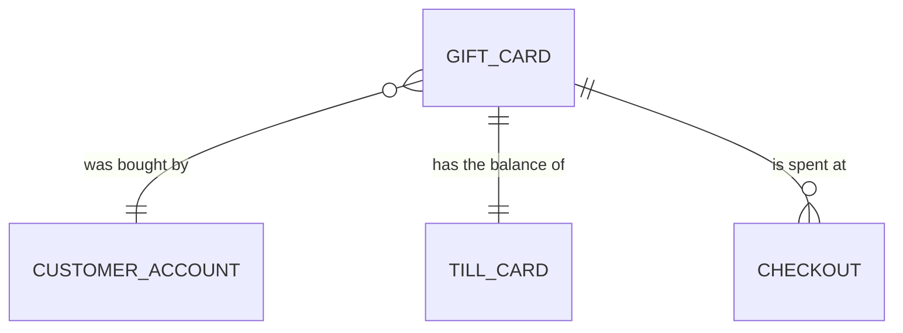
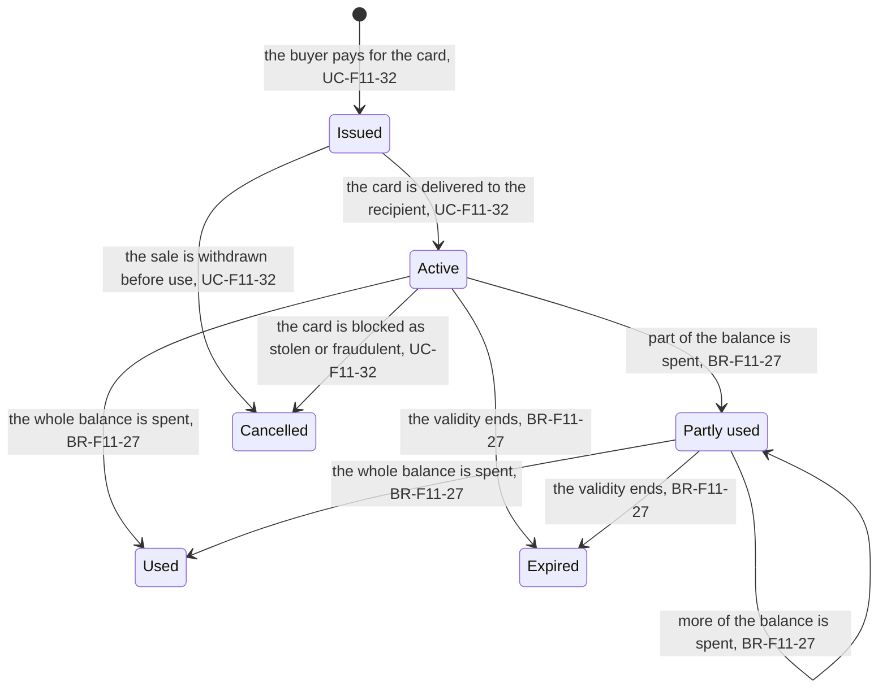

🏠 [Specs](../../../README.md) › 🧩 [Functional capabilities](../../README.md) ›
🛍️ [F11 Online shop (plugin)](../README.md) › 🗃️ [Data](README.md) › 🗃️ E-F11-26 Online gift card

# 🗃️ E-F11-26 Online gift card

**Status:** ✅ specified

## Purpose

A gift card sold online and spent online or at a till, with its single balance
([D530](../../../06-decisions/f11-online-shop/d530-benchmark-gaps-f11-online-shop.md)). It is the online sale and
delivery side of the card that
[E-F10-10 Loyalty card and gift card](../../f10-point-of-sale/data/e-f10-10-loyalty-card-and-gift-card.md) holds for the
tills; the balance is the same value.

## Fields

| Name | Type | Required | Validation | Default | Example | Personal data | Custom fields |
|---|---|---|---|---|---|---|---|
| code | text | yes | random, unique | auto | 8H4K-2Q9T | no | no |
| amount sold | money | yes | within the amounts offered | - | 50.00 | no | no |
| balance | money | yes | 0 to amount sold | amount sold | 20.00 | no | no |
| buyer | customer account or name | yes | - | - | Valérie P. | yes | no |
| recipient email | email | yes | - | - | sonia@example.com | yes | no |
| message and delivery date | text and date | no | - | now | Happy birthday, 2026-12-24 | yes | no |
| valid until | date | yes | per the legal rules | - | 2027-12-24 | no | no |
| wrong tries | number | yes | locks at 5 | 0 | 0 | no | no |
| state | issued, active, partly used, used, expired, cancelled | yes | the lifecycle below | issued | issued | no | no |

## Relations

- [E-F10-10 Loyalty card and gift card](../../f10-point-of-sale/data/e-f10-10-loyalty-card-and-gift-card.md)
- [E-F11-09 Customer account](e-f11-09-customer-account.md)
- [E-F11-05 Checkout](e-f11-05-checkout.md)

## Lifecycle

## Indexes and search

By code, buyer, recipient, state and valid-until date; the cards expiring this month.

## Retention

Kept as an accounting record while a balance remains and 10 years after
([CR-FR-002](../../../10-country-packs/france/accounting/cr-fr-002-accounting-records-kept-ten-years.md)).

## Audit

Every sale, delivery, use, adjustment, block and expiry, with the channel.

## Import and export

CSV export of the cards sold and their balances; no import.

## Used by

- [UC-F11-32 Sell and redeem gift cards online](../use-cases/11-donations-gift-cards-and-cross-border/uc-f11-32-sell-and-redeem-gift-cards-online.md)

## Open questions

None.

---

⬅️ [E-F11-25 Wishlist](e-f11-25-wishlist.md) · ⬆️ [Up](README.md) ·
➡️ [E-F11-27 Country price list](e-f11-27-country-price-list.md)
