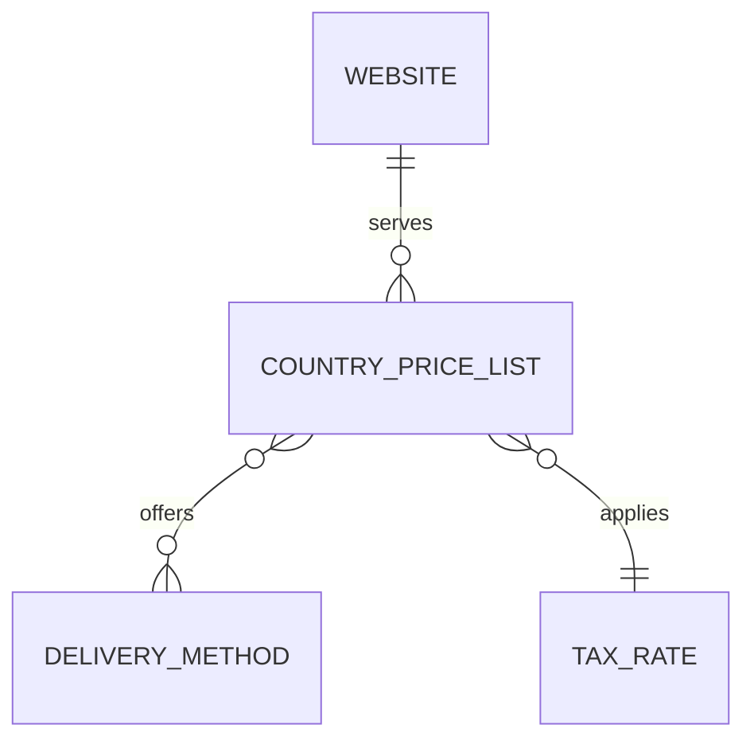
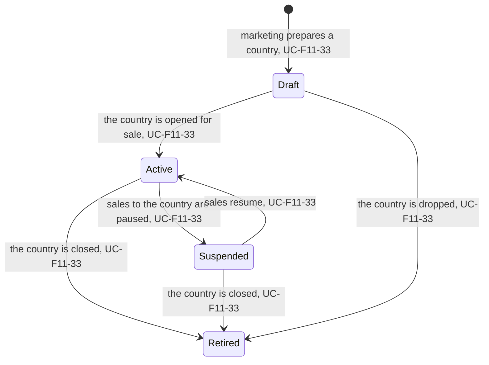

🏠 [Specs](../../../README.md) › 🧩 [Functional capabilities](../../README.md) ›
🛍️ [F11 Online shop (plugin)](../README.md) › 🗃️ [Data](README.md) › 🗃️ E-F11-27 Country price list

# 🗃️ E-F11-27 Country price list

**Status:** ✅ specified

## Purpose

The prices, currency, VAT, delivery and payment methods of the shop in one country
([D530](../../../06-decisions/f11-online-shop/d530-benchmark-gaps-f11-online-shop.md)).

## Fields

| Name | Type | Required | Validation | Default | Example | Personal data | Custom fields |
|---|---|---|---|---|---|---|---|
| country | country | yes | unique per shop | - | Germany | no | no |
| currency | currency | yes | - | euro | euro | no | no |
| language | language | yes | - | - | German | no | no |
| price rule | converted, fixed by product | yes | - | converted | converted | no | no |
| rounding | text | no | - | none | to .90 | no | no |
| VAT rate | percent | yes | from the tax rates | - | 19 | no | no |
| delivery methods | list of delivery method | yes | at least 1 | - | Parcel 6.90 | no | no |
| duties collected | at checkout, by the carrier, not applicable | yes | - | not applicable | not applicable | no | no |
| state | draft, active, suspended, retired | yes | the lifecycle below | draft | draft | no | no |

## Relations

- [E-F11-01 Website](e-f11-01-website.md)
- [E-F11-07 Delivery method](e-f11-07-delivery-method.md)
- [E-F8-33 Tax rate](../../f08-accounting/data/e-f08-33-tax-rate.md)

## Lifecycle

## Indexes and search

By country and state; the countries paused or without prices for some products.

## Retention

Kept with its history of rates and prices for 10 years
([CR-FR-002](../../../10-country-packs/france/accounting/cr-fr-002-accounting-records-kept-ten-years.md)).

## Audit

Every opening, pause, price rule and rate change, with who and from which date.

## Import and export

CSV import of fixed prices per product and country; CSV export of the list.

## Used by

- [UC-F11-33 Sell across borders](../use-cases/11-donations-gift-cards-and-cross-border/uc-f11-33-sell-across-borders.md)

## Open questions

None.

---

⬅️ [E-F11-26 Online gift card](e-f11-26-online-gift-card.md) · ⬆️ [Up](README.md)
