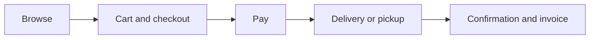

🏠 [Specs](../../../README.md) › 🧩 [Functional capabilities](../../README.md) ›
🛍️ [F11 Online shop (plugin)](../README.md) › 🔀 [Flows](README.md) › 🔀 FL-F11-02 Shop and check out

# 🔀 FL-F11-02 Shop and check out

**Status:** ✅ specified

## Summary

Covers UC-F11-04, UC-F11-05, UC-F11-06, UC-F11-07, UC-F11-08.

## Personas

- [U03 Sales](../../../01-users/personas/u03-sales.md)
- [U09 Customer](../../../01-users/personas/u09-customer.md)
- [U15 Warehouse operator](../../../01-users/personas/u15-warehouse-operator.md)

## Flowchart

## Sequence diagram

See each use case.

## Steps

| Step | Persona | Screen | Use case | What happens |
|---|---|---|---|---|
| 1 | U09 | [S-F11-04](../screens/02-shop-and-check-out/s-f11-04-shop.md) | [UC-F11-04](../use-cases/02-shop-and-check-out/uc-f11-04-browse-and-search-the-shop.md) | Browse and search the shop |
| 2 | U09 | [S-F11-05](../screens/02-shop-and-check-out/s-f11-05-checkout.md) | [UC-F11-05](../use-cases/02-shop-and-check-out/uc-f11-05-check-out.md) | Check out |
| 3 | U09 | [S-F11-06](../screens/02-shop-and-check-out/s-f11-06-payment.md) | [UC-F11-06](../use-cases/02-shop-and-check-out/uc-f11-06-pay-online.md) | Pay online |
| 4 | U09, U15 | [S-F11-07](../screens/02-shop-and-check-out/s-f11-07-delivery-options.md) | [UC-F11-07](../use-cases/02-shop-and-check-out/uc-f11-07-choose-delivery-or-click-collect.md) | Choose delivery or click & collect |
| 5 | U09, U03 | [S-F11-08](../screens/02-shop-and-check-out/s-f11-08-order-confirmation.md) | [UC-F11-08](../use-cases/02-shop-and-check-out/uc-f11-08-confirm-the-order-and-invoice.md) | Confirm the order and invoice |

### Entities and screens

| Entity | States in this flow | Shown at step and screen | Aggregated view |
|---|---|---|---|
| [E-F11-04 Cart](../data/e-f11-04-cart.md) | Open, Ordered, Abandoned | 2 [S-F11-05](../screens/02-shop-and-check-out/s-f11-05-checkout.md) | Carts |
| [E-F11-05 Checkout](../data/e-f11-05-checkout.md) | Recorded | 2 [S-F11-05](../screens/02-shop-and-check-out/s-f11-05-checkout.md); 3 [S-F11-06](../screens/02-shop-and-check-out/s-f11-06-payment.md); 5 [S-F11-08](../screens/02-shop-and-check-out/s-f11-08-order-confirmation.md) | Checkouts |
| [E-F11-07 Delivery method](../data/e-f11-07-delivery-method.md) | Recorded | 4 [S-F11-07](../screens/02-shop-and-check-out/s-f11-07-delivery-options.md) | Delivery methods |
| [E-T10-02 Notification](../../../03-technical/t10-translations-and-notifications/data/e-t10-02-notification.md) | Active | Shown elsewhere: [S-T10-02 Notification](../../../03-technical/t10-translations-and-notifications/screens/s-t10-02-notification.md), from the admin list [S-T10-L02](../../../03-technical/t10-translations-and-notifications/screens/00-lists/s-t10-l02-notifications.md) | Notifications |
| [E-F6-05 Invoice](../../f06-customers-and-sales/data/e-f06-05-invoice.md) | Sent, Received, Refused, Paid, Draft, Issued, Partly paid, Overdue | Shown elsewhere: [S-F6-06 Invoice](../../f06-customers-and-sales/screens/03-invoice-and-get-paid/s-f06-06-invoice.md) | Invoices |

## Errors

As each use case.

## Images

Every step and error, for each persona taking part, in light and dark mode (D120). Steps are numbered as in the Steps
table; E rows are the error cases.

| Step | Persona | Device | Light | Dark |
|---|---|---|---|---|
| 1 | U09 | phone | [light](../images/02-shop-and-check-out/u09-customer/1-browse-phone-light.png) | [dark](../images/02-shop-and-check-out/u09-customer/1-browse-phone-dark.png) |
| 2 | U09 | phone | [light](../images/02-shop-and-check-out/u09-customer/2-checkout-phone-light.png) | [dark](../images/02-shop-and-check-out/u09-customer/2-checkout-phone-dark.png) |
| 3 | U09 | phone | [light](../images/02-shop-and-check-out/u09-customer/3-payment-phone-light.png) | [dark](../images/02-shop-and-check-out/u09-customer/3-payment-phone-dark.png) |
| 4 | U09 | phone | [light](../images/02-shop-and-check-out/u09-customer/4-delivery-or-pickup-phone-light.png) | [dark](../images/02-shop-and-check-out/u09-customer/4-delivery-or-pickup-phone-dark.png) |
| 4 | U15 | phone | [light](../images/02-shop-and-check-out/u15-warehouse-operator/4-delivery-or-pickup-phone-light.png) | [dark](../images/02-shop-and-check-out/u15-warehouse-operator/4-delivery-or-pickup-phone-dark.png) |
| 4 | U15 | tablet | [light](../images/02-shop-and-check-out/u15-warehouse-operator/4-delivery-or-pickup-tablet-light.png) | [dark](../images/02-shop-and-check-out/u15-warehouse-operator/4-delivery-or-pickup-tablet-dark.png) |
| 5 | U09 | phone | [light](../images/02-shop-and-check-out/u09-customer/5-confirmation-phone-light.png) | [dark](../images/02-shop-and-check-out/u09-customer/5-confirmation-phone-dark.png) |
| 5 | U03 | desktop | [light](../images/02-shop-and-check-out/u03-sales/5-confirmation-desktop-light.png) | [dark](../images/02-shop-and-check-out/u03-sales/5-confirmation-desktop-dark.png) |
| 5 | U03 | phone | [light](../images/02-shop-and-check-out/u03-sales/5-confirmation-phone-light.png) | [dark](../images/02-shop-and-check-out/u03-sales/5-confirmation-phone-dark.png) |
| 5 | U03 | tablet | [light](../images/02-shop-and-check-out/u03-sales/5-confirmation-tablet-light.png) | [dark](../images/02-shop-and-check-out/u03-sales/5-confirmation-tablet-dark.png) |
| E1 | U09 | phone | [light](../images/02-shop-and-check-out/u09-customer/e1-payment-refused-phone-light.png) | [dark](../images/02-shop-and-check-out/u09-customer/e1-payment-refused-phone-dark.png) |
| E2 | U09 | phone | [light](../images/02-shop-and-check-out/u09-customer/e2-out-of-stock-meanwhile-phone-light.png) | [dark](../images/02-shop-and-check-out/u09-customer/e2-out-of-stock-meanwhile-phone-dark.png) |

## Open questions

None.

---

⬅️ [FL-F11-01 Build the shop](fl-f11-01-build-the-shop.md) · ⬆️ [Up](README.md) ·
➡️ [FL-F11-03 After the order](fl-f11-03-after-the-order.md)
