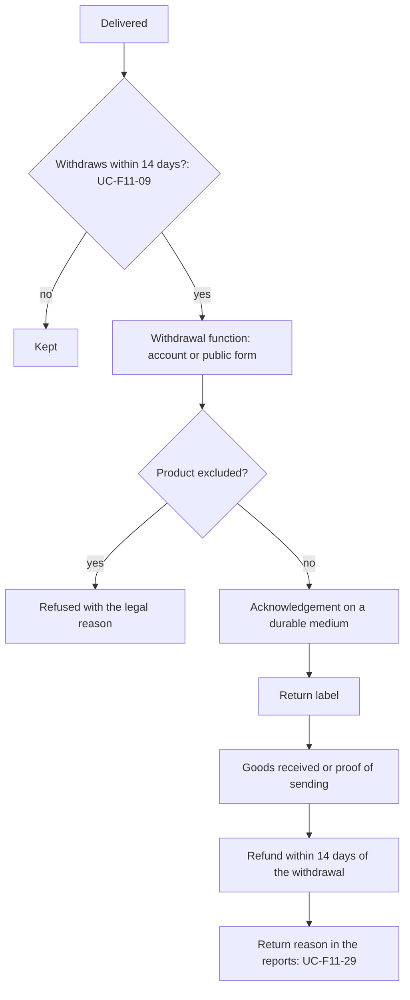

🏠 [Specs](../../../README.md) › 🧩 [Functional capabilities](../../README.md) ›
🛍️ [F11 Online shop (plugin)](../README.md) › 🔀 [Flows](README.md) › 🔀 FL-F11-03 After the order

# 🔀 FL-F11-03 After the order

**Status:** ✅ specified

## Summary

After the order: the shopper withdraws within 14 days with the withdrawal function, gets the acknowledgement and a
return label, sends the goods back, and is refunded within the legal period; the account shows orders, invoices and
returns.

## Personas

- [U03 Sales](../../../01-users/personas/u03-sales.md)
- [U09 Customer](../../../01-users/personas/u09-customer.md)

## Flowchart

## Sequence diagram

See each use case.

## Steps

| Step | Persona | Screen | Use case | What happens |
|---|---|---|---|---|
| 1 | [U09](../../../01-users/personas/u09-customer.md) | [S-F11-09](../screens/03-after-the-order/s-f11-09-withdrawal.md) | [UC-F11-09](../use-cases/03-after-the-order/uc-f11-09-withdraw-return-and-refund.md) | Withdraw from the account or the public form |
| 2 | [U09](../../../01-users/personas/u09-customer.md) | [S-F11-09](../screens/03-after-the-order/s-f11-09-withdrawal.md) | [UC-F11-09](../use-cases/03-after-the-order/uc-f11-09-withdraw-return-and-refund.md) | Receive the acknowledgement and the return label |
| 3 | [U03](../../../01-users/personas/u03-sales.md) | [S-F11-09](../screens/03-after-the-order/s-f11-09-withdrawal.md) | [UC-F11-09](../use-cases/03-after-the-order/uc-f11-09-withdraw-return-and-refund.md) | Receive the goods and refund within the period |
| 4 | [U09](../../../01-users/personas/u09-customer.md) | [S-F11-10](../screens/03-after-the-order/s-f11-10-customer-account.md) | [UC-F11-10](../use-cases/03-after-the-order/uc-f11-10-use-the-customer-account.md) | Follow the return and the refund in the account |

### Entities and screens

| Entity | States in this flow | Shown at step and screen | Aggregated view |
|---|---|---|---|
| [E-F11-08 Withdrawal request](../data/e-f11-08-withdrawal-request.md) | Received, Acknowledged, Returned, Refunded | 1, 2, 3 [S-F11-09](../screens/03-after-the-order/s-f11-09-withdrawal.md) | Withdrawal requests |
| [E-F11-03 Online product](../data/e-f11-03-online-product.md) | Delivered | Shown elsewhere: [S-F11-13 Digital products](../screens/04-special-sales/s-f11-13-digital-products.md) | Online products |
| [E-F2-13 Document](../../f02-no-code-configuration/data/e-f02-13-document.md) | To sort, To validate, Done | Shown elsewhere: [S-F2-13 Documents workspace](../../f02-no-code-configuration/screens/07-benchmark-additions/s-f02-13-documents-workspace.md) | Documents |
| [E-F6-06 Customer payment](../../f06-customers-and-sales/data/e-f06-06-customer-payment.md) | Refused | Shown elsewhere: [S-F6-07 Payments and reconciliation](../../f06-customers-and-sales/screens/03-invoice-and-get-paid/s-f06-07-payments-and-reconciliation.md) | Customer payments |

## Errors

An excluded product, a withdrawal after 14 days, a refund late (BR-F11-03).

## Images

Every step and error, for each persona taking part, in light and dark mode (D120). Steps are numbered as in the Steps
table; E rows are the error cases.

| Step | Persona | Device | Light | Dark |
|---|---|---|---|---|
| 1 | U09 | phone | [light](../images/03-after-the-order/u09-customer/1-account-phone-light.png) | [dark](../images/03-after-the-order/u09-customer/1-account-phone-dark.png) |
| 2 | U09 | phone | [light](../images/03-after-the-order/u09-customer/2-withdrawal-phone-light.png) | [dark](../images/03-after-the-order/u09-customer/2-withdrawal-phone-dark.png) |
| 3 | U03 | desktop | [light](../images/03-after-the-order/u03-sales/3-refund-desktop-light.png) | [dark](../images/03-after-the-order/u03-sales/3-refund-desktop-dark.png) |
| 3 | U03 | phone | [light](../images/03-after-the-order/u03-sales/3-refund-phone-light.png) | [dark](../images/03-after-the-order/u03-sales/3-refund-phone-dark.png) |
| 3 | U03 | tablet | [light](../images/03-after-the-order/u03-sales/3-refund-tablet-light.png) | [dark](../images/03-after-the-order/u03-sales/3-refund-tablet-dark.png) |
| E1 | U09 | phone | [light](../images/03-after-the-order/u09-customer/e1-excluded-product-phone-light.png) | [dark](../images/03-after-the-order/u09-customer/e1-excluded-product-phone-dark.png) |
| 4 | U09 | phone | [light](../images/03-after-the-order/u09-customer/4-customer-account-phone-light.png) | [dark](../images/03-after-the-order/u09-customer/4-customer-account-phone-dark.png) |

## Open questions

None.

---

⬅️ [FL-F11-02 Shop and check out](fl-f11-02-shop-and-check-out.md) · ⬆️ [Up](README.md) ·
➡️ [FL-F11-04 B2B, subscriptions, rentals and digital](fl-f11-04-special-sales.md)
