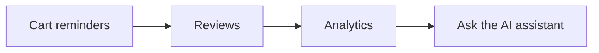

🏠 [Specs](../../../README.md) › 🧩 [Functional capabilities](../../README.md) ›
🛍️ [F11 Online shop (plugin)](../README.md) › 🔀 [Flows](README.md) › 🔀 FL-F11-05 Grow the shop

# 🔀 FL-F11-05 Grow the shop

**Status:** ✅ specified

## Summary

Covers UC-F11-14, UC-F11-15, UC-F11-17, UC-F11-20.

## Personas

- [U03 Sales](../../../01-users/personas/u03-sales.md)
- [U09 Customer](../../../01-users/personas/u09-customer.md)
- [U12 Marketing](../../../01-users/personas/u12-marketing.md)
- [U13 Owner](../../../01-users/personas/u13-owner.md)

## Flowchart

## Sequence diagram

See each use case.

## Steps

| Step | Persona | Screen | Use case | What happens |
|---|---|---|---|---|
| 1 | U12 | [S-F11-14](../screens/05-grow-the-shop/s-f11-14-cart-reminders.md) | [UC-F11-14](../use-cases/05-grow-the-shop/uc-f11-14-recover-abandoned-carts.md) | Recover abandoned carts |
| 2 | U12, U09 | [S-F11-15](../screens/05-grow-the-shop/s-f11-15-reviews.md) | [UC-F11-15](../use-cases/05-grow-the-shop/uc-f11-15-collect-and-moderate-reviews.md) | Collect and moderate reviews |
| 3 | U12, U13 | [S-F11-17](../screens/05-grow-the-shop/s-f11-17-shop-analytics-report.md) | [UC-F11-17](../use-cases/05-grow-the-shop/uc-f11-17-read-shop-analytics.md) | Read shop analytics |
| 4 | U12, U03 | [S-F11-20](../screens/05-grow-the-shop/s-f11-20-shop-assistant.md) | [UC-F11-20](../use-cases/05-grow-the-shop/uc-f11-20-ask-the-assistant-about-the-shop.md) | Ask the AI assistant about the shop |

### Entities and screens

| Entity | States in this flow | Shown at step and screen | Aggregated view |
|---|---|---|---|
| [E-F11-12 Cart reminder](../data/e-f11-12-cart-reminder.md) | Active | 1 [S-F11-14](../screens/05-grow-the-shop/s-f11-14-cart-reminders.md) | Cart reminders |
| [E-F11-10 Product review](../data/e-f11-10-product-review.md) | To check, Published, Rejected | 2 [S-F11-15](../screens/05-grow-the-shop/s-f11-15-reviews.md) | Product reviews |

## Errors

As each use case.

## Images

Every step and error, for each persona taking part, in light and dark mode (D120). Steps are numbered as in the Steps
table; E rows are the error cases.

| Step | Persona | Device | Light | Dark |
|---|---|---|---|---|
| 1 | U12 | desktop | [light](../images/05-grow-the-shop/u12-marketing/1-cart-reminders-desktop-light.png) | [dark](../images/05-grow-the-shop/u12-marketing/1-cart-reminders-desktop-dark.png) |
| 1 | U12 | phone | [light](../images/05-grow-the-shop/u12-marketing/1-cart-reminders-phone-light.png) | [dark](../images/05-grow-the-shop/u12-marketing/1-cart-reminders-phone-dark.png) |
| 2 | U12 | desktop | [light](../images/05-grow-the-shop/u12-marketing/2-reviews-desktop-light.png) | [dark](../images/05-grow-the-shop/u12-marketing/2-reviews-desktop-dark.png) |
| 2 | U12 | phone | [light](../images/05-grow-the-shop/u12-marketing/2-reviews-phone-light.png) | [dark](../images/05-grow-the-shop/u12-marketing/2-reviews-phone-dark.png) |
| 2 | U09 | phone | [light](../images/05-grow-the-shop/u09-customer/2-reviews-phone-light.png) | [dark](../images/05-grow-the-shop/u09-customer/2-reviews-phone-dark.png) |
| 3 | U13 | desktop | [light](../images/05-grow-the-shop/u13-owner/3-analytics-desktop-light.png) | [dark](../images/05-grow-the-shop/u13-owner/3-analytics-desktop-dark.png) |
| 3 | U13 | phone | [light](../images/05-grow-the-shop/u13-owner/3-analytics-phone-light.png) | [dark](../images/05-grow-the-shop/u13-owner/3-analytics-phone-dark.png) |
| 3 | U12 | desktop | [light](../images/05-grow-the-shop/u12-marketing/3-analytics-desktop-light.png) | [dark](../images/05-grow-the-shop/u12-marketing/3-analytics-desktop-dark.png) |
| 3 | U12 | phone | [light](../images/05-grow-the-shop/u12-marketing/3-analytics-phone-light.png) | [dark](../images/05-grow-the-shop/u12-marketing/3-analytics-phone-dark.png) |
| 4 | U12 | desktop | [light](../images/05-grow-the-shop/u12-marketing/4-assistant-desktop-light.png) | [dark](../images/05-grow-the-shop/u12-marketing/4-assistant-desktop-dark.png) |
| 4 | U12 | phone | [light](../images/05-grow-the-shop/u12-marketing/4-assistant-phone-light.png) | [dark](../images/05-grow-the-shop/u12-marketing/4-assistant-phone-dark.png) |
| 4 | U03 | desktop | [light](../images/05-grow-the-shop/u03-sales/4-assistant-desktop-light.png) | [dark](../images/05-grow-the-shop/u03-sales/4-assistant-desktop-dark.png) |
| 4 | U03 | phone | [light](../images/05-grow-the-shop/u03-sales/4-assistant-phone-light.png) | [dark](../images/05-grow-the-shop/u03-sales/4-assistant-phone-dark.png) |
| 4 | U03 | tablet | [light](../images/05-grow-the-shop/u03-sales/4-assistant-tablet-light.png) | [dark](../images/05-grow-the-shop/u03-sales/4-assistant-tablet-dark.png) |
| E1 | U12 | desktop | [light](../images/05-grow-the-shop/u12-marketing/e1-no-consent-desktop-light.png) | [dark](../images/05-grow-the-shop/u12-marketing/e1-no-consent-desktop-dark.png) |
| E1 | U12 | phone | [light](../images/05-grow-the-shop/u12-marketing/e1-no-consent-phone-light.png) | [dark](../images/05-grow-the-shop/u12-marketing/e1-no-consent-phone-dark.png) |

## Open questions

None.

---

⬅️ [FL-F11-04 B2B, subscriptions, rentals and digital](fl-f11-04-special-sales.md) · ⬆️ [Up](README.md) ·
➡️ [FL-F11-06 Channels and legal pages](fl-f11-06-channels-and-legal.md)
