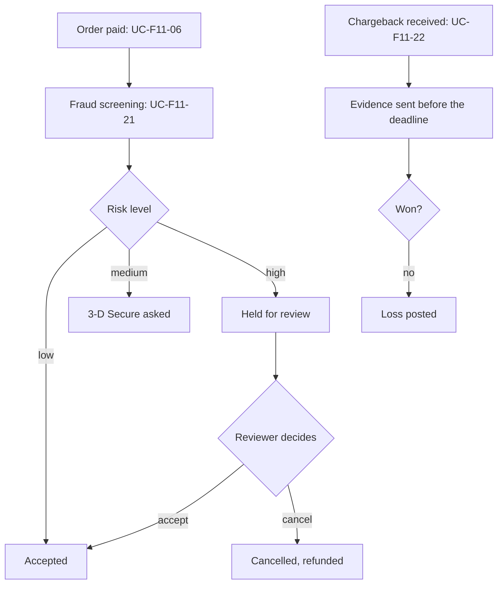

🏠 [Specs](../../../README.md) › 🧩 [Functional capabilities](../../README.md) ›
🛍️ [F11 Online shop (plugin)](../README.md) › 🔀 [Flows](README.md) › 🔀 FL-F11-07 Payment risk

# 🔀 FL-F11-07 Payment risk

**Status:** ✅ specified

## Summary

Orders screened for fraud, payments authenticated when the rules require it, and chargebacks answered with evidence.

## Personas

- [U05 Accounting](../../../01-users/personas/u05-accounting.md)
- [U09 Customer](../../../01-users/personas/u09-customer.md)
- [U16 Office worker](../../../01-users/personas/u16-office-worker.md), acting in the chart, step 36i

## Flowchart

## Sequence diagram

- [UC-F11-21 Screen orders for fraud and authenticate payments](../use-cases/07-payment-risk/uc-f11-21-screen-orders-for-fraud-and-authenticate-payments.md#sequence-diagram)

## Steps

| Step | Persona | Screen | Use case | What happens |
|---|---|---|---|---|
| 1 | [U09](../../../01-users/personas/u09-customer.md) | [S-F11-06](../screens/02-shop-and-check-out/s-f11-06-payment.md) | [UC-F11-21](../use-cases/07-payment-risk/uc-f11-21-screen-orders-for-fraud-and-authenticate-payments.md) | A shopper authenticates a payment |
| 2 | [U05](../../../01-users/personas/u05-accounting.md) | [S-F11-21](../screens/07-payment-risk/s-f11-21-order-risk.md) | [UC-F11-21](../use-cases/07-payment-risk/uc-f11-21-screen-orders-for-fraud-and-authenticate-payments.md) | Review an order held for risk |
| 3 | [U05](../../../01-users/personas/u05-accounting.md) | [S-F11-22](../screens/07-payment-risk/s-f11-22-chargebacks.md) | [UC-F11-22](../use-cases/07-payment-risk/uc-f11-22-handle-a-chargeback.md) | Answer a chargeback with evidence |

### Entities and screens

| Entity | States in this flow | Shown at step and screen | Aggregated view |
|---|---|---|---|
| [E-F6-04 Order](../../f06-customers-and-sales/data/e-f06-04-order.md) | Cancelled | Shown elsewhere: [S-F6-05 Order](../../f06-customers-and-sales/screens/02-quote-to-order/s-f06-05-order.md) | Orders |
| [E-F11-16 Fraud check](../data/e-f11-16-fraud-check.md) | Accepted, Held | 1 [S-F11-06](../screens/02-shop-and-check-out/s-f11-06-payment.md); 2 [S-F11-21](../screens/07-payment-risk/s-f11-21-order-risk.md) | Fraud checks |
| [E-F11-17 Chargeback](../data/e-f11-17-chargeback.md) | Received, Won | 3 [S-F11-22](../screens/07-payment-risk/s-f11-22-chargebacks.md) | Chargebacks |

## Errors

A legitimate order held, evidence missing for a chargeback, a deadline passed (BR-F11-16, BR-F11-17).

## Images

Every step and error, for each persona taking part, in light and dark mode (D120). Steps are numbered as in the Steps
table; E rows are the error cases.

| Step | Persona | Device | Light | Dark |
|---|---|---|---|---|
| 1 | U09 | phone | [light](../images/07-payment-risk/u09-customer/1-payment-phone-light.png) | [dark](../images/07-payment-risk/u09-customer/1-payment-phone-dark.png) |
| 2 | U05 | desktop | [light](../images/07-payment-risk/u05-accounting/2-order-risk-desktop-light.png) | [dark](../images/07-payment-risk/u05-accounting/2-order-risk-desktop-dark.png) |
| 3 | U05 | desktop | [light](../images/07-payment-risk/u05-accounting/3-chargebacks-desktop-light.png) | [dark](../images/07-payment-risk/u05-accounting/3-chargebacks-desktop-dark.png) |
| E1 | U09 | phone | [light](../images/07-payment-risk/u09-customer/e1-payment-refused-phone-light.png) | [dark](../images/07-payment-risk/u09-customer/e1-payment-refused-phone-dark.png) |

## Open questions

None.

---

⬅️ [FL-F11-06 Channels and legal pages](fl-f11-06-channels-and-legal.md) · ⬆️ [Up](README.md) ·
➡️ [FL-F11-08 Product content and listings](fl-f11-08-product-content-and-listings.md)
