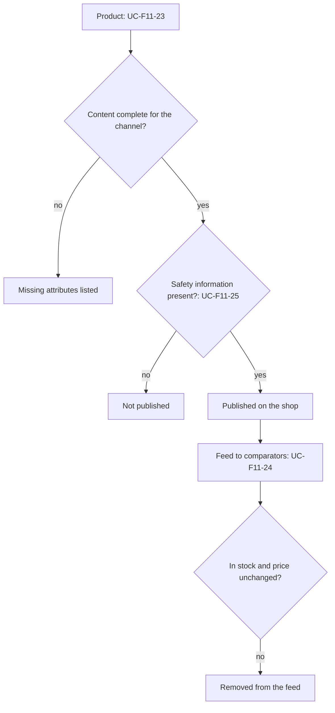

🏠 [Specs](../../../README.md) › 🧩 [Functional capabilities](../../README.md) ›
🛍️ [F11 Online shop (plugin)](../README.md) › 🔀 [Flows](README.md) › 🔀 FL-F11-08 Product content and listings

# 🔀 FL-F11-08 Product content and listings

**Status:** ✅ specified

## Summary

Product content complete per channel and language, feeds to shopping comparators, and the product safety information
every listing must show.

## Personas

- [U04 Purchasing and stock](../../../01-users/personas/u04-purchasing.md)
- [U12 Marketing and communication](../../../01-users/personas/u12-marketing.md)

## Flowchart

## Sequence diagram

- [UC-F11-23 Enrich product content per channel](../use-cases/08-product-content-and-listings/uc-f11-23-enrich-product-content-per-channel.md#sequence-diagram)

## Steps

| Step | Persona | Screen | Use case | What happens |
|---|---|---|---|---|
| 1 | [U12](../../../01-users/personas/u12-marketing.md) | [S-F11-23](../screens/08-product-content-and-listings/s-f11-23-product-content.md) | [UC-F11-23](../use-cases/08-product-content-and-listings/uc-f11-23-enrich-product-content-per-channel.md) | Complete a product's content per channel |
| 2 | [U04](../../../01-users/personas/u04-purchasing.md) | [S-F11-25](../screens/08-product-content-and-listings/s-f11-25-product-safety.md) | [UC-F11-25](../use-cases/08-product-content-and-listings/uc-f11-25-show-product-safety-information.md) | Add the manufacturer and safety warnings |
| 3 | [U12](../../../01-users/personas/u12-marketing.md) | [S-F11-24](../screens/08-product-content-and-listings/s-f11-24-product-feeds.md) | [UC-F11-24](../use-cases/08-product-content-and-listings/uc-f11-24-publish-product-feeds-to-shopping-comparators.md) | Publish the Google Shopping feed |

### Entities and screens

| Entity | States in this flow | Shown at step and screen | Aggregated view |
|---|---|---|---|
| [E-F11-03 Online product](../data/e-f11-03-online-product.md) | New, Published, Delivered, Complete | 1 [S-F11-23](../screens/08-product-content-and-listings/s-f11-23-product-content.md); 2 [S-F11-25](../screens/08-product-content-and-listings/s-f11-25-product-safety.md) | Online products |
| [E-F11-13 Channel listing](../data/e-f11-13-channel-listing.md) | Active | Shown elsewhere: [S-F11-18 Channels](../screens/06-channels-and-legal/s-f11-18-channels.md) | Channel listings |
| [E-F11-18 Product content](../data/e-f11-18-product-content.md) | Draft, Complete | 1 [S-F11-23](../screens/08-product-content-and-listings/s-f11-23-product-content.md) | Product contents |
| [E-F11-20 Product safety information](../data/e-f11-20-product-safety-information.md) | Active | 2 [S-F11-25](../screens/08-product-content-and-listings/s-f11-25-product-safety.md) | Product safety informations |
| [E-F11-19 Product feed](../data/e-f11-19-product-feed.md) | Active, Paused | 3 [S-F11-24](../screens/08-product-content-and-listings/s-f11-24-product-feeds.md) | Product feeds |
| [E-F7-06 Item](../../f07-purchasing-and-stock/data/e-f07-06-item.md) | Active | Shown elsewhere: [S-F7-21 Stock levels](../../f07-purchasing-and-stock/screens/03-replenish/s-f07-21-stock-levels.md) | Items |

## Errors

A required attribute missing, no responsible person in the EU, a feed item refused by the comparator (BR-F11-18 to
BR-F11-20).

## Images

Every step and error, for each persona taking part, in light and dark mode (D120). Steps are numbered as in the Steps
table; E rows are the error cases.

| Step | Persona | Device | Light | Dark |
|---|---|---|---|---|
| 1 | U12 | desktop | [light](../images/08-product-content-and-listings/u12-marketing/1-product-content-desktop-light.png) | [dark](../images/08-product-content-and-listings/u12-marketing/1-product-content-desktop-dark.png) |
| 1 | U12 | phone | [light](../images/08-product-content-and-listings/u12-marketing/1-product-content-phone-light.png) | [dark](../images/08-product-content-and-listings/u12-marketing/1-product-content-phone-dark.png) |
| 2 | U04 | desktop | [light](../images/08-product-content-and-listings/u04-purchasing/2-product-safety-desktop-light.png) | [dark](../images/08-product-content-and-listings/u04-purchasing/2-product-safety-desktop-dark.png) |
| 3 | U12 | desktop | [light](../images/08-product-content-and-listings/u12-marketing/3-product-feeds-desktop-light.png) | [dark](../images/08-product-content-and-listings/u12-marketing/3-product-feeds-desktop-dark.png) |
| 3 | U12 | phone | [light](../images/08-product-content-and-listings/u12-marketing/3-product-feeds-phone-light.png) | [dark](../images/08-product-content-and-listings/u12-marketing/3-product-feeds-phone-dark.png) |
| E1 | U12 | desktop | [light](../images/08-product-content-and-listings/u12-marketing/e1-product-content-refused-desktop-light.png) | [dark](../images/08-product-content-and-listings/u12-marketing/e1-product-content-refused-desktop-dark.png) |
| E1 | U12 | phone | [light](../images/08-product-content-and-listings/u12-marketing/e1-product-content-refused-phone-light.png) | [dark](../images/08-product-content-and-listings/u12-marketing/e1-product-content-refused-phone-dark.png) |

## Open questions

None.

---

⬅️ [FL-F11-07 Payment risk](fl-f11-07-payment-risk.md) · ⬆️ [Up](README.md) ·
➡️ [FL-F11-09 Pre-orders and B2B buying](fl-f11-09-pre-orders-and-b2b-buying.md)
