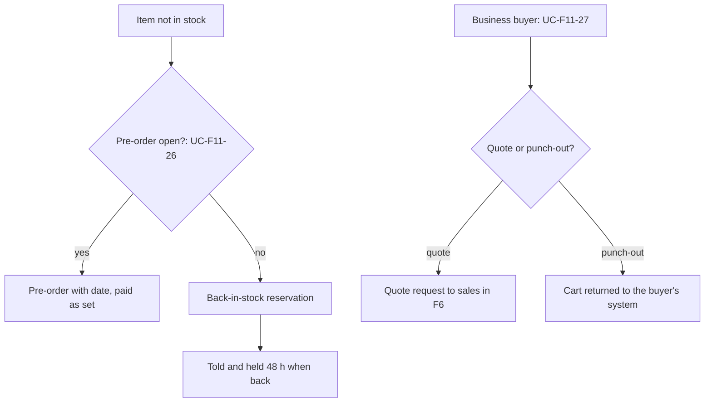

🏠 [Specs](../../../README.md) › 🧩 [Functional capabilities](../../README.md) ›
🛍️ [F11 Online shop (plugin)](../README.md) › 🔀 [Flows](README.md) › 🔀 FL-F11-09 Pre-orders and B2B buying

# 🔀 FL-F11-09 Pre-orders and B2B buying

**Status:** ✅ specified

## Summary

Shoppers pre-order items not yet in stock or reserve them for their return; business buyers ask quotes from the cart or
punch out from their purchasing system.

## Personas

- [U03 Sales](../../../01-users/personas/u03-sales.md)
- [U09 Customer](../../../01-users/personas/u09-customer.md)

## Flowchart

## Sequence diagram

- [UC-F11-27 Request a quote or punch out from a buyer's system](../use-cases/09-pre-orders-and-b2b-buying/uc-f11-27-request-a-quote-or-punch-out-from-a-buyers-system.md#sequence-diagram)

## Steps

| Step | Persona | Screen | Use case | What happens |
|---|---|---|---|---|
| 1 | [U09](../../../01-users/personas/u09-customer.md) | [S-F11-26](../screens/09-pre-orders-and-b2b-buying/s-f11-26-pre-order.md) | [UC-F11-26](../use-cases/09-pre-orders-and-b2b-buying/uc-f11-26-take-pre-orders-and-back-in-stock-reservations.md) | Pre-order an item with its date |
| 2 | [U09](../../../01-users/personas/u09-customer.md) | [S-F11-26](../screens/09-pre-orders-and-b2b-buying/s-f11-26-pre-order.md) | [UC-F11-26](../use-cases/09-pre-orders-and-b2b-buying/uc-f11-26-take-pre-orders-and-back-in-stock-reservations.md) | Reserve an item when back in stock |
| 3 | [U09](../../../01-users/personas/u09-customer.md) | [S-F11-11](../screens/04-special-sales/s-f11-11-b2b-access.md) | [UC-F11-27](../use-cases/09-pre-orders-and-b2b-buying/uc-f11-27-request-a-quote-or-punch-out-from-a-buyers-system.md) | Ask a quote from the cart |
| 4 | [U03](../../../01-users/personas/u03-sales.md) | [S-F11-11](../screens/04-special-sales/s-f11-11-b2b-access.md) | [UC-F11-27](../use-cases/09-pre-orders-and-b2b-buying/uc-f11-27-request-a-quote-or-punch-out-from-a-buyers-system.md) | Sales answer the quote request |

### Entities and screens

| Entity | States in this flow | Shown at step and screen | Aggregated view |
|---|---|---|---|
| [E-F7-06 Item](../../f07-purchasing-and-stock/data/e-f07-06-item.md) | Active | Shown elsewhere: [S-F7-21 Stock levels](../../f07-purchasing-and-stock/screens/03-replenish/s-f07-21-stock-levels.md) | Items |
| [E-F11-21 Pre-order and reservation](../data/e-f11-21-pre-order-and-reservation.md) | Open, Held | 1, 2 [S-F11-26](../screens/09-pre-orders-and-b2b-buying/s-f11-26-pre-order.md) | Pre-order and reservations |
| [E-F6-03 Quote](../../f06-customers-and-sales/data/e-f06-03-quote.md) | Draft, To approve, Sent, Expired, Accepted | 3, 4 [S-F11-11](../screens/04-special-sales/s-f11-11-b2b-access.md) | Quotes |
| [E-F11-22 Punch-out session](../data/e-f11-22-punch-out-session.md) | Open, Returned, Expired | 3, 4 [S-F11-11](../screens/04-special-sales/s-f11-11-b2b-access.md) | Punch-out sessions |
| [E-F11-04 Cart](../data/e-f11-04-cart.md) | Open | Shown elsewhere: [S-F11-05 Checkout](../screens/02-shop-and-check-out/s-f11-05-checkout.md) | Carts |

## Errors

A pre-order date missed, a reservation not collected, a punch-out session expired (BR-F11-21, BR-F11-22).

## Images

Every step and error, for each persona taking part, in light and dark mode (D120). Steps are numbered as in the Steps
table; E rows are the error cases.

| Step | Persona | Device | Light | Dark |
|---|---|---|---|---|
| 1 | U09 | phone | [light](../images/09-pre-orders-and-b2b-buying/u09-customer/1-pre-order-phone-light.png) | [dark](../images/09-pre-orders-and-b2b-buying/u09-customer/1-pre-order-phone-dark.png) |
| 2 | U09 | phone | [light](../images/09-pre-orders-and-b2b-buying/u09-customer/2-pre-order-phone-light.png) | [dark](../images/09-pre-orders-and-b2b-buying/u09-customer/2-pre-order-phone-dark.png) |
| 3 | U09 | phone | [light](../images/09-pre-orders-and-b2b-buying/u09-customer/3-b2b-access-phone-light.png) | [dark](../images/09-pre-orders-and-b2b-buying/u09-customer/3-b2b-access-phone-dark.png) |
| 4 | U03 | desktop | [light](../images/09-pre-orders-and-b2b-buying/u03-sales/4-b2b-access-desktop-light.png) | [dark](../images/09-pre-orders-and-b2b-buying/u03-sales/4-b2b-access-desktop-dark.png) |
| 4 | U03 | phone | [light](../images/09-pre-orders-and-b2b-buying/u03-sales/4-b2b-access-phone-light.png) | [dark](../images/09-pre-orders-and-b2b-buying/u03-sales/4-b2b-access-phone-dark.png) |
| 4 | U03 | tablet | [light](../images/09-pre-orders-and-b2b-buying/u03-sales/4-b2b-access-tablet-light.png) | [dark](../images/09-pre-orders-and-b2b-buying/u03-sales/4-b2b-access-tablet-dark.png) |
| E1 | U09 | phone | [light](../images/09-pre-orders-and-b2b-buying/u09-customer/e1-pre-order-refused-phone-light.png) | [dark](../images/09-pre-orders-and-b2b-buying/u09-customer/e1-pre-order-refused-phone-dark.png) |

## Open questions

None.

---

⬅️ [FL-F11-08 Product content and listings](fl-f11-08-product-content-and-listings.md) · ⬆️ [Up](README.md) ·
➡️ [FL-F11-10 Fulfil from stores and report](fl-f11-10-fulfil-from-stores-and-report.md)
