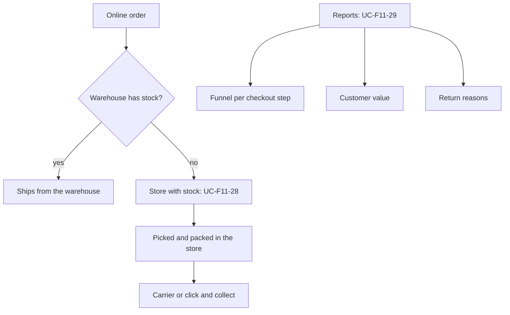

🏠 [Specs](../../../README.md) › 🧩 [Functional capabilities](../../README.md) ›
🛍️ [F11 Online shop (plugin)](../README.md) › 🔀 [Flows](README.md) › 🔀 FL-F11-10 Fulfil from stores and report

# 🔀 FL-F11-10 Fulfil from stores and report

**Status:** ✅ specified

## Summary

Online orders picked and shipped from a store when the warehouse lacks stock, and the shop's funnel, customer value and
return reasons.

## Personas

- [U13 Owner](../../../01-users/personas/u13-owner.md)
- [U23 Store manager](../../../01-users/personas/u23-store-manager.md)

## Flowchart

## Sequence diagram

- [UC-F11-28 Fulfil online orders from a store](../use-cases/10-fulfil-from-stores-and-report/uc-f11-28-fulfil-online-orders-from-a-store.md#sequence-diagram)

## Steps

| Step | Persona | Screen | Use case | What happens |
|---|---|---|---|---|
| 1 | [U23](../../../01-users/personas/u23-store-manager.md) | [S-F11-27](../screens/10-fulfil-from-stores-and-report/s-f11-27-store-fulfilment.md) | [UC-F11-28](../use-cases/10-fulfil-from-stores-and-report/uc-f11-28-fulfil-online-orders-from-a-store.md) | Pick and ship an online order from the store |
| 2 | [U13](../../../01-users/personas/u13-owner.md) | [S-F11-28](../screens/10-fulfil-from-stores-and-report/s-f11-28-shop-reports.md) | [UC-F11-29](../use-cases/10-fulfil-from-stores-and-report/uc-f11-29-read-the-funnel-customer-value-and-return-reasons.md) | Read the funnel, customer value and return reasons |

### Entities and screens

| Entity | States in this flow | Shown at step and screen | Aggregated view |
|---|---|---|---|
| [E-F6-04 Order](../../f06-customers-and-sales/data/e-f06-04-order.md) | Open, In progress, Cancelled, Done | Shown elsewhere: [S-F6-05 Order](../../f06-customers-and-sales/screens/02-quote-to-order/s-f06-05-order.md) | Orders |
| [E-F7-07 Location](../../f07-purchasing-and-stock/data/e-f07-07-location.md) | Active | Shown elsewhere: [S-F7-23 Dangerous goods](../../f07-purchasing-and-stock/screens/02-receive-and-store/s-f07-23-dangerous-goods.md) | Locations |
| [E-F7-06 Item](../../f07-purchasing-and-stock/data/e-f07-06-item.md) | Active | Shown elsewhere: [S-F7-21 Stock levels](../../f07-purchasing-and-stock/screens/03-replenish/s-f07-21-stock-levels.md) | Items |
| [E-F1-02 Company site](../../f01-administration/data/e-f01-02-company-site.md) | Open, Closed | Shown elsewhere: [S-F1-02 Sites](../../f01-administration/screens/02-manage-sites/s-f01-02-sites.md) | Company sites |
| [E-F11-23 Store fulfilment](../data/e-f11-23-store-fulfilment.md) | Assigned, Picked, Shipped | 1 [S-F11-27](../screens/10-fulfil-from-stores-and-report/s-f11-27-store-fulfilment.md) | Store fulfilments |
| [E-F11-05 Checkout](../data/e-f11-05-checkout.md) | Recorded | 2 [S-F11-28](../screens/10-fulfil-from-stores-and-report/s-f11-28-shop-reports.md) | Checkouts |
| [E-F11-08 Withdrawal request](../data/e-f11-08-withdrawal-request.md) | Received, Acknowledged, Returned, Refunded | 2 [S-F11-28](../screens/10-fulfil-from-stores-and-report/s-f11-28-shop-reports.md) | Withdrawal requests |

## Errors

Store stock sold at the counter meanwhile, a store over its picking capacity (BR-F11-23, BR-F11-24).

## Images

Every step and error, for each persona taking part, in light and dark mode (D120). Steps are numbered as in the Steps
table; E rows are the error cases.

| Step | Persona | Device | Light | Dark |
|---|---|---|---|---|
| 1 | U23 | desktop | [light](../images/10-fulfil-from-stores-and-report/u23-store-manager/1-store-fulfilment-desktop-light.png) | [dark](../images/10-fulfil-from-stores-and-report/u23-store-manager/1-store-fulfilment-desktop-dark.png) |
| 1 | U23 | phone | [light](../images/10-fulfil-from-stores-and-report/u23-store-manager/1-store-fulfilment-phone-light.png) | [dark](../images/10-fulfil-from-stores-and-report/u23-store-manager/1-store-fulfilment-phone-dark.png) |
| 1 | U23 | tablet | [light](../images/10-fulfil-from-stores-and-report/u23-store-manager/1-store-fulfilment-tablet-light.png) | [dark](../images/10-fulfil-from-stores-and-report/u23-store-manager/1-store-fulfilment-tablet-dark.png) |
| 2 | U13 | desktop | [light](../images/10-fulfil-from-stores-and-report/u13-owner/2-shop-reports-desktop-light.png) | [dark](../images/10-fulfil-from-stores-and-report/u13-owner/2-shop-reports-desktop-dark.png) |
| 2 | U13 | phone | [light](../images/10-fulfil-from-stores-and-report/u13-owner/2-shop-reports-phone-light.png) | [dark](../images/10-fulfil-from-stores-and-report/u13-owner/2-shop-reports-phone-dark.png) |
| E1 | U23 | desktop | [light](../images/10-fulfil-from-stores-and-report/u23-store-manager/e1-store-fulfilment-refused-desktop-light.png) | [dark](../images/10-fulfil-from-stores-and-report/u23-store-manager/e1-store-fulfilment-refused-desktop-dark.png) |
| E1 | U23 | phone | [light](../images/10-fulfil-from-stores-and-report/u23-store-manager/e1-store-fulfilment-refused-phone-light.png) | [dark](../images/10-fulfil-from-stores-and-report/u23-store-manager/e1-store-fulfilment-refused-phone-dark.png) |
| E1 | U23 | tablet | [light](../images/10-fulfil-from-stores-and-report/u23-store-manager/e1-store-fulfilment-refused-tablet-light.png) | [dark](../images/10-fulfil-from-stores-and-report/u23-store-manager/e1-store-fulfilment-refused-tablet-dark.png) |

## Open questions

None.

---

⬅️ [FL-F11-09 Pre-orders and B2B buying](fl-f11-09-pre-orders-and-b2b-buying.md) · ⬆️ [Up](README.md) ·
➡️ [FL-F11-11 Donations, wishlists, gift cards and cross-border](fl-f11-11-donations-gift-cards-and-cross-border.md)
