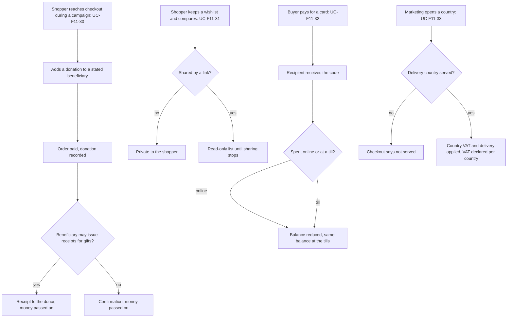
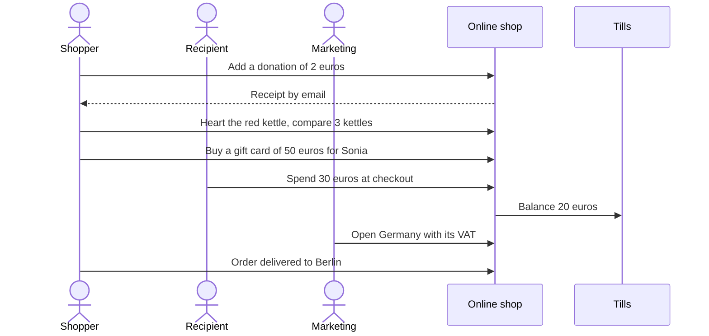

🏠 [Specs](../../../README.md) › 🧩 [Functional capabilities](../../README.md) ›
🛍️ [F11 Online shop (plugin)](../README.md) › 🔀 [Flows](README.md) ›
🔀 FL-F11-11 Donations, wishlists, gift cards and cross-border

# 🔀 FL-F11-11 Donations, wishlists, gift cards and cross-border

**Status:** ✅ specified

## Summary

Four gaps of the online shop that benchmarked suites cover and simple-ERP lacked: shoppers donate to a stated
beneficiary at checkout
([UC-F11-30](../use-cases/11-donations-gift-cards-and-cross-border/uc-f11-30-accept-donations-at-checkout.md)), keep
wishlists and compare products
([UC-F11-31](../use-cases/11-donations-gift-cards-and-cross-border/uc-f11-31-keep-wishlists-and-compare-products.md)),
buy and spend gift cards that share one balance with the tills
([UC-F11-32](../use-cases/11-donations-gift-cards-and-cross-border/uc-f11-32-sell-and-redeem-gift-cards-online.md)), and
the shop sells to other countries with the right prices, VAT and delivery
([UC-F11-33](../use-cases/11-donations-gift-cards-and-cross-border/uc-f11-33-sell-across-borders.md)). The owner chose
each in the 2026-11-14 interview ([D530](../../../06-decisions/f11-online-shop/d530-benchmark-gaps-f11-online-shop.md)).

## Personas

- [U09 Customer](../../../01-users/personas/u09-customer.md)
- [U12 Marketing and communication](../../../01-users/personas/u12-marketing.md)
- [U23 Store manager](../../../01-users/personas/u23-store-manager.md)

## Flowchart

## Sequence diagram

## Steps

| Step | Persona | Screen | Use case | What happens |
|---|---|---|---|---|
| 1 | [U09](../../../01-users/personas/u09-customer.md), [U12](../../../01-users/personas/u12-marketing.md) | [S-F11-29](../screens/11-donations-gift-cards-and-cross-border/s-f11-29-checkout-donations.md) | [UC-F11-30](../use-cases/11-donations-gift-cards-and-cross-border/uc-f11-30-accept-donations-at-checkout.md) | The shopper adds a donation at checkout and marketing sets the campaign |
| 2 | [U09](../../../01-users/personas/u09-customer.md) | [S-F11-30](../screens/11-donations-gift-cards-and-cross-border/s-f11-30-wishlists.md) | [UC-F11-31](../use-cases/11-donations-gift-cards-and-cross-border/uc-f11-31-keep-wishlists-and-compare-products.md) | The shopper keeps wishlists, compares products and shares a list on purpose |
| 3 | [U09](../../../01-users/personas/u09-customer.md), [U23](../../../01-users/personas/u23-store-manager.md) | [S-F11-31](../screens/11-donations-gift-cards-and-cross-border/s-f11-31-gift-cards-online.md) | [UC-F11-32](../use-cases/11-donations-gift-cards-and-cross-border/uc-f11-32-sell-and-redeem-gift-cards-online.md) | The shopper buys and spends a gift card and the store manager follows the cards |
| 4 | [U12](../../../01-users/personas/u12-marketing.md), [U09](../../../01-users/personas/u09-customer.md) | [S-F11-32](../screens/11-donations-gift-cards-and-cross-border/s-f11-32-cross-border.md) | [UC-F11-33](../use-cases/11-donations-gift-cards-and-cross-border/uc-f11-33-sell-across-borders.md) | Marketing opens a country and the shopper abroad sees the right price, VAT and delivery |

### Entities and screens

| Entity | States in this flow | Shown at step and screen | Aggregated view |
|---|---|---|---|
| [E-F11-24 Donation](../data/e-f11-24-donation.md) | Pledged, Paid, Removed, Receipted, Passed on, Refunded | 1 [S-F11-29](../screens/11-donations-gift-cards-and-cross-border/s-f11-29-checkout-donations.md) | Donations |
| [E-F11-25 Wishlist](../data/e-f11-25-wishlist.md) | Private, Shared, Archived | 2 [S-F11-30](../screens/11-donations-gift-cards-and-cross-border/s-f11-30-wishlists.md) | Wishlists |
| [E-F11-26 Online gift card](../data/e-f11-26-online-gift-card.md) | Issued, Active, Partly used, Used, Expired, Cancelled | 3 [S-F11-31](../screens/11-donations-gift-cards-and-cross-border/s-f11-31-gift-cards-online.md) | Gift cards |
| [E-F11-27 Country price list](../data/e-f11-27-country-price-list.md) | Draft, Active, Suspended, Retired | 4 [S-F11-32](../screens/11-donations-gift-cards-and-cross-border/s-f11-32-cross-border.md) | Country price lists |

## Errors

- **E1 The delivery country is not served.** Checkout says so with the countries served
  ([BR-F11-28](../business-rules/br-f11-28-vat-follows-the-customers-country-under-oss.md)), step 4.
- **E2 A donation without a beneficiary or receipt data.** It is not offered, or the receipt waits for the donor's
  address ([BR-F11-25](../business-rules/br-f11-25-donations-reach-the-stated-beneficiary-with-a-receipt.md)), step 1.
- **E3 A wishlist opened after sharing stopped.** It shows that it is no longer shared
  ([BR-F11-26](../business-rules/br-f11-26-wishlists-are-private-unless-shared.md)), step 2.
- **E4 A gift card used beyond its balance.** Refused on every channel
  ([BR-F11-27](../business-rules/br-f11-27-one-gift-card-balance-across-shop-and-tills.md)), step 3.

## Images

Every step and error, for each persona taking part, in light and dark mode (D120). Steps are numbered as in the Steps
table; E rows are the error cases.

| Step | Persona | Device | Light | Dark |
|---|---|---|---|---|
| 1 | U09 | phone | [light](../images/11-donations-gift-cards-and-cross-border/u09-customer/1-checkout-donations-phone-light.png) | [dark](../images/11-donations-gift-cards-and-cross-border/u09-customer/1-checkout-donations-phone-dark.png) |
| 1 | U12 | desktop | [light](../images/11-donations-gift-cards-and-cross-border/u12-marketing/1-checkout-donations-desktop-light.png) | [dark](../images/11-donations-gift-cards-and-cross-border/u12-marketing/1-checkout-donations-desktop-dark.png) |
| 1 | U09 | phone | [light](../images/11-donations-gift-cards-and-cross-border/u09-customer/1-checkout-donations-phone-light.png) | [dark](../images/11-donations-gift-cards-and-cross-border/u09-customer/1-checkout-donations-phone-dark.png) |
| 1 | U12 | desktop | [light](../images/11-donations-gift-cards-and-cross-border/u12-marketing/1-checkout-donations-desktop-light.png) | [dark](../images/11-donations-gift-cards-and-cross-border/u12-marketing/1-checkout-donations-desktop-dark.png) |
| 1 | U12 | phone | [light](../images/11-donations-gift-cards-and-cross-border/u12-marketing/1-checkout-donations-phone-light.png) | [dark](../images/11-donations-gift-cards-and-cross-border/u12-marketing/1-checkout-donations-phone-dark.png) |
| 2 | U09 | phone | [light](../images/11-donations-gift-cards-and-cross-border/u09-customer/2-wishlists-phone-light.png) | [dark](../images/11-donations-gift-cards-and-cross-border/u09-customer/2-wishlists-phone-dark.png) |
| 2 | U09 | phone | [light](../images/11-donations-gift-cards-and-cross-border/u09-customer/2-wishlists-phone-light.png) | [dark](../images/11-donations-gift-cards-and-cross-border/u09-customer/2-wishlists-phone-dark.png) |
| 3 | U09 | phone | [light](../images/11-donations-gift-cards-and-cross-border/u09-customer/3-gift-cards-online-phone-light.png) | [dark](../images/11-donations-gift-cards-and-cross-border/u09-customer/3-gift-cards-online-phone-dark.png) |
| 3 | U23 | desktop | [light](../images/11-donations-gift-cards-and-cross-border/u23-store-manager/3-gift-cards-online-desktop-light.png) | [dark](../images/11-donations-gift-cards-and-cross-border/u23-store-manager/3-gift-cards-online-desktop-dark.png) |
| 3 | U09 | phone | [light](../images/11-donations-gift-cards-and-cross-border/u09-customer/3-gift-cards-online-phone-light.png) | [dark](../images/11-donations-gift-cards-and-cross-border/u09-customer/3-gift-cards-online-phone-dark.png) |
| 3 | U23 | desktop | [light](../images/11-donations-gift-cards-and-cross-border/u23-store-manager/3-gift-cards-online-desktop-light.png) | [dark](../images/11-donations-gift-cards-and-cross-border/u23-store-manager/3-gift-cards-online-desktop-dark.png) |
| 3 | U23 | phone | [light](../images/11-donations-gift-cards-and-cross-border/u23-store-manager/3-gift-cards-online-phone-light.png) | [dark](../images/11-donations-gift-cards-and-cross-border/u23-store-manager/3-gift-cards-online-phone-dark.png) |
| 3 | U23 | tablet | [light](../images/11-donations-gift-cards-and-cross-border/u23-store-manager/3-gift-cards-online-tablet-light.png) | [dark](../images/11-donations-gift-cards-and-cross-border/u23-store-manager/3-gift-cards-online-tablet-dark.png) |
| 4 | U09 | phone | [light](../images/11-donations-gift-cards-and-cross-border/u09-customer/4-cross-border-phone-light.png) | [dark](../images/11-donations-gift-cards-and-cross-border/u09-customer/4-cross-border-phone-dark.png) |
| 4 | U12 | desktop | [light](../images/11-donations-gift-cards-and-cross-border/u12-marketing/4-cross-border-desktop-light.png) | [dark](../images/11-donations-gift-cards-and-cross-border/u12-marketing/4-cross-border-desktop-dark.png) |
| 4 | U09 | phone | [light](../images/11-donations-gift-cards-and-cross-border/u09-customer/4-cross-border-phone-light.png) | [dark](../images/11-donations-gift-cards-and-cross-border/u09-customer/4-cross-border-phone-dark.png) |
| 4 | U12 | desktop | [light](../images/11-donations-gift-cards-and-cross-border/u12-marketing/4-cross-border-desktop-light.png) | [dark](../images/11-donations-gift-cards-and-cross-border/u12-marketing/4-cross-border-desktop-dark.png) |
| 4 | U12 | phone | [light](../images/11-donations-gift-cards-and-cross-border/u12-marketing/4-cross-border-phone-light.png) | [dark](../images/11-donations-gift-cards-and-cross-border/u12-marketing/4-cross-border-phone-dark.png) |
| E1 | U09 | phone | [light](../images/11-donations-gift-cards-and-cross-border/u09-customer/e1-the-delivery-country-is-not-served-phone-light.png) | [dark](../images/11-donations-gift-cards-and-cross-border/u09-customer/e1-the-delivery-country-is-not-served-phone-dark.png) |

## Open questions

None.

---

⬅️ [FL-F11-10 Fulfil from stores and report](fl-f11-10-fulfil-from-stores-and-report.md) · ⬆️ [Up](README.md)
