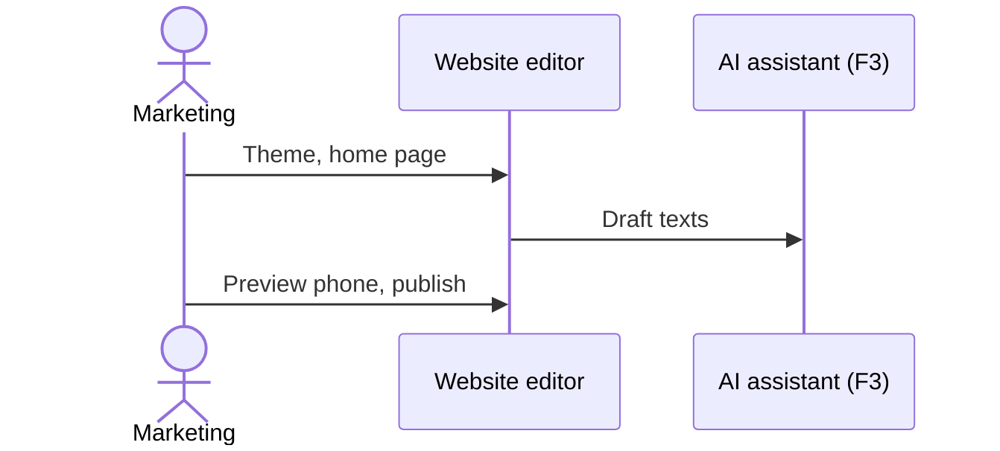

🏠 [Specs](../../../../README.md) › 🧩 [Functional capabilities](../../../README.md) ›
🛍️ [F11 Online shop (plugin)](../../README.md) › 📝 [Use cases](../README.md) ›
📝 [Use cases: FL-F11-01 Build the shop](README.md) › 📝 UC-F11-01 Build and design the website

# 📝 UC-F11-01 Build and design the website

**Status:** 🔄 waiting for the owner

## Summary

Pages from blocks, themes, menus, headers and footers, an AI configurator and AI texts, forms, content by visitor.

## Personas

- [U12 Marketing](../../../../01-users/personas/u12-marketing.md)
- [U07 Administrator](../../../../01-users/personas/u07-administrator.md)

## Goal

A website that looks like the company, without a developer.

## Trigger

Building or changing the website.

## Frequency

At start; then weekly changes.

## Preconditions

F11 set up for the company.

## Postconditions

- **Succeeded:** pages published.
- **Failed:** broken links listed before publishing.

## Main flow

1. Marketing starts from the AI configurator or a theme on the website editor
   ([S-F11-01](../../screens/01-build-the-shop/s-f11-01-website-editor.md)).
2. They drag blocks and edit texts and images, using the brand kit,
   [UC-F5-21](../../../f05-social-media/use-cases/09-brand-tests-and-return-on-investment/uc-f05-21-keep-the-brand-kit-and-asset-library.md).
3. They preview on phone and desktop.
4. They publish; broken links are listed first.

## Alternative flows

- 2a. Content shown by country or source.

## Error flows

- 4e. A page with a broken link: listed before publishing.

## Business rules

- [BR-F11-01 The shop follows the country pack](../../business-rules/br-f11-01-shop-follows-the-country-pack.md)

## Entities

- [E-F11-01 Website](../../data/e-f11-01-website.md)
- [E-F11-02 Web page](../../data/e-f11-02-web-page.md)

## Permissions

Marketing and communication for the shop; sales for B2B; accounting for payments; the owner reads. Administrators.

## Notifications

None.

## Audit events

Pages published.

## AI involvement

AI texts and layouts as drafts.

## API, MCP and A2A exposure

T5 operations of F11 with the caller's rights; the MCP tool of F11; no A2A skill.

## Screens

- [S-F11-01](../../screens/01-build-the-shop/s-f11-01-website-editor.md)

## Flowchart

See [FL-F11-01 Build the shop](../../flows/fl-f11-01-build-the-shop.md#flowchart).

## Sequence diagram

## Acceptance criteria

1. **Given** the example shop chain's new home page **when** it is previewed on a phone **then** the phone layout shows.
2. **Given** a link to a deleted page **when** publish is asked **then** it is listed first.
3. **Given** AI-drafted text **when** it is published **then** it was reviewed by marketing.

## Non-functional notes

Pages load within 2 seconds on a phone (Proposed); accessible
([CR-FR-072](../../../../10-country-packs/france/consumer/cr-fr-072-web-accessibility-eaa.md)).

## Regulatory references

[CR-FR-069](../../../../10-country-packs/france/consumer/cr-fr-069-website-legal-notices.md);
[CR-FR-072](../../../../10-country-packs/france/consumer/cr-fr-072-web-accessibility-eaa.md).

## Related use cases

See the flows.

## Open questions

None.

---

⬆️ [Up](README.md) · ➡️ [UC-F11-02 Publish the catalogue](uc-f11-02-publish-the-catalogue.md)
