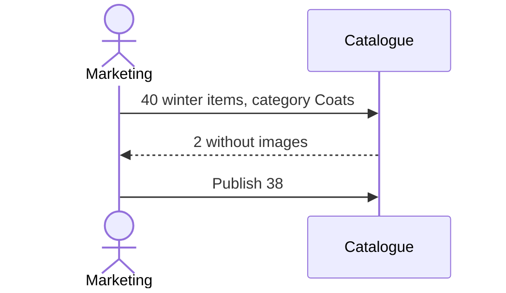

🏠 [Specs](../../../../README.md) › 🧩 [Functional capabilities](../../../README.md) ›
🛍️ [F11 Online shop (plugin)](../../README.md) › 📝 [Use cases](../README.md) ›
📝 [Use cases: FL-F11-01 Build the shop](README.md) › 📝 UC-F11-02 Publish the catalogue

# 📝 UC-F11-02 Publish the catalogue

**Status:** ✅ specified

## Summary

Products online with categories, variants, images, ribbons, tags, filters, sorting and per-website visibility.

## Personas

- [U12 Marketing](../../../../01-users/personas/u12-marketing.md)

## Goal

Products online, findable, on the right websites.

## Trigger

New products.

## Frequency

Weekly.

## Preconditions

F11 set up for the company.

## Postconditions

- **Succeeded:** products published.
- **Failed:** missing images or prices listed.

## Main flow

1. Marketing chooses products and categories on the catalogue
   ([S-F11-02](../../screens/01-build-the-shop/s-f11-02-catalogue.md)).
2. Content comes from product content
   ([UC-F11-23](../08-product-content-and-listings/uc-f11-23-enrich-product-content-per-channel.md)); safety information
   is checked ([UC-F11-25](../08-product-content-and-listings/uc-f11-25-show-product-safety-information.md)).
3. They set ribbons, tags and filters.
4. They publish on one or several websites.

## Alternative flows

- 1a. Bulk import and publish.

## Error flows

- 2e. Missing image, price or safety information: listed.

## Business rules

- [BR-F11-06 Stock shown or sold out](../../business-rules/br-f11-06-stock-shown-or-sold-out.md)

## Entities

- [E-F11-03 Online product](../../data/e-f11-03-online-product.md)

## Permissions

Marketing and communication for the shop; sales for B2B; accounting for payments; the owner reads.

## Notifications

None.

## Audit events

Published.

## AI involvement

The AI assistant prepares it for confirmation
([BR-F3-07](../../../f03-assistant/business-rules/br-f03-07-no-deletes-no-irreversible-acts.md)); figures come from
queries ([BR-F3-03](../../../f03-assistant/business-rules/br-f03-03-figures-come-from-queries.md)).

## API, MCP and A2A exposure

T5 operations of F11 with the caller's rights; the MCP tool of F11; no A2A skill.

## Screens

- [S-F11-02](../../screens/01-build-the-shop/s-f11-02-catalogue.md)

## Flowchart

See [FL-F11-01 Build the shop](../../flows/fl-f11-01-build-the-shop.md#flowchart).

## Sequence diagram

## Acceptance criteria

1. **Given** 40 items with 2 missing images **when** they are published **then** 38 publish and 2 are listed.
2. **Given** an item on two websites **when** it is published **then** both show it.
3. **Given** a toy without safety information **when** it is published **then** it is refused.

## Non-functional notes

Pages load within 2 seconds on a phone; accessible
([CR-FR-072](../../../../10-country-packs/france/consumer/cr-fr-072-web-accessibility-eaa.md)).

## Regulatory references

[CR-FR-065](../../../../10-country-packs/france/consumer/cr-fr-065-online-pre-contract-information.md).

## Related use cases

See the flows.

- [UC-F11-23 Enrich product content per channel](../08-product-content-and-listings/uc-f11-23-enrich-product-content-per-channel.md)

## Open questions

None.

---

⬅️ [UC-F11-01 Build and design the website](uc-f11-01-build-and-design-the-website.md) · ⬆️ [Up](README.md) ·
➡️ [UC-F11-03 Set online prices and promotions](uc-f11-03-set-online-prices-and-promotions.md)
