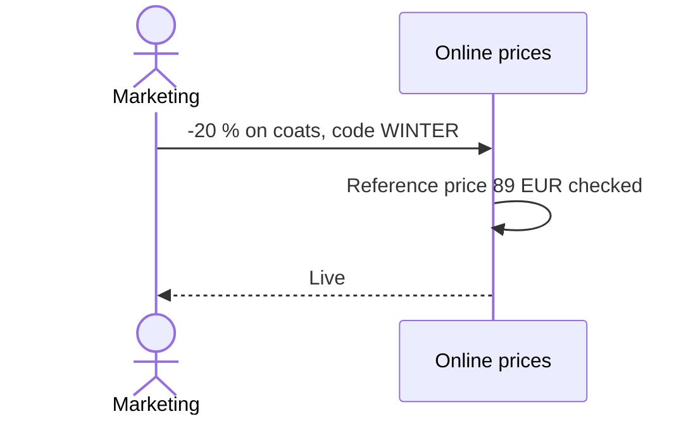

🏠 [Specs](../../../../README.md) › 🧩 [Functional capabilities](../../../README.md) ›
🛍️ [F11 Online shop (plugin)](../../README.md) › 📝 [Use cases](../README.md) ›
📝 [Use cases: FL-F11-01 Build the shop](README.md) › 📝 UC-F11-03 Set online prices and promotions

# 📝 UC-F11-03 Set online prices and promotions

**Status:** ✅ specified

## Summary

Pricelists by country, customer or currency, promotions and codes, loyalty, gift cards, B2B or B2C tax display.

## Personas

- [U12 Marketing](../../../../01-users/personas/u12-marketing.md)
- [U03 Sales](../../../../01-users/personas/u03-sales.md)

## Goal

Right prices online, legal reductions.

## Trigger

A price or promotion change.

## Frequency

Weekly.

## Preconditions

F11 set up for the company.

## Postconditions

- **Succeeded:** prices and promotions live.
- **Failed:** a reduction without a reference price refused.

## Main flow

1. Marketing sets pricelists per website on online prices
   ([S-F11-03](../../screens/01-build-the-shop/s-f11-03-online-prices.md)).
2. They create promotions and codes.
3. Reference prices are checked, [BR-F11-05](../../business-rules/br-f11-05-reductions-show-the-reference-price.md),
   [CR-FR-035](../../../../10-country-packs/france/consumer/cr-fr-035-reference-price-for-reductions.md).
4. B2B or B2C tax display applies per website
   ([BR-F11-04](../../business-rules/br-f11-04-prices-with-taxes-and-delivery.md)).

## Alternative flows

- 1a. Prices shown only when logged in (B2B).

## Error flows

- 3e. A reduction without a reference price: refused.

## Business rules

- [BR-F11-04 Prices with taxes and delivery](../../business-rules/br-f11-04-prices-with-taxes-and-delivery.md)
- [BR-F11-05 Reductions show the reference price](../../business-rules/br-f11-05-reductions-show-the-reference-price.md)

## Entities

- [E-F11-11 Online promotion code](../../data/e-f11-11-online-promotion-code.md)

## Permissions

Marketing and communication for the shop; sales for B2B; accounting for payments; the owner reads.

## Notifications

None.

## Audit events

Price changes.

## AI involvement

The AI assistant prepares it for confirmation
([BR-F3-07](../../../f03-assistant/business-rules/br-f03-07-no-deletes-no-irreversible-acts.md)); figures come from
queries ([BR-F3-03](../../../f03-assistant/business-rules/br-f03-03-figures-come-from-queries.md)).

## API, MCP and A2A exposure

T5 operations of F11 with the caller's rights; the MCP tool of F11; no A2A skill.

## Screens

- [S-F11-03](../../screens/01-build-the-shop/s-f11-03-online-prices.md)

## Flowchart

See [FL-F11-01 Build the shop](../../flows/fl-f11-01-build-the-shop.md#flowchart).

## Sequence diagram

## Acceptance criteria

1. **Given** coats at -20 % with a 30-day lowest price of 89 EUR **when** it goes live **then** the page shows 89 struck
   and 71.20.
2. **Given** a reduction without history **when** it is saved **then** it is refused.
3. **Given** a B2B website **when** prices show **then** excluding VAT.

## Non-functional notes

Pages load within 2 seconds on a phone; accessible
([CR-FR-072](../../../../10-country-packs/france/consumer/cr-fr-072-web-accessibility-eaa.md)).

## Regulatory references

[CR-FR-035](../../../../10-country-packs/france/consumer/cr-fr-035-reference-price-for-reductions.md);
[CR-FR-034](../../../../10-country-packs/france/consumer/cr-fr-034-prices-shown-including-vat.md).

## Related use cases

See the flows.

## Open questions

None.

---

⬅️ [UC-F11-02 Publish the catalogue](uc-f11-02-publish-the-catalogue.md) · ⬆️ [Up](README.md) ·
➡️ [UC-F11-04 Browse and search the shop](../02-shop-and-check-out/uc-f11-04-browse-and-search-the-shop.md)
