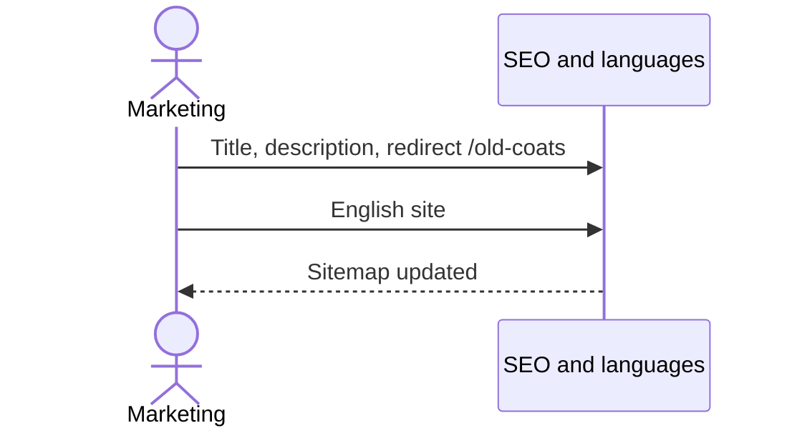

🏠 [Specs](../../../../README.md) › 🧩 [Functional capabilities](../../../README.md) ›
🛍️ [F11 Online shop (plugin)](../../README.md) › 📝 [Use cases](../README.md) ›
📝 [Use cases: FL-F11-01 Build the shop](README.md) › 📝 UC-F11-16 Manage SEO, languages and several websites

# 📝 UC-F11-16 Manage SEO, languages and several websites

**Status:** ✅ specified

## Summary

Titles, descriptions, sitemaps, redirects, structured data, translations and several domains.

## Personas

- [U12 Marketing](../../../../01-users/personas/u12-marketing.md)
- [U07 Administrator](../../../../01-users/personas/u07-administrator.md)

## Goal

Found by search engines in every language.

## Trigger

Pages and products change.

## Frequency

Weekly.

## Preconditions

F11 set up for the company.

## Postconditions

- **Succeeded:** SEO set; sites translated.
- **Failed:** duplicate content warned.

## Main flow

1. Marketing sets SEO per page on SEO and languages
   ([S-F11-16](../../screens/01-build-the-shop/s-f11-16-seo-and-languages.md)).
2. Redirects keep old addresses working.
3. They translate pages, with the AI assistant's drafts.
4. They add a website on its domain.

## Alternative flows

- 1a. AI keywords and texts.

## Error flows

- 1e. Duplicate content: warned.

## Business rules

- [BR-F11-01 The shop follows the country pack](../../business-rules/br-f11-01-shop-follows-the-country-pack.md)

## Entities

- [E-F11-01 Website](../../data/e-f11-01-website.md)
- [E-F11-02 Web page](../../data/e-f11-02-web-page.md)

## Permissions

Marketing and communication for the shop; sales for B2B; accounting for payments; the owner reads. Administrators.

## Notifications

None.

## Audit events

SEO and redirects.

## AI involvement

The AI assistant prepares it for confirmation
([BR-F3-07](../../../f03-assistant/business-rules/br-f03-07-no-deletes-no-irreversible-acts.md)); figures come from
queries ([BR-F3-03](../../../f03-assistant/business-rules/br-f03-03-figures-come-from-queries.md)).

## API, MCP and A2A exposure

T5 operations of F11 with the caller's rights; the MCP tool of F11; no A2A skill.

## Screens

- [S-F11-16](../../screens/01-build-the-shop/s-f11-16-seo-and-languages.md)

## Flowchart

See [FL-F11-01 Build the shop](../../flows/fl-f11-01-build-the-shop.md#flowchart).

## Sequence diagram

## Acceptance criteria

1. **Given** a redirect from /old-coats to /coats **when** the old address is opened **then** it redirects.
2. **Given** two pages with the same text **when** they are checked **then** a warning shows.
3. **Given** an English website **when** it is added **then** its sitemap is generated.

## Non-functional notes

Pages load within 2 seconds on a phone; accessible
([CR-FR-072](../../../../10-country-packs/france/consumer/cr-fr-072-web-accessibility-eaa.md)).

## Regulatory references

None.

## Related use cases

See the flows.

## Open questions

None.

---

⬅️ [UC-F11-15 Collect and moderate reviews](../05-grow-the-shop/uc-f11-15-collect-and-moderate-reviews.md) ·
⬆️ [Up](README.md) · ➡️ [UC-F11-17 Read shop analytics](../05-grow-the-shop/uc-f11-17-read-shop-analytics.md)
