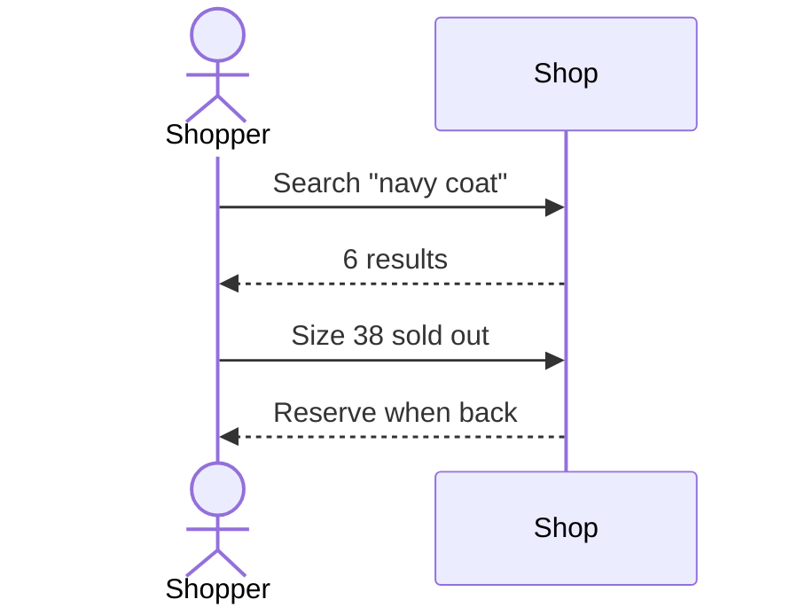

🏠 [Specs](../../../../README.md) › 🧩 [Functional capabilities](../../../README.md) ›
🛍️ [F11 Online shop (plugin)](../../README.md) › 📝 [Use cases](../README.md) ›
📝 [Use cases: FL-F11-02 Shop and check out](README.md) › 📝 UC-F11-04 Browse and search the shop

# 📝 UC-F11-04 Browse and search the shop

**Status:** ✅ specified

## Summary

Categories, search, filters, comparison, wishlist, stock and delivery estimate, reviews.

## Personas

- [U09 Customer](../../../../01-users/personas/u09-customer.md)

## Goal

Shoppers find what they want quickly.

## Trigger

A shopper visits.

## Frequency

All the time.

## Preconditions

F11 set up for the company.

## Postconditions

- **Succeeded:** the shopper opens a product.
- **Failed:** nothing found: suggestions.

## Main flow

1. The shopper searches or browses the shop ([S-F11-04](../../screens/02-shop-and-check-out/s-f11-04-shop.md)).
2. They filter and compare.
3. They open a product: stock, delivery estimate, reviews
   ([BR-F11-06](../../business-rules/br-f11-06-stock-shown-or-sold-out.md)).
4. Sold out: they pre-order or reserve,
   [UC-F11-26](../09-pre-orders-and-b2b-buying/uc-f11-26-take-pre-orders-and-back-in-stock-reservations.md).

## Alternative flows

- 4a. Back-in-stock alert.

## Error flows

- 1e. Nothing found: suggestions and the search kept.

## Business rules

- [BR-F11-06 Stock shown or sold out](../../business-rules/br-f11-06-stock-shown-or-sold-out.md)
- [BR-F11-04 Prices with taxes and delivery](../../business-rules/br-f11-04-prices-with-taxes-and-delivery.md)

## Entities

- [E-F11-03 Online product](../../data/e-f11-03-online-product.md)

## Permissions

The shopper, as a guest or with an account
([BR-F11-08](../../business-rules/br-f11-08-checkout-as-guest-or-account.md)).

## Notifications

None.

## Audit events

None.

## AI involvement

Search suggestions.

## API, MCP and A2A exposure

None.

## Screens

- [S-F11-04](../../screens/02-shop-and-check-out/s-f11-04-shop.md)

## Flowchart

See [FL-F11-02 Shop and check out](../../flows/fl-f11-02-shop-and-check-out.md#flowchart).

## Sequence diagram

## Acceptance criteria

1. **Given** a search for "navy coat" **when** it runs **then** 6 results show.
2. **Given** size 38 sold out **when** she opens it **then** the page says sold out and offers Reserve.
3. **Given** a search with no result **when** it runs **then** suggestions show.

## Non-functional notes

Pages load within 2 seconds on a phone; accessible
([CR-FR-072](../../../../10-country-packs/france/consumer/cr-fr-072-web-accessibility-eaa.md)).

## Regulatory references

[CR-FR-034](../../../../10-country-packs/france/consumer/cr-fr-034-prices-shown-including-vat.md);
[CR-FR-068](../../../../10-country-packs/france/consumer/cr-fr-068-online-reviews.md).

## Related use cases

See the flows.

- [UC-F11-26 Take pre-orders and back-in-stock reservations](../09-pre-orders-and-b2b-buying/uc-f11-26-take-pre-orders-and-back-in-stock-reservations.md)

## Open questions

None.

---

⬅️ [UC-F11-03 Set online prices and promotions](../01-build-the-shop/uc-f11-03-set-online-prices-and-promotions.md) ·
⬆️ [Up](README.md) · ➡️ [UC-F11-05 Check out](uc-f11-05-check-out.md)
