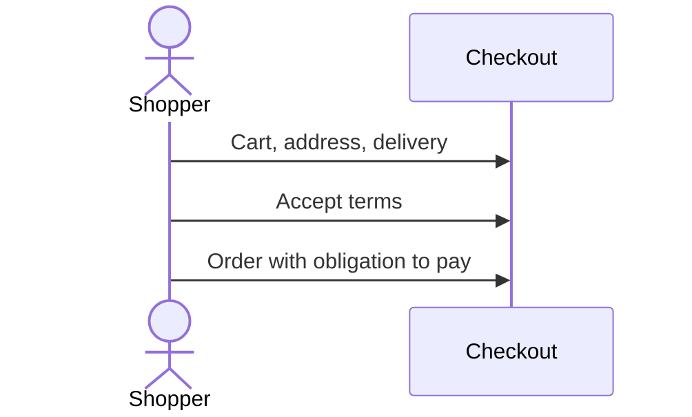

🏠 [Specs](../../../../README.md) › 🧩 [Functional capabilities](../../../README.md) ›
🛍️ [F11 Online shop (plugin)](../../README.md) › 📝 [Use cases](../README.md) ›
📝 [Use cases: FL-F11-02 Shop and check out](README.md) › 📝 UC-F11-05 Check out

# 📝 UC-F11-05 Check out

**Status:** 🔄 waiting for the owner

## Summary

Cart review, addresses, delivery, extra information, terms, the order button, as a guest or with an account.

## Personas

- [U09 Customer](../../../../01-users/personas/u09-customer.md)

## Goal

A clear, legal checkout.

## Trigger

The shopper checks out.

## Frequency

Every order.

## Preconditions

F11 set up for the company.

## Postconditions

- **Succeeded:** the order is placed with the obligation to pay.
- **Failed:** an item out of stock is explained.

## Main flow

1. The shopper reviews the cart on checkout ([S-F11-05](../../screens/02-shop-and-check-out/s-f11-05-checkout.md)); an
   empty cart says so.
2. Addresses and delivery ([UC-F11-07](uc-f11-07-choose-delivery-or-click-collect.md)).
3. They accept the terms ([BR-F11-15](../../business-rules/br-f11-15-accepted-terms-are-kept.md)).
4. The order button states the obligation to pay
   ([BR-F11-02](../../business-rules/br-f11-02-order-button-states-the-obligation-to-pay.md)).

## Alternative flows

- 1a. Express checkout.
- 2a. As a guest ([BR-F11-08](../../business-rules/br-f11-08-checkout-as-guest-or-account.md)).

## Error flows

- 1e. Item out of stock meanwhile: explained and removed.

## Business rules

- [BR-F11-02 The order button states the obligation to pay](../../business-rules/br-f11-02-order-button-states-the-obligation-to-pay.md)
- [BR-F11-08 Checkout as a guest or with an account](../../business-rules/br-f11-08-checkout-as-guest-or-account.md)
- [BR-F11-15 Accepted terms are kept](../../business-rules/br-f11-15-accepted-terms-are-kept.md)
- [BR-F11-01 The shop follows the country pack](../../business-rules/br-f11-01-shop-follows-the-country-pack.md)

## Entities

- [E-F11-04 Cart](../../data/e-f11-04-cart.md)
- [E-F11-05 Checkout](../../data/e-f11-05-checkout.md)

## Permissions

The shopper, as a guest or with an account
([BR-F11-08](../../business-rules/br-f11-08-checkout-as-guest-or-account.md)).

## Notifications

None.

## Audit events

Terms accepted.

## AI involvement

None.

## API, MCP and A2A exposure

None.

## Screens

- [S-F11-05](../../screens/02-shop-and-check-out/s-f11-05-checkout.md)

## Flowchart

See [FL-F11-02 Shop and check out](../../flows/fl-f11-02-shop-and-check-out.md#flowchart).

## Sequence diagram

## Acceptance criteria

1. **Given** a cart of 2 items **when** the shopper checks out as a guest **then** no account is required.
2. **Given** an item sold out during checkout **when** she continues **then** it is explained and removed.
3. **Given** the order button **when** it shows **then** it reads "Order with obligation to pay".

## Non-functional notes

Pages load within 2 seconds on a phone (Proposed); accessible
([CR-FR-072](../../../../10-country-packs/france/consumer/cr-fr-072-web-accessibility-eaa.md)).

## Regulatory references

[CR-FR-065](../../../../10-country-packs/france/consumer/cr-fr-065-online-pre-contract-information.md).

## Related use cases

See the flows.

## Open questions

None.

---

⬅️ [UC-F11-04 Browse and search the shop](uc-f11-04-browse-and-search-the-shop.md) · ⬆️ [Up](README.md) ·
➡️ [UC-F11-06 Pay online](uc-f11-06-pay-online.md)
