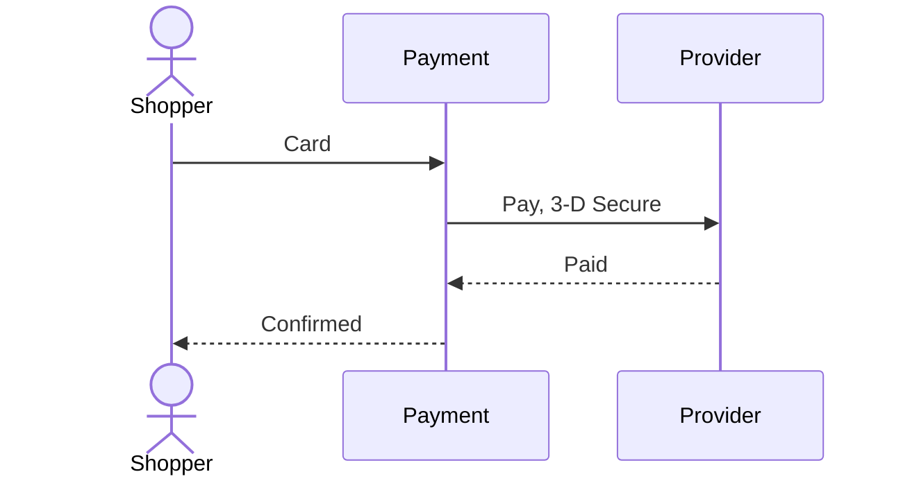

🏠 [Specs](../../../../README.md) › 🧩 [Functional capabilities](../../../README.md) ›
🛍️ [F11 Online shop (plugin)](../../README.md) › 📝 [Use cases](../README.md) ›
📝 [Use cases: FL-F11-02 Shop and check out](README.md) › 📝 UC-F11-06 Pay online

# 📝 UC-F11-06 Pay online

**Status:** ✅ specified

## Summary

Card, wallet, transfer, direct debit, gift card or e-wallet, through the company's providers.

## Personas

- [U09 Customer](../../../../01-users/personas/u09-customer.md)

## Goal

Pay safely by the shopper's method.

## Trigger

The order is placed.

## Frequency

Every order.

## Preconditions

F11 set up for the company.

## Postconditions

- **Succeeded:** paid and confirmed.
- **Failed:** refused: another method offered.

## Main flow

1. The shopper chooses a method on payment ([S-F11-06](../../screens/02-shop-and-check-out/s-f11-06-payment.md)).
2. They pay with the provider ([BR-F11-14](../../business-rules/br-f11-14-payment-keys-in-the-vault.md)); 3-D Secure
   where required ([UC-F11-21](../07-payment-risk/uc-f11-21-screen-orders-for-fraud-and-authenticate-payments.md)).
3. While the provider confirms, the page shows "payment pending".
4. The order is confirmed ([UC-F11-08](uc-f11-08-confirm-the-order-and-invoice.md)).

## Alternative flows

- 1a. Pay on invoice for B2B.

## Error flows

- 2e. Payment refused: another method offered.

## Business rules

- [BR-F11-14 Payment keys in the vault](../../business-rules/br-f11-14-payment-keys-in-the-vault.md)

## Entities

- [E-F11-06 Payment provider](../../data/e-f11-06-payment-provider.md)
- [E-F11-05 Checkout](../../data/e-f11-05-checkout.md)

## Permissions

The shopper, as a guest or with an account
([BR-F11-08](../../business-rules/br-f11-08-checkout-as-guest-or-account.md)).

## Notifications

Shopper: confirmation.

## Audit events

Payment.

## AI involvement

None.

## API, MCP and A2A exposure

None.

## Screens

- [S-F11-06](../../screens/02-shop-and-check-out/s-f11-06-payment.md)

## Flowchart

See [FL-F11-02 Shop and check out](../../flows/fl-f11-02-shop-and-check-out.md#flowchart).

## Sequence diagram

## Acceptance criteria

1. **Given** a card payment **when** the provider confirms **then** the order is confirmed.
2. **Given** a refused card **when** it fails **then** another method is offered.
3. **Given** a bank transfer **when** it is chosen **then** the page shows payment pending.

## Non-functional notes

Pages load within 2 seconds on a phone; accessible
([CR-FR-072](../../../../10-country-packs/france/consumer/cr-fr-072-web-accessibility-eaa.md)).

## Regulatory references

[CR-FR-065](../../../../10-country-packs/france/consumer/cr-fr-065-online-pre-contract-information.md).

## Related use cases

See the flows.

- [UC-F11-21 Screen orders for fraud and authenticate payments](../07-payment-risk/uc-f11-21-screen-orders-for-fraud-and-authenticate-payments.md)

## Open questions

None.

---

⬅️ [UC-F11-05 Check out](uc-f11-05-check-out.md) · ⬆️ [Up](README.md) ·
➡️ [UC-F11-07 Choose delivery or click & collect](uc-f11-07-choose-delivery-or-click-collect.md)
