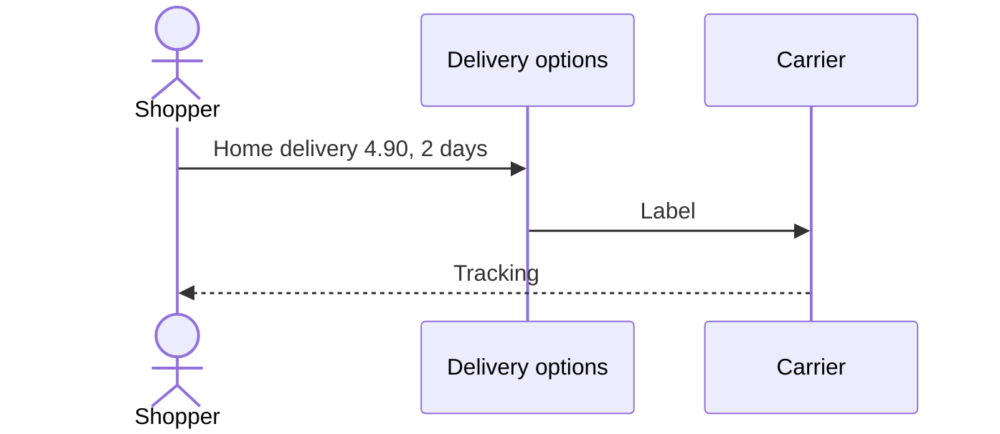

🏠 [Specs](../../../../README.md) › 🧩 [Functional capabilities](../../../README.md) ›
🛍️ [F11 Online shop (plugin)](../../README.md) › 📝 [Use cases](../README.md) ›
📝 [Use cases: FL-F11-02 Shop and check out](README.md) › 📝 UC-F11-07 Choose delivery or click & collect

# 📝 UC-F11-07 Choose delivery or click & collect

**Status:** ✅ specified

## Summary

Carriers and rates, free-shipping thresholds, pickup points with stock, labels and tracking.

## Personas

- [U09 Customer](../../../../01-users/personas/u09-customer.md)
- [U15 Warehouse operator](../../../../01-users/personas/u15-warehouse-operator.md)

## Goal

Delivered how and when the shopper chose.

## Trigger

Checkout.

## Frequency

Every order.

## Preconditions

F11 set up for the company.

## Postconditions

- **Succeeded:** label and tracking sent.
- **Failed:** no carrier for the address.

## Main flow

1. Delivery options show with prices and dates,
   [S-F11-07](../../screens/02-shop-and-check-out/s-f11-07-delivery-options.md),
   [BR-F11-04](../../business-rules/br-f11-04-prices-with-taxes-and-delivery.md).
2. Or a pickup point or store with stock
   ([BR-F11-07](../../business-rules/br-f11-07-click-and-collect-where-in-stock.md)).
3. Fulfilment ships from the warehouse or a store
   ([UC-F11-28](../10-fulfil-from-stores-and-report/uc-f11-28-fulfil-online-orders-from-a-store.md)).
4. The label and tracking are sent.

## Alternative flows

- 3a. Several parcels.

## Error flows

- 1e. No carrier for the address: shown.

## Business rules

- [BR-F11-07 Click & collect only where in stock](../../business-rules/br-f11-07-click-and-collect-where-in-stock.md)

## Entities

- [E-F11-07 Delivery method](../../data/e-f11-07-delivery-method.md)

## Permissions

The shopper, as a guest or with an account
([BR-F11-08](../../business-rules/br-f11-08-checkout-as-guest-or-account.md)). Warehouse operators.

## Notifications

Shopper: tracking.

## Audit events

Shipments.

## AI involvement

None.

## API, MCP and A2A exposure

T5 operations of F11 with the caller's rights; the MCP tool of F11; no A2A skill.

## Screens

- [S-F11-07](../../screens/02-shop-and-check-out/s-f11-07-delivery-options.md)

## Flowchart

See [FL-F11-02 Shop and check out](../../flows/fl-f11-02-shop-and-check-out.md#flowchart).

## Sequence diagram

## Acceptance criteria

1. **Given** a free-shipping threshold of 60 EUR **when** a cart of 72 EUR **then** home delivery is free.
2. **Given** click and collect in Lyon with stock **when** it is chosen **then** the store reserves it.
3. **Given** an address no carrier serves **when** it is entered **then** it is shown.

## Non-functional notes

Pages load within 2 seconds on a phone; accessible
([CR-FR-072](../../../../10-country-packs/france/consumer/cr-fr-072-web-accessibility-eaa.md)).

## Regulatory references

[CR-FR-066](../../../../10-country-packs/france/consumer/cr-fr-066-delivery-within-30-days.md).

## Related use cases

See the flows.

- [UC-F11-28 Fulfil online orders from a store](../10-fulfil-from-stores-and-report/uc-f11-28-fulfil-online-orders-from-a-store.md)

## Open questions

None.

---

⬅️ [UC-F11-06 Pay online](uc-f11-06-pay-online.md) · ⬆️ [Up](README.md) ·
➡️ [UC-F11-08 Confirm the order and invoice](uc-f11-08-confirm-the-order-and-invoice.md)
