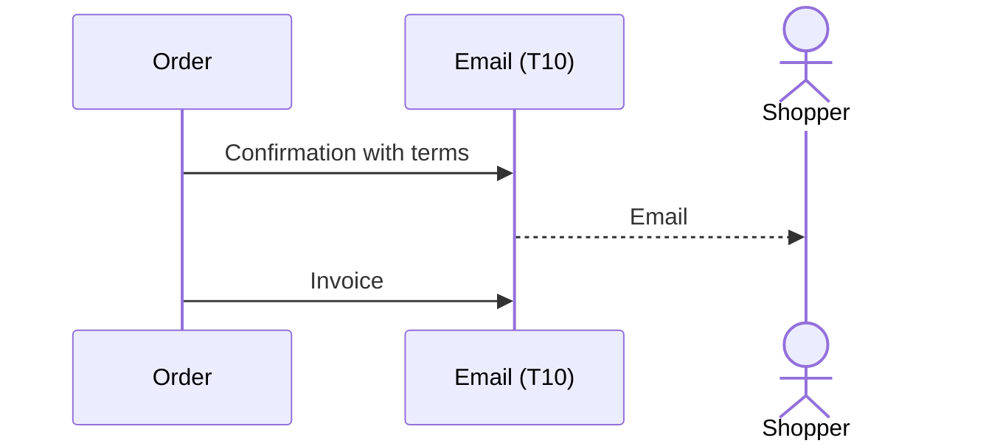

🏠 [Specs](../../../../README.md) › 🧩 [Functional capabilities](../../../README.md) ›
🛍️ [F11 Online shop (plugin)](../../README.md) › 📝 [Use cases](../README.md) ›
📝 [Use cases: FL-F11-02 Shop and check out](README.md) › 📝 UC-F11-08 Confirm the order and invoice

# 📝 UC-F11-08 Confirm the order and invoice

**Status:** ✅ specified

## Summary

Order confirmation on a durable medium, the invoice on payment or on request, delivery notifications.

## Personas

- [U09 Customer](../../../../01-users/personas/u09-customer.md)
- [U03 Sales](../../../../01-users/personas/u03-sales.md)

## Goal

The order confirmed on a durable medium, invoiced.

## Trigger

Payment confirmed.

## Frequency

Every order.

## Preconditions

F11 set up for the company.

## Postconditions

- **Succeeded:** confirmation and invoice sent.
- **Failed:** a bounced email shown on the order.

## Main flow

1. The confirmation email holds the order and the terms,
   [S-F11-08](../../screens/02-shop-and-check-out/s-f11-08-order-confirmation.md),
   [CR-FR-065](../../../../10-country-packs/france/consumer/cr-fr-065-online-pre-contract-information.md).
2. The invoice is issued on payment or on request.
3. Shipped and delivered notices follow.
4. The account shows it all ([UC-F11-10](../03-after-the-order/uc-f11-10-use-the-customer-account.md)).

## Alternative flows

- 2a. Invoice requested later.

## Error flows

- 1e. Email bounced: shown on the order.

## Business rules

- [BR-F11-15 Accepted terms are kept](../../business-rules/br-f11-15-accepted-terms-are-kept.md)
- [BR-F11-02 The order button states the obligation to pay](../../business-rules/br-f11-02-order-button-states-the-obligation-to-pay.md)

## Entities

- [E-F11-05 Checkout](../../data/e-f11-05-checkout.md)

## Permissions

The shopper, as a guest or with an account
([BR-F11-08](../../business-rules/br-f11-08-checkout-as-guest-or-account.md)). Sales.

## Notifications

Shopper: confirmation, shipped, delivered.

## Audit events

Sent.

## AI involvement

None.

## API, MCP and A2A exposure

T5 operations of F11 with the caller's rights; the MCP tool of F11; no A2A skill.

## Screens

- [S-F11-08](../../screens/02-shop-and-check-out/s-f11-08-order-confirmation.md)

## Flowchart

See [FL-F11-02 Shop and check out](../../flows/fl-f11-02-shop-and-check-out.md#flowchart).

## Sequence diagram

## Acceptance criteria

1. **Given** a paid order **when** it is confirmed **then** the email holds the terms as a PDF.
2. **Given** a bounced email **when** it fails **then** the order shows it.
3. **Given** an invoice asked later **when** it is asked **then** it is issued.

## Non-functional notes

None.

## Regulatory references

[CR-FR-065](../../../../10-country-packs/france/consumer/cr-fr-065-online-pre-contract-information.md);
[CR-FR-015](../../../../10-country-packs/france/invoicing/cr-fr-015-invoice-mandatory-mentions.md).

## Related use cases

See the flows.

## Open questions

None.

---

⬅️ [UC-F11-07 Choose delivery or click & collect](uc-f11-07-choose-delivery-or-click-collect.md) · ⬆️ [Up](README.md) ·
➡️ [UC-F11-09 Withdraw, return and refund](../03-after-the-order/uc-f11-09-withdraw-return-and-refund.md)
