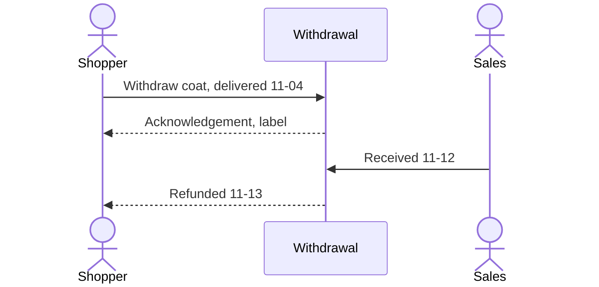

🏠 [Specs](../../../../README.md) › 🧩 [Functional capabilities](../../../README.md) ›
🛍️ [F11 Online shop (plugin)](../../README.md) › 📝 [Use cases](../README.md) ›
📝 [Use cases: FL-F11-03 After the order](README.md) › 📝 UC-F11-09 Withdraw, return and refund

# 📝 UC-F11-09 Withdraw, return and refund

**Status:** ✅ specified

## Summary

The shopper withdraws within 14 days with the withdrawal function, gets an acknowledgement and a return label, and is
refunded within the legal period.

## Personas

- [U09 Customer](../../../../01-users/personas/u09-customer.md)
- [U03 Sales](../../../../01-users/personas/u03-sales.md)

## Goal

A legal, easy withdrawal and refund.

## Trigger

A shopper changes their mind within 14 days.

## Frequency

Daily.

## Preconditions

F11 set up for the company.

## Postconditions

- **Succeeded:** refunded within 14 days of the withdrawal.
- **Failed:** excluded products refused with the reason.

## Main flow

1. The shopper uses the withdrawal function from the account or the public form on withdrawal,
   [S-F11-09](../../screens/03-after-the-order/s-f11-09-withdrawal.md),
   [BR-F11-03](../../business-rules/br-f11-03-withdrawal-function-always-available.md), within 14 days of delivery.
2. They choose the items; an acknowledgement is sent on a durable medium.
3. They get a return label and send the goods back.
4. On receipt or proof of sending, they are refunded by the original method within 14 days of the withdrawal
   ([CR-FR-036](../../../../10-country-packs/france/consumer/cr-fr-036-withdrawal-right.md)).
5. The return reason feeds the reports,
   [UC-F11-29](../10-fulfil-from-stores-and-report/uc-f11-29-read-the-funnel-customer-value-and-return-reasons.md).

## Alternative flows

- 2a. Partial withdrawal.
- 4a. Exchange instead of refund.

## Error flows

- 2e. An excluded product (made to measure, unsealed hygiene item): the legal reason shown.
- 1e. After 14 days: the function says the period ended.

## Business rules

- [BR-F11-03 The withdrawal function is always available](../../business-rules/br-f11-03-withdrawal-function-always-available.md)

## Entities

- [E-F11-08 Withdrawal request](../../data/e-f11-08-withdrawal-request.md)

## Permissions

The shopper, as a guest or with an account
([BR-F11-08](../../business-rules/br-f11-08-checkout-as-guest-or-account.md)). Sales handle returns.

## Notifications

Shopper: acknowledgement, refund.

## Audit events

Withdrawal, receipt, refund dates.

## AI involvement

None.

## API, MCP and A2A exposure

T5 operations of F11 with the caller's rights; the MCP tool of F11; no A2A skill.

## Screens

- [S-F11-09](../../screens/03-after-the-order/s-f11-09-withdrawal.md)

## Flowchart

See [FL-F11-03 After the order](../../flows/fl-f11-03-after-the-order.md#flowchart).

## Sequence diagram

## Acceptance criteria

1. **Given** a coat delivered on 2026-11-04 **when** the shopper withdraws on 11-10 **then** she gets the
   acknowledgement and a label.
2. **Given** the goods received on 11-12 **when** the refund runs **then** she is refunded before 11-24.
3. **Given** a withdrawal on 11-20 **when** it is asked **then** the function says the period ended.
4. **Given** a made-to-measure item **when** it is chosen **then** the legal reason is shown.

## Non-functional notes

Pages load within 2 seconds on a phone; accessible
([CR-FR-072](../../../../10-country-packs/france/consumer/cr-fr-072-web-accessibility-eaa.md)).

## Regulatory references

[CR-FR-036](../../../../10-country-packs/france/consumer/cr-fr-036-withdrawal-right.md).

## Related use cases

See the flows.

- [UC-F11-22 Handle a chargeback](../07-payment-risk/uc-f11-22-handle-a-chargeback.md)

- [UC-F11-29 Read the funnel, customer value and return reasons](../10-fulfil-from-stores-and-report/uc-f11-29-read-the-funnel-customer-value-and-return-reasons.md)

## Open questions

None.

---

⬅️ [UC-F11-08 Confirm the order and invoice](../02-shop-and-check-out/uc-f11-08-confirm-the-order-and-invoice.md) ·
⬆️ [Up](README.md) · ➡️ [UC-F11-10 Use the customer account](uc-f11-10-use-the-customer-account.md)
