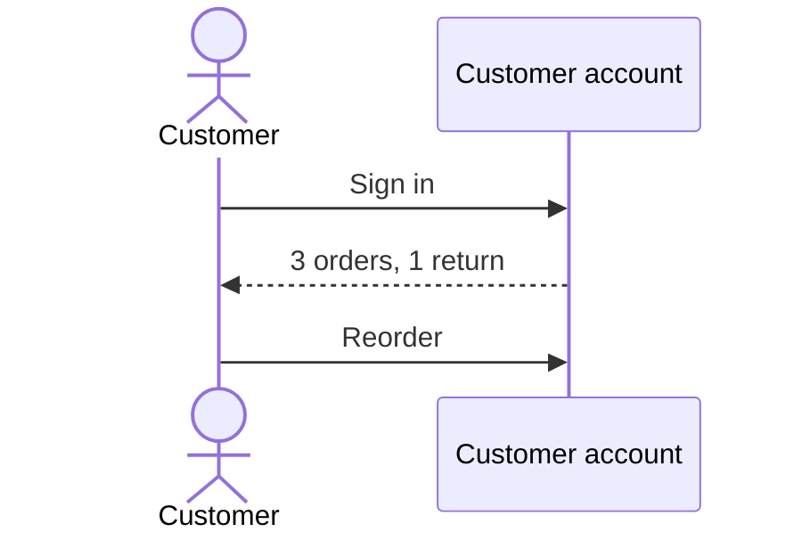

🏠 [Specs](../../../../README.md) › 🧩 [Functional capabilities](../../../README.md) ›
🛍️ [F11 Online shop (plugin)](../../README.md) › 📝 [Use cases](../README.md) ›
📝 [Use cases: FL-F11-03 After the order](README.md) › 📝 UC-F11-10 Use the customer account

# 📝 UC-F11-10 Use the customer account

**Status:** 🔄 waiting for the owner

## Summary

Orders, invoices, deliveries, subscriptions, reorder, wishlist, addresses, consents.

## Personas

- [U09 Customer](../../../../01-users/personas/u09-customer.md)

## Goal

Customers manage their orders themselves.

## Trigger

A customer signs in.

## Frequency

Monthly.

## Preconditions

F11 set up for the company.

## Postconditions

- **Succeeded:** orders followed; invoices downloaded.
- **Failed:** an expired link resent.

## Main flow

1. The customer signs in to the account ([S-F11-10](../../screens/03-after-the-order/s-f11-10-customer-account.md)).
2. They follow orders, returns and pre-orders, download invoices.
3. They reorder or update addresses and consents.
4. They withdraw from an order ([UC-F11-09](uc-f11-09-withdraw-return-and-refund.md)).

## Alternative flows

- 1a. Shared account across websites.

## Error flows

- 1e. Expired link: a new one sent.

## Business rules

- [BR-F11-08 Checkout as a guest or with an account](../../business-rules/br-f11-08-checkout-as-guest-or-account.md)

## Entities

- [E-F11-09 Customer account](../../data/e-f11-09-customer-account.md)

## Permissions

The shopper, as a guest or with an account
([BR-F11-08](../../business-rules/br-f11-08-checkout-as-guest-or-account.md)).

## Notifications

None.

## Audit events

Account changes.

## AI involvement

None.

## API, MCP and A2A exposure

None.

## Screens

- [S-F11-10](../../screens/03-after-the-order/s-f11-10-customer-account.md)

## Flowchart

See [FL-F11-03 After the order](../../flows/fl-f11-03-after-the-order.md#flowchart).

## Sequence diagram

## Acceptance criteria

1. **Given** 3 orders **when** she signs in **then** they show with status.
2. **Given** an expired sign-in link **when** she opens it **then** a new one is sent.
3. **Given** email consent withdrawn **when** she changes it **then** it is withdrawn at once.

## Non-functional notes

Pages load within 2 seconds on a phone (Proposed); accessible
([CR-FR-072](../../../../10-country-packs/france/consumer/cr-fr-072-web-accessibility-eaa.md)).

## Regulatory references

[CR-FR-063](../../../../10-country-packs/france/consumer/cr-fr-063-electronic-marketing-consent.md).

## Related use cases

See the flows.

## Open questions

None.

---

⬅️ [UC-F11-09 Withdraw, return and refund](uc-f11-09-withdraw-return-and-refund.md) · ⬆️ [Up](README.md) ·
➡️ [UC-F11-11 Sell B2B online](../04-special-sales/uc-f11-11-sell-b2b-online.md)
