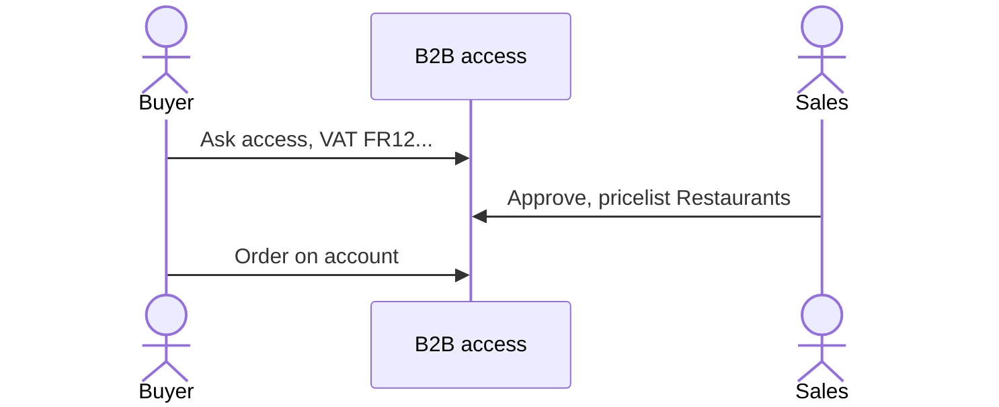

🏠 [Specs](../../../../README.md) › 🧩 [Functional capabilities](../../../README.md) ›
🛍️ [F11 Online shop (plugin)](../../README.md) › 📝 [Use cases](../README.md) ›
📝 [Use cases: FL-F11-04 B2B, subscriptions, rentals and digital](README.md) › 📝 UC-F11-11 Sell B2B online

# 📝 UC-F11-11 Sell B2B online

**Status:** 🔄 waiting for the owner

## Summary

Business buyers ask access, see their prices, give their VAT number, pay on invoice and ask quotes from the cart.

## Personas

- [U03 Sales](../../../../01-users/personas/u03-sales.md)
- [U09 Customer](../../../../01-users/personas/u09-customer.md)

## Goal

Sell online to businesses at their prices.

## Trigger

A company asks access.

## Frequency

Weekly.

## Preconditions

F11 set up for the company.

## Postconditions

- **Succeeded:** orders on account at the company's prices.
- **Failed:** an invalid VAT number asked again.

## Main flow

1. A company asks access on B2B access ([S-F11-11](../../screens/04-special-sales/s-f11-11-b2b-access.md)).
2. Sales approve it with its pricelist
   ([BR-F11-13](../../business-rules/br-f11-13-b2b-prices-for-approved-customers.md)).
3. The buyer orders on account or asks a quote,
   [UC-F11-27](../09-pre-orders-and-b2b-buying/uc-f11-27-request-a-quote-or-punch-out-from-a-buyers-system.md).
4. Invoices follow the company's terms (F6).

## Alternative flows

- 3a. Punch-out from the buyer's system,
  [UC-F11-27](../09-pre-orders-and-b2b-buying/uc-f11-27-request-a-quote-or-punch-out-from-a-buyers-system.md).

## Error flows

- 1e. VAT number invalid: asked again.

## Business rules

- [BR-F11-13 B2B prices for approved customers](../../business-rules/br-f11-13-b2b-prices-for-approved-customers.md)

## Entities

- [E-F11-09 Customer account](../../data/e-f11-09-customer-account.md)

## Permissions

Sales approve; approved buyers.

## Notifications

Sales: access requests.

## Audit events

Approvals.

## AI involvement

The AI assistant prepares it for confirmation
([BR-F3-07](../../../f03-assistant/business-rules/br-f03-07-no-deletes-no-irreversible-acts.md)); figures come from
queries ([BR-F3-03](../../../f03-assistant/business-rules/br-f03-03-figures-come-from-queries.md)).

## API, MCP and A2A exposure

T5 operations of F11 with the caller's rights; the MCP tool of F11; no A2A skill.

## Screens

- [S-F11-11](../../screens/04-special-sales/s-f11-11-b2b-access.md)

## Flowchart

See [FL-F11-04 B2B, subscriptions, rentals and digital](../../flows/fl-f11-04-special-sales.md#flowchart).

## Sequence diagram

## Acceptance criteria

1. **Given** a company with a valid VAT number **when** sales approve it **then** the buyer sees the Restaurants prices.
2. **Given** an invalid VAT number **when** it is entered **then** it is asked again.
3. **Given** an approved buyer **when** she orders **then** it is on account.

## Non-functional notes

Pages load within 2 seconds on a phone (Proposed); accessible
([CR-FR-072](../../../../10-country-packs/france/consumer/cr-fr-072-web-accessibility-eaa.md)).

## Regulatory references

[CR-FR-009](../../../../10-country-packs/france/tax-and-vat/cr-fr-009-vat-mentions.md).

## Related use cases

See the flows.

- [UC-F11-27 Request a quote or punch out from a buyer's system](../09-pre-orders-and-b2b-buying/uc-f11-27-request-a-quote-or-punch-out-from-a-buyers-system.md)

## Open questions

None.

---

⬅️ [UC-F11-10 Use the customer account](../03-after-the-order/uc-f11-10-use-the-customer-account.md) ·
⬆️ [Up](README.md) ·
➡️ [UC-F11-12 Sell subscriptions and rentals online](uc-f11-12-sell-subscriptions-and-rentals-online.md)
