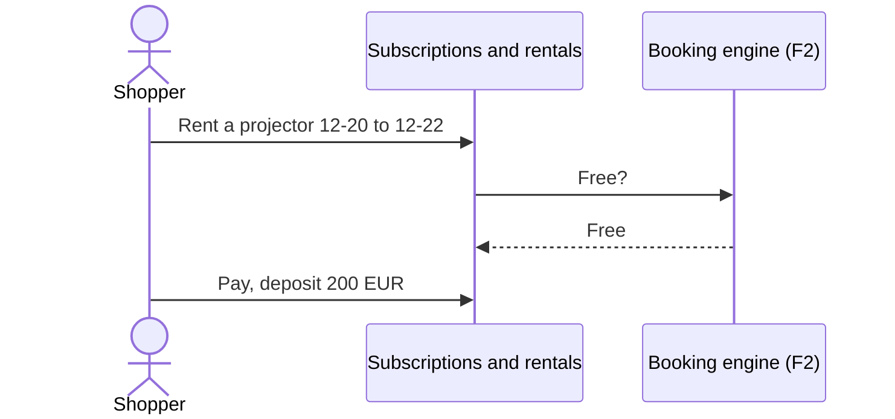

🏠 [Specs](../../../../README.md) › 🧩 [Functional capabilities](../../../README.md) ›
🛍️ [F11 Online shop (plugin)](../../README.md) › 📝 [Use cases](../README.md) ›
📝 [Use cases: FL-F11-04 B2B, subscriptions, rentals and digital](README.md) ›
📝 UC-F11-12 Sell subscriptions and rentals online

# 📝 UC-F11-12 Sell subscriptions and rentals online

**Status:** ✅ specified

## Summary

Shoppers buy recurring products with their periods, and rentals with dates, deposits and availability.

## Personas

- [U09 Customer](../../../../01-users/personas/u09-customer.md)
- [U12 Marketing](../../../../01-users/personas/u12-marketing.md)

## Goal

Subscriptions and rentals sold online.

## Trigger

A shopper chooses a plan or dates.

## Frequency

Weekly.

## Preconditions

F11 set up for the company.

## Postconditions

- **Succeeded:** subscribed or rented; renewals and returns follow F6.
- **Failed:** unavailable dates: alternatives.

## Main flow

1. The shopper chooses a period or dates on subscriptions and rentals
   ([S-F11-12](../../screens/04-special-sales/s-f11-12-subscriptions-and-rentals.md)).
2. Availability is checked,
   [UC-F2-19](../../../f02-no-code-configuration/use-cases/08-views-and-bookings/uc-f02-19-book-a-resource.md).
3. They pay; a deposit is taken for a rental.
4. Renewals or pickup and return follow F6,
   [UC-F6-10](../../../f06-customers-and-sales/use-cases/04-subscriptions/uc-f06-10-manage-subscriptions.md),
   [UC-F6-15](../../../f06-customers-and-sales/use-cases/05-benchmark-additions/uc-f06-15-rent-out-equipment.md).

## Alternative flows

- 4a. Upgrade or downgrade.

## Error flows

- 2e. Dates unavailable: alternatives offered.

## Business rules

- [BR-F11-01 The shop follows the country pack](../../business-rules/br-f11-01-shop-follows-the-country-pack.md)

## Entities

- [E-F11-03 Online product](../../data/e-f11-03-online-product.md)

## Permissions

The shopper, as a guest or with an account
([BR-F11-08](../../business-rules/br-f11-08-checkout-as-guest-or-account.md)).

## Notifications

Shopper: renewals and dates.

## Audit events

Subscriptions and rentals.

## AI involvement

None.

## API, MCP and A2A exposure

T5 operations of F11 with the caller's rights; the MCP tool of F11; no A2A skill.

## Screens

- [S-F11-12](../../screens/04-special-sales/s-f11-12-subscriptions-and-rentals.md)

## Flowchart

See [FL-F11-04 B2B, subscriptions, rentals and digital](../../flows/fl-f11-04-special-sales.md#flowchart).

## Sequence diagram

## Acceptance criteria

1. **Given** a projector free on 12-20 to 12-22 **when** it is rented **then** the deposit of 200 EUR is taken.
2. **Given** dates taken **when** they are chosen **then** alternatives are offered.
3. **Given** a monthly plan **when** it renews **then** the next invoice is issued.

## Non-functional notes

Pages load within 2 seconds on a phone; accessible
([CR-FR-072](../../../../10-country-packs/france/consumer/cr-fr-072-web-accessibility-eaa.md)).

## Regulatory references

[CR-FR-065](../../../../10-country-packs/france/consumer/cr-fr-065-online-pre-contract-information.md).

## Related use cases

See the flows.

## Open questions

None.

---

⬅️ [UC-F11-11 Sell B2B online](uc-f11-11-sell-b2b-online.md) · ⬆️ [Up](README.md) ·
➡️ [UC-F11-13 Sell digital products](uc-f11-13-sell-digital-products.md)
