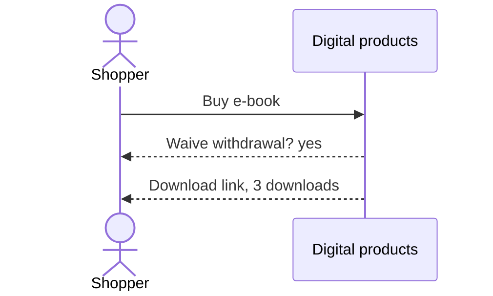

🏠 [Specs](../../../../README.md) › 🧩 [Functional capabilities](../../../README.md) ›
🛍️ [F11 Online shop (plugin)](../../README.md) › 📝 [Use cases](../README.md) ›
📝 [Use cases: FL-F11-04 B2B, subscriptions, rentals and digital](README.md) › 📝 UC-F11-13 Sell digital products

# 📝 UC-F11-13 Sell digital products

**Status:** 🔄 waiting for the owner

## Summary

Files or links are delivered after payment, within download limits.

## Personas

- [U09 Customer](../../../../01-users/personas/u09-customer.md)

## Goal

Digital products delivered at once.

## Trigger

A digital product is bought.

## Frequency

Daily where sold.

## Preconditions

F11 set up for the company.

## Postconditions

- **Succeeded:** the file is downloadable.
- **Failed:** the download limit reached is shown.

## Main flow

1. The shopper buys a digital product ([S-F11-13](../../screens/04-special-sales/s-f11-13-digital-products.md)).
2. After payment, the download link is in the account and the email.
3. They download within the limit.
4. They confirm the waiver of withdrawal before download, as the law requires
   ([CR-FR-036](../../../../10-country-packs/france/consumer/cr-fr-036-withdrawal-right.md)).

## Alternative flows

- 1a. Free sample before buying.

## Error flows

- 3e. Download limit reached: shown, support contact given.

## Business rules

- [BR-F11-03 The withdrawal function is always available](../../business-rules/br-f11-03-withdrawal-function-always-available.md)

## Entities

- [E-F11-03 Online product](../../data/e-f11-03-online-product.md)

## Permissions

The shopper, as a guest or with an account
([BR-F11-08](../../business-rules/br-f11-08-checkout-as-guest-or-account.md)).

## Notifications

Shopper: download link.

## Audit events

Downloads.

## AI involvement

None.

## API, MCP and A2A exposure

None.

## Screens

- [S-F11-13](../../screens/04-special-sales/s-f11-13-digital-products.md)

## Flowchart

See [FL-F11-04 B2B, subscriptions, rentals and digital](../../flows/fl-f11-04-special-sales.md#flowchart).

## Sequence diagram

## Acceptance criteria

1. **Given** an e-book with 3 downloads **when** the fourth is tried **then** it is refused with the limit.
2. **Given** the waiver not confirmed **when** download is asked **then** it is not offered.
3. **Given** a free sample **when** it is downloaded **then** no payment is asked.

## Non-functional notes

Pages load within 2 seconds on a phone (Proposed); accessible
([CR-FR-072](../../../../10-country-packs/france/consumer/cr-fr-072-web-accessibility-eaa.md)).

## Regulatory references

[CR-FR-036](../../../../10-country-packs/france/consumer/cr-fr-036-withdrawal-right.md).

## Related use cases

See the flows.

## Open questions

None.

---

⬅️ [UC-F11-12 Sell subscriptions and rentals online](uc-f11-12-sell-subscriptions-and-rentals-online.md) ·
⬆️ [Up](README.md) · ➡️ [UC-F11-14 Recover abandoned carts](../05-grow-the-shop/uc-f11-14-recover-abandoned-carts.md)
