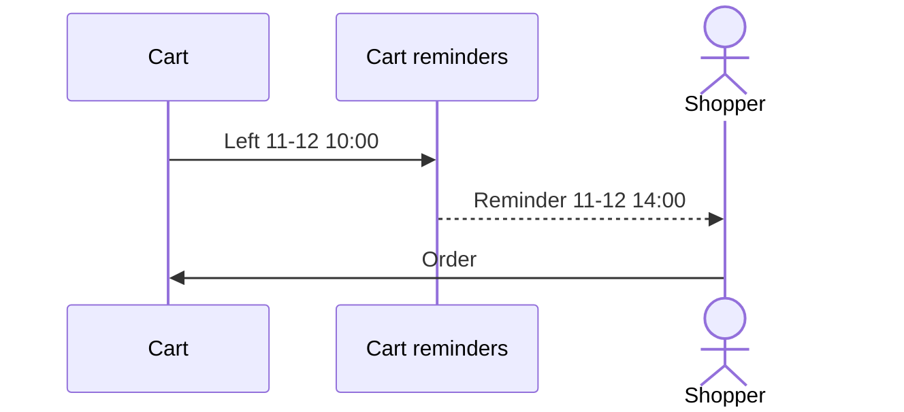

🏠 [Specs](../../../../README.md) › 🧩 [Functional capabilities](../../../README.md) ›
🛍️ [F11 Online shop (plugin)](../../README.md) › 📝 [Use cases](../README.md) ›
📝 [Use cases: FL-F11-05 Grow the shop](README.md) › 📝 UC-F11-14 Recover abandoned carts

# 📝 UC-F11-14 Recover abandoned carts

**Status:** ✅ specified

## Summary

Abandoned carts are reminded, and shoppers are told when items are back in stock, with consent.

## Personas

- [U12 Marketing](../../../../01-users/personas/u12-marketing.md)

## Goal

Recover carts without bothering anyone.

## Trigger

A cart is left.

## Frequency

Daily.

## Preconditions

F11 set up for the company.

## Postconditions

- **Succeeded:** carts recovered.
- **Failed:** no reminder without consent.

## Main flow

1. A cart is left by a known shopper ([S-F11-14](../../screens/05-grow-the-shop/s-f11-14-cart-reminders.md)).
2. After the delay, a reminder is sent if consent allows
   ([BR-F11-11](../../business-rules/br-f11-11-cart-reminders-respect-consent.md)).
3. The shopper returns and completes the order.
4. Back-in-stock alerts and reservations follow
   [UC-F11-26](../09-pre-orders-and-b2b-buying/uc-f11-26-take-pre-orders-and-back-in-stock-reservations.md).

## Alternative flows

- 2a. A code in the second reminder.

## Error flows

- 2e. The shopper objected: no reminder ([BR-F11-11](../../business-rules/br-f11-11-cart-reminders-respect-consent.md)).

## Business rules

- [BR-F11-11 Cart reminders respect consent](../../business-rules/br-f11-11-cart-reminders-respect-consent.md)

## Entities

- [E-F11-12 Cart reminder](../../data/e-f11-12-cart-reminder.md)

## Permissions

Marketing and communication for the shop; sales for B2B; accounting for payments; the owner reads.

## Notifications

Shoppers: reminders.

## Audit events

Reminders sent.

## AI involvement

The AI assistant prepares it for confirmation
([BR-F3-07](../../../f03-assistant/business-rules/br-f03-07-no-deletes-no-irreversible-acts.md)); figures come from
queries ([BR-F3-03](../../../f03-assistant/business-rules/br-f03-03-figures-come-from-queries.md)).

## API, MCP and A2A exposure

T5 operations of F11 with the caller's rights; the MCP tool of F11; no A2A skill.

## Screens

- [S-F11-14](../../screens/05-grow-the-shop/s-f11-14-cart-reminders.md)

## Flowchart

See [FL-F11-05 Grow the shop](../../flows/fl-f11-05-grow-the-shop.md#flowchart).

## Sequence diagram

## Acceptance criteria

1. **Given** a cart left at 10:00 with a 4-hour delay **when** 14:00 comes **then** a reminder is sent if consent
   allows.
2. **Given** a shopper who objected **when** the delay passes **then** no reminder.
3. **Given** the shopper orders **when** she completes it **then** the cart is marked recovered.

## Non-functional notes

None.

## Regulatory references

[CR-FR-063](../../../../10-country-packs/france/consumer/cr-fr-063-electronic-marketing-consent.md).

## Related use cases

See the flows.

- [UC-F11-26 Take pre-orders and back-in-stock reservations](../09-pre-orders-and-b2b-buying/uc-f11-26-take-pre-orders-and-back-in-stock-reservations.md)

## Open questions

None.

---

⬅️ [UC-F11-13 Sell digital products](../04-special-sales/uc-f11-13-sell-digital-products.md) · ⬆️ [Up](README.md) ·
➡️ [UC-F11-15 Collect and moderate reviews](uc-f11-15-collect-and-moderate-reviews.md)
