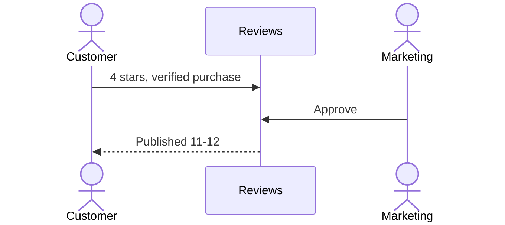

🏠 [Specs](../../../../README.md) › 🧩 [Functional capabilities](../../../README.md) ›
🛍️ [F11 Online shop (plugin)](../../README.md) › 📝 [Use cases](../README.md) ›
📝 [Use cases: FL-F11-05 Grow the shop](README.md) › 📝 UC-F11-15 Collect and moderate reviews

# 📝 UC-F11-15 Collect and moderate reviews

**Status:** 🔄 waiting for the owner

## Summary

Customers rate and review products; reviews are checked by the rules and published with their date.

## Personas

- [U12 Marketing](../../../../01-users/personas/u12-marketing.md)
- [U09 Customer](../../../../01-users/personas/u09-customer.md)

## Goal

Honest reviews that help shoppers.

## Trigger

A customer reviews.

## Frequency

Daily.

## Preconditions

F11 set up for the company.

## Postconditions

- **Succeeded:** reviews published with their date.
- **Failed:** rejected with the reason.

## Main flow

1. A customer reviews a product they bought ([S-F11-15](../../screens/05-grow-the-shop/s-f11-15-reviews.md)).
2. It is checked by the rules, [BR-F11-09](../../business-rules/br-f11-09-reviews-follow-the-review-rules.md),
   [CR-FR-068](../../../../10-country-packs/france/consumer/cr-fr-068-online-reviews.md).
3. It is published with its date and whether the purchase is verified.
4. The owner may report a review.

## Alternative flows

- 4a. Answer a review publicly.

## Error flows

- 2e. Rejected: the reason is sent.

## Business rules

- [BR-F11-09 Reviews follow the review rules](../../business-rules/br-f11-09-reviews-follow-the-review-rules.md)

## Entities

- [E-F11-10 Product review](../../data/e-f11-10-product-review.md)

## Permissions

Customers; marketing moderates.

## Notifications

Customer: published or rejected.

## Audit events

Moderation.

## AI involvement

The AI assistant flags reviews breaking the rules; a person decides.

## API, MCP and A2A exposure

T5 operations of F11 with the caller's rights; the MCP tool of F11; no A2A skill.

## Screens

- [S-F11-15](../../screens/05-grow-the-shop/s-f11-15-reviews.md)

## Flowchart

See [FL-F11-05 Grow the shop](../../flows/fl-f11-05-grow-the-shop.md#flowchart).

## Sequence diagram

## Acceptance criteria

1. **Given** a verified purchase review **when** it is approved **then** it shows with its date and "verified".
2. **Given** insults in a review **when** it is checked **then** it is rejected with the reason.
3. **Given** an answer by the shop **when** it is posted **then** it shows under the review.

## Non-functional notes

Pages load within 2 seconds on a phone (Proposed); accessible
([CR-FR-072](../../../../10-country-packs/france/consumer/cr-fr-072-web-accessibility-eaa.md)).

## Regulatory references

[CR-FR-068](../../../../10-country-packs/france/consumer/cr-fr-068-online-reviews.md).

## Related use cases

See the flows.

## Open questions

None.

---

⬅️ [UC-F11-14 Recover abandoned carts](uc-f11-14-recover-abandoned-carts.md) · ⬆️ [Up](README.md) ·
➡️ [UC-F11-16](../01-build-the-shop/uc-f11-16-manage-seo-languages-and-several-websites.md)
