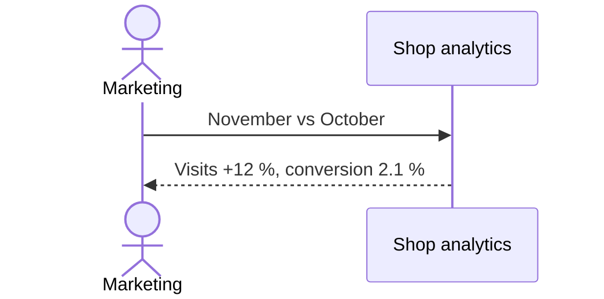

🏠 [Specs](../../../../README.md) › 🧩 [Functional capabilities](../../../README.md) ›
🛍️ [F11 Online shop (plugin)](../../README.md) › 📝 [Use cases](../README.md) ›
📝 [Use cases: FL-F11-05 Grow the shop](README.md) › 📝 UC-F11-17 Read shop analytics

# 📝 UC-F11-17 Read shop analytics

**Status:** ✅ specified

## Summary

Visits, conversion, carts, top products and revenue, with trackers only after consent.

## Personas

- [U12 Marketing](../../../../01-users/personas/u12-marketing.md)
- [U13 Owner](../../../../01-users/personas/u13-owner.md)

## Goal

Know how the shop performs.

## Trigger

A review.

## Frequency

Weekly.

## Preconditions

F11 set up for the company.

## Postconditions

- **Succeeded:** analytics read.
- **Failed:** without consent, counted without trackers.

## Main flow

1. Marketing opens shop analytics ([S-F11-17](../../screens/05-grow-the-shop/s-f11-17-shop-analytics-report.md)).
2. They compare periods.
3. Campaign links are tracked
   ([BR-F5-06](../../../f05-social-media/business-rules/br-f05-06-leads-traced-through-tracked-links.md)).
4. Deeper funnel and value reports in
   [UC-F11-29](../10-fulfil-from-stores-and-report/uc-f11-29-read-the-funnel-customer-value-and-return-reasons.md).

## Alternative flows

- 4a. Export.

## Error flows

- 1e. Consent refused: counted without trackers
  ([BR-F11-10](../../business-rules/br-f11-10-trackers-wait-for-consent.md)).

## Business rules

- [BR-F11-10 Trackers wait for consent](../../business-rules/br-f11-10-trackers-wait-for-consent.md)

## Entities

- [E-F11-15 Tracker consent](../../data/e-f11-15-tracker-consent.md)

## Permissions

Marketing and communication for the shop; sales for B2B; accounting for payments; the owner reads.

## Notifications

Weekly digest.

## Audit events

Exports.

## AI involvement

The AI assistant prepares it for confirmation
([BR-F3-07](../../../f03-assistant/business-rules/br-f03-07-no-deletes-no-irreversible-acts.md)); figures come from
queries ([BR-F3-03](../../../f03-assistant/business-rules/br-f03-03-figures-come-from-queries.md)).

## API, MCP and A2A exposure

T5 operations of F11 with the caller's rights; the MCP tool of F11; no A2A skill.

## Screens

- [S-F11-17](../../screens/05-grow-the-shop/s-f11-17-shop-analytics-report.md)

## Flowchart

See [FL-F11-05 Grow the shop](../../flows/fl-f11-05-grow-the-shop.md#flowchart).

## Sequence diagram

## Acceptance criteria

1. **Given** November **when** analytics open **then** visits, conversion and revenue show.
2. **Given** consent refused by 30 % **when** visits are counted **then** the share without trackers is shown.
3. **Given** a campaign link **when** it brings 40 orders **then** they are attributed.

## Non-functional notes

None.

## Regulatory references

[CR-FR-070](../../../../10-country-packs/france/data-protection/cr-fr-070-cookie-consent.md).

## Related use cases

See the flows.

- [UC-F11-29 Read the funnel, customer value and return reasons](../10-fulfil-from-stores-and-report/uc-f11-29-read-the-funnel-customer-value-and-return-reasons.md)

## Open questions

None.

---

⬅️ [UC-F11-16](../01-build-the-shop/uc-f11-16-manage-seo-languages-and-several-websites.md) · ⬆️ [Up](README.md) ·
➡️ [UC-F11-18](../06-channels-and-legal/uc-f11-18-connect-marketplaces-and-other-shops.md)
