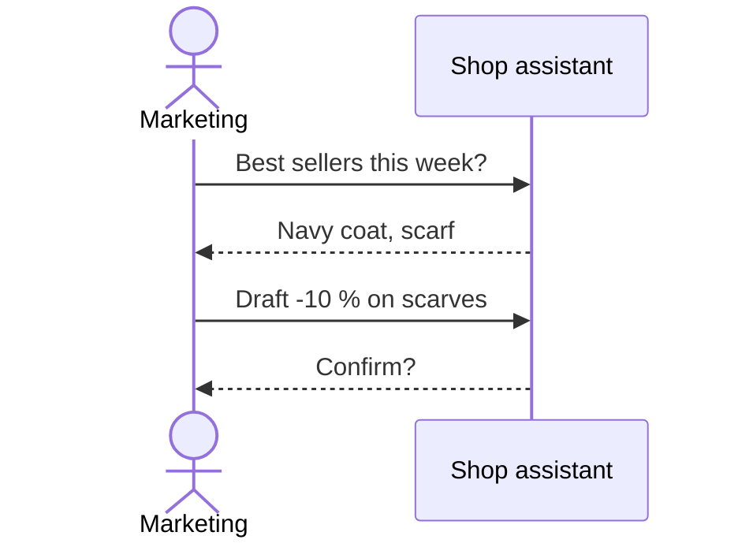

🏠 [Specs](../../../../README.md) › 🧩 [Functional capabilities](../../../README.md) ›
🛍️ [F11 Online shop (plugin)](../../README.md) › 📝 [Use cases](../README.md) ›
📝 [Use cases: FL-F11-05 Grow the shop](README.md) › 📝 UC-F11-20 Ask the AI assistant about the shop

# 📝 UC-F11-20 Ask the AI assistant about the shop

**Status:** ✅ specified

## Summary

Ask or act about the shop: today's orders, best sellers, a product page, a promotion draft, within the role's rights.

## Personas

- [U12 Marketing](../../../../01-users/personas/u12-marketing.md)
- [U03 Sales](../../../../01-users/personas/u03-sales.md)

## Goal

Answers and drafts without searching.

## Trigger

Marketing asks.

## Frequency

Daily.

## Preconditions

F11 set up for the company.

## Postconditions

- **Succeeded:** answered or action confirmed.
- **Failed:** actions beyond rights refused.

## Main flow

1. Marketing asks the shop assistant ([S-F11-20](../../screens/05-grow-the-shop/s-f11-20-shop-assistant.md)).
2. It answers from data ([BR-F3-03](../../../f03-assistant/business-rules/br-f03-03-figures-come-from-queries.md)).
3. For an action (a promotion draft), it prepares it.
4. Marketing confirms ([BR-F3-07](../../../f03-assistant/business-rules/br-f03-07-no-deletes-no-irreversible-acts.md)).

## Alternative flows

- 1a. Draft a product description.

## Error flows

- 3e. Action beyond rights: refused.

## Business rules

- [BR-F11-01 The shop follows the country pack](../../business-rules/br-f11-01-shop-follows-the-country-pack.md)

## Entities

- [E-F11-03 Online product](../../data/e-f11-03-online-product.md)
- [E-F11-04 Cart](../../data/e-f11-04-cart.md)

## Permissions

Marketing and communication for the shop; sales for B2B; accounting for payments; the owner reads.

## Notifications

None.

## Audit events

Actions through the AI assistant.

## AI involvement

Answers and drafts.

## API, MCP and A2A exposure

T5 operations of F11 with the caller's rights; the MCP tool of F11; no A2A skill.

## Screens

- [S-F11-20](../../screens/05-grow-the-shop/s-f11-20-shop-assistant.md)

## Flowchart

See [FL-F11-05 Grow the shop](../../flows/fl-f11-05-grow-the-shop.md#flowchart).

## Sequence diagram

## Acceptance criteria

1. **Given** a question on best sellers **when** it is asked **then** the top items show with figures.
2. **Given** a promotion draft **when** it is confirmed **then** it is saved as draft.
3. **Given** a seller asking to change prices **when** it is asked **then** it is refused.

## Non-functional notes

None.

## Regulatory references

None.

## Related use cases

See the flows.

## Open questions

None.

---

⬅️ [UC-F11-19 Publish the legal pages](../06-channels-and-legal/uc-f11-19-publish-the-legal-pages.md) ·
⬆️ [Up](README.md) · ➡️ [UC-F11-21](../07-payment-risk/uc-f11-21-screen-orders-for-fraud-and-authenticate-payments.md)
