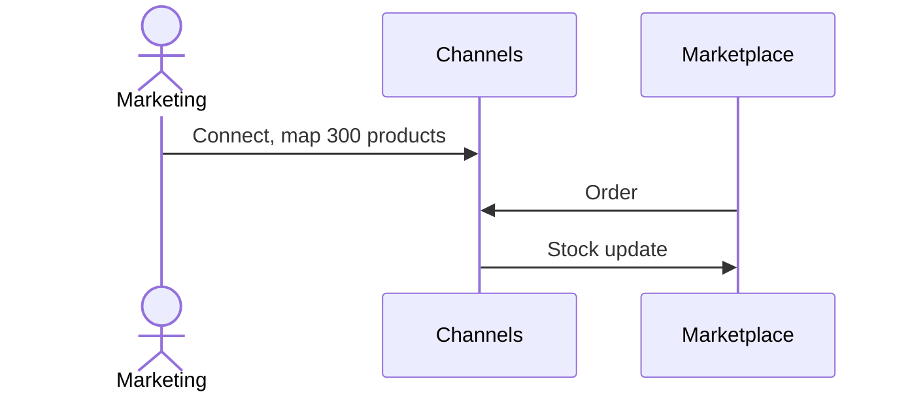

🏠 [Specs](../../../../README.md) › 🧩 [Functional capabilities](../../../README.md) ›
🛍️ [F11 Online shop (plugin)](../../README.md) › 📝 [Use cases](../README.md) ›
📝 [Use cases: FL-F11-06 Channels and legal pages](README.md) › 📝 UC-F11-18 Connect marketplaces and other shops

# 📝 UC-F11-18 Connect marketplaces and other shops

**Status:** ✅ specified

## Summary

Marketplaces and shop platforms connected through T12: listings, stock, prices and orders.

## Personas

- [U12 Marketing](../../../../01-users/personas/u12-marketing.md)
- [U07 Administrator](../../../../01-users/personas/u07-administrator.md)

## Goal

Sell on marketplaces from one stock.

## Trigger

A channel is added.

## Frequency

Daily sync.

## Preconditions

F11 set up for the company.

## Postconditions

- **Succeeded:** listings live; orders in, stock out.
- **Failed:** connector down pauses the channel.

## Main flow

1. Marketing connects a channel on channels ([S-F11-18](../../screens/06-channels-and-legal/s-f11-18-channels.md))
   through T12.
2. They map products; content must be complete for the channel
   ([UC-F11-23](../08-product-content-and-listings/uc-f11-23-enrich-product-content-per-channel.md)).
3. Orders come in ([BR-F11-12](../../business-rules/br-f11-12-marketplace-orders-through-connectors.md)); stock goes
   out.
4. Prices sync per channel.

## Alternative flows

- 1a. Several accounts per marketplace.

## Error flows

- 3e. Connector down: channel paused, shown.

## Business rules

- [BR-F11-12 Marketplace orders through connectors](../../business-rules/br-f11-12-marketplace-orders-through-connectors.md)

## Entities

- [E-F11-13 Channel listing](../../data/e-f11-13-channel-listing.md)

## Permissions

Marketing and communication for the shop; sales for B2B; accounting for payments; the owner reads. Administrators.

## Notifications

Marketing: channel paused.

## Audit events

Mappings and syncs.

## AI involvement

The AI assistant prepares it for confirmation
([BR-F3-07](../../../f03-assistant/business-rules/br-f03-07-no-deletes-no-irreversible-acts.md)); figures come from
queries ([BR-F3-03](../../../f03-assistant/business-rules/br-f03-03-figures-come-from-queries.md)).

## API, MCP and A2A exposure

T5 operations of F11 with the caller's rights; the MCP tool of F11; no A2A skill.

## Screens

- [S-F11-18](../../screens/06-channels-and-legal/s-f11-18-channels.md)

## Flowchart

See [FL-F11-06 Channels and legal pages](../../flows/fl-f11-06-channels-and-legal.md#flowchart).

## Sequence diagram

## Acceptance criteria

1. **Given** 300 products mapped **when** the channel goes live **then** they are listed.
2. **Given** a marketplace order **when** it arrives **then** stock is reserved.
3. **Given** the connector down **when** it fails **then** the channel is paused and shown.

## Non-functional notes

None.

## Regulatory references

[CR-FR-188](../../../../10-country-packs/france/digital/cr-fr-188-dac7-seller-reporting.md);
[CR-FR-191](../../../../10-country-packs/france/consumer/cr-fr-191-marketplace-consumer-information.md).

## Related use cases

See the flows.

- [UC-F11-24 Publish product feeds to shopping comparators](../08-product-content-and-listings/uc-f11-24-publish-product-feeds-to-shopping-comparators.md)

## Open questions

None.

---

⬅️ [UC-F11-17 Read shop analytics](../05-grow-the-shop/uc-f11-17-read-shop-analytics.md) · ⬆️ [Up](README.md) ·
➡️ [UC-F11-19 Publish the legal pages](uc-f11-19-publish-the-legal-pages.md)
