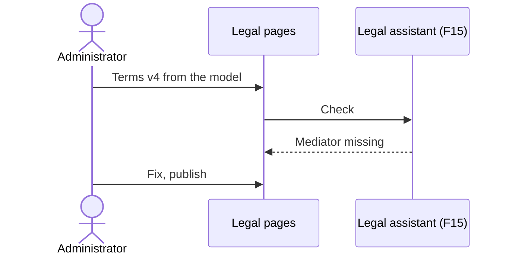

🏠 [Specs](../../../../README.md) › 🧩 [Functional capabilities](../../../README.md) ›
🛍️ [F11 Online shop (plugin)](../../README.md) › 📝 [Use cases](../README.md) ›
📝 [Use cases: FL-F11-06 Channels and legal pages](README.md) › 📝 UC-F11-19 Publish the legal pages

# 📝 UC-F11-19 Publish the legal pages

**Status:** ✅ specified

## Summary

Legal notices, terms, privacy and cookie policies, mediator, versioned and linked at checkout.

## Personas

- [U07 Administrator](../../../../01-users/personas/u07-administrator.md)
- [U12 Marketing](../../../../01-users/personas/u12-marketing.md)

## Goal

Legal pages right and current.

## Trigger

Opening the shop or a law change.

## Frequency

Yearly.

## Preconditions

F11 set up for the company.

## Postconditions

- **Succeeded:** a version published and linked.
- **Failed:** a missing mandatory notice refused.

## Main flow

1. The administrator drafts from the country pack's models on legal pages
   ([S-F11-19](../../screens/06-channels-and-legal/s-f11-19-legal-pages.md)); the legal assistant checks (F15).
2. They publish a version.
3. It is linked at checkout ([BR-F11-15](../../business-rules/br-f11-15-accepted-terms-are-kept.md)).
4. A new version is announced to customers.

## Alternative flows

- 4a. New version: customers told.

## Error flows

- 2e. A mandatory notice missing: publishing refused.

## Business rules

- [BR-F11-01 The shop follows the country pack](../../business-rules/br-f11-01-shop-follows-the-country-pack.md)
- [BR-F11-15 Accepted terms are kept](../../business-rules/br-f11-15-accepted-terms-are-kept.md)

## Entities

- [E-F11-14 Legal page](../../data/e-f11-14-legal-page.md)

## Permissions

Administrators and marketing.

## Notifications

Customers: new terms.

## Audit events

Versions.

## AI involvement

The legal assistant checks.

## API, MCP and A2A exposure

T5 operations of F11 with the caller's rights; the MCP tool of F11; no A2A skill.

## Screens

- [S-F11-19](../../screens/06-channels-and-legal/s-f11-19-legal-pages.md)

## Flowchart

See [FL-F11-06 Channels and legal pages](../../flows/fl-f11-06-channels-and-legal.md#flowchart).

## Sequence diagram

## Acceptance criteria

1. **Given** terms without the mediator **when** publish is asked **then** it is refused.
2. **Given** terms v4 published **when** a shopper checks out **then** she accepts v4.
3. **Given** a new version **when** it is published **then** customers are told.

## Non-functional notes

Pages load within 2 seconds on a phone; accessible
([CR-FR-072](../../../../10-country-packs/france/consumer/cr-fr-072-web-accessibility-eaa.md)).

## Regulatory references

[CR-FR-069](../../../../10-country-packs/france/consumer/cr-fr-069-website-legal-notices.md);
[CR-FR-065](../../../../10-country-packs/france/consumer/cr-fr-065-online-pre-contract-information.md).

## Related use cases

See the flows.

## Open questions

None.

---

⬅️ [UC-F11-18 Connect marketplaces and other shops](uc-f11-18-connect-marketplaces-and-other-shops.md) ·
⬆️ [Up](README.md) ·
➡️ [UC-F11-20 Ask the AI assistant about the shop](../05-grow-the-shop/uc-f11-20-ask-the-assistant-about-the-shop.md)
