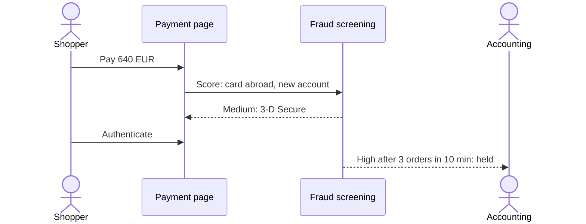

🏠 [Specs](../../../../README.md) › 🧩 [Functional capabilities](../../../README.md) ›
🛍️ [F11 Online shop (plugin)](../../README.md) › 📝 [Use cases](../README.md) ›
📝 [Use cases: FL-F11-07 Payment risk](README.md) › 📝 UC-F11-21 Screen orders for fraud and authenticate payments

# 📝 UC-F11-21 Screen orders for fraud and authenticate payments

**Status:** ✅ specified, ⚖️ lawyer review before launch (D574)

## Summary

Each online order is scored for fraud; the payment is authenticated with 3-D Secure when the rules or the risk require
it; risky orders are held for a person to review.

## Personas

- [U05 Accounting](../../../../01-users/personas/u05-accounting.md)
- [U09 Customer](../../../../01-users/personas/u09-customer.md)
- [U12 Marketing and communication](../../../../01-users/personas/u12-marketing.md)

## Goal

Accept good orders fast and stop fraudulent ones before shipping.

## Trigger

An order is paid.

## Frequency

Every order.

## Preconditions

- A payment provider with 3-D Secure ([UC-F11-06](../02-shop-and-check-out/uc-f11-06-pay-online.md)).

## Postconditions

- **Succeeded:** the order is accepted, or held, or cancelled and refunded.
- **Failed:** a held order waits for review.

## Main flow

1. The shopper pays ([UC-F11-06](../02-shop-and-check-out/uc-f11-06-pay-online.md)); the provider and SimpleERP score
   the order: card country, address mismatch, order velocity, amount
   ([BR-F11-16](../../business-rules/br-f11-16-risky-orders-are-authenticated-or-held.md)).
2. When strong authentication is required or the risk is medium, the shopper confirms with 3-D Secure in the payment
   page ([S-F11-06](../../screens/02-shop-and-check-out/s-f11-06-payment.md)).
3. A high-risk order is held; accounting reviews it on order risk
   ([S-F11-21](../../screens/07-payment-risk/s-f11-21-order-risk.md)) with its signals.
4. The reviewer accepts it (it ships) or cancels it (refunded, the shopper told).

## Alternative flows

- 2a. Low-value or recurring payments exempt as the rules allow.

## Error flows

- 2e. Authentication fails: the payment is refused and another method offered.
- 3e. Not reviewed within 24 hours: reminded, not shipped.

## Business rules

- [BR-F11-16 Risky orders are authenticated or held](../../business-rules/br-f11-16-risky-orders-are-authenticated-or-held.md)
- [BR-F11-14 Payment keys in the vault](../../business-rules/br-f11-14-payment-keys-in-the-vault.md)

## Entities

- [E-F11-16 Fraud check](../../data/e-f11-16-fraud-check.md)
- [E-F11-05 Checkout](../../data/e-f11-05-checkout.md)

## Permissions

Accounting and shop managers review; shoppers authenticate.

## Notifications

Reviewer: order held; shopper: cancelled.

## Audit events

Score, decision, reviewer.

## AI involvement

Scores are explained by their signals; a person decides held orders.

## API, MCP and A2A exposure

T5 operations of F11 with the caller's rights; the MCP tool of F11; no A2A skill.

## Screens

- [S-F11-21 Order risk](../../screens/07-payment-risk/s-f11-21-order-risk.md)
- [S-F11-06 Payment](../../screens/02-shop-and-check-out/s-f11-06-payment.md)

## Flowchart

See [FL-F11-07 Payment risk](../../flows/fl-f11-07-payment-risk.md#flowchart).

## Sequence diagram

## Acceptance criteria

1. **Given** an order of 640 EUR on the example shop chain's site with a foreign card **when** it is paid **then** 3-D
   Secure is asked.
2. **Given** 3 orders in 10 minutes to different addresses with one card **when** the third is paid **then** it is held
   for review.
3. **Given** a held order **when** the reviewer cancels it **then** it is refunded and the shopper told.
4. **Given** an order of 18 EUR from a known customer **when** it is paid **then** it is accepted without authentication
   where exempt.

## Non-functional notes

Scoring adds under 1 second to checkout.

## Regulatory references

(⚖️ lawyer review before launch, D574) to read: PSD2 strong customer authentication (Regulation (EU) 2018/389).

## Related use cases

- [UC-F11-06 Pay online](../02-shop-and-check-out/uc-f11-06-pay-online.md)
- [UC-F11-22 Handle a chargeback](uc-f11-22-handle-a-chargeback.md)

## Open questions

None.

---

⬅️ [UC-F11-20 Ask the AI assistant about the shop](../05-grow-the-shop/uc-f11-20-ask-the-assistant-about-the-shop.md) ·
⬆️ [Up](README.md) · ➡️ [UC-F11-22 Handle a chargeback](uc-f11-22-handle-a-chargeback.md)
