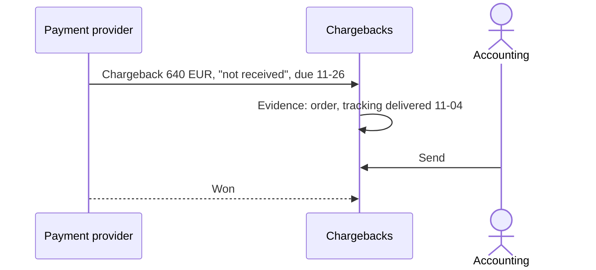

🏠 [Specs](../../../../README.md) › 🧩 [Functional capabilities](../../../README.md) ›
🛍️ [F11 Online shop (plugin)](../../README.md) › 📝 [Use cases](../README.md) ›
📝 [Use cases: FL-F11-07 Payment risk](README.md) › 📝 UC-F11-22 Handle a chargeback

# 📝 UC-F11-22 Handle a chargeback

**Status:** ✅ specified

## Summary

When a customer's bank disputes a card payment, accounting gathers the evidence (order, delivery proof, messages) and
answers before the acquirer's deadline; a lost chargeback is posted.

## Personas

- [U05 Accounting](../../../../01-users/personas/u05-accounting.md)

## Goal

Win the chargebacks that should be won, on time.

## Trigger

The provider reports a chargeback.

## Frequency

A few a month.

## Preconditions

- A paid order.

## Postconditions

- **Succeeded:** evidence sent; won or lost and posted.
- **Failed:** missed deadline: lost.

## Main flow

1. The chargeback arrives on chargebacks ([S-F11-22](../../screens/07-payment-risk/s-f11-22-chargebacks.md)) with its
   reason and deadline ([BR-F11-17](../../business-rules/br-f11-17-chargebacks-are-answered-before-their-deadline.md)).
2. simple-ERP gathers the evidence: order, terms accepted
   ([BR-F11-15](../../business-rules/br-f11-15-accepted-terms-are-kept.md)), delivery proof, messages, 3-D Secure
   result.
3. Accounting checks and sends it through the provider.
4. The result arrives; a lost chargeback posts the loss and its fee.

## Alternative flows

- 1a. The customer withdrew: refunded instead
  ([UC-F11-09](../03-after-the-order/uc-f11-09-withdraw-return-and-refund.md)).

## Error flows

- 3e. Deadline in 2 days: accounting alerted.
- 2e. No delivery proof: said, evidence sent without it.

## Business rules

- [BR-F11-17 Chargebacks are answered before their deadline](../../business-rules/br-f11-17-chargebacks-are-answered-before-their-deadline.md)

## Entities

- [E-F11-17 Chargeback](../../data/e-f11-17-chargeback.md)

## Permissions

Accounting.

## Notifications

Accounting: new chargeback, deadline.

## Audit events

Evidence sent, result.

## AI involvement

The AI assistant prepares it for confirmation
([BR-F3-07](../../../f03-assistant/business-rules/br-f03-07-no-deletes-no-irreversible-acts.md)); figures come from
queries ([BR-F3-03](../../../f03-assistant/business-rules/br-f03-03-figures-come-from-queries.md)).

## API, MCP and A2A exposure

T5 operations of F11 with the caller's rights; the MCP tool of F11; no A2A skill.

## Screens

- [S-F11-22 Chargebacks](../../screens/07-payment-risk/s-f11-22-chargebacks.md)

## Flowchart

See [FL-F11-07 Payment risk](../../flows/fl-f11-07-payment-risk.md#flowchart).

## Sequence diagram

## Acceptance criteria

1. **Given** a chargeback "not received" due 2026-11-26 **when** it arrives **then** the evidence pack includes the
   tracking showing delivery.
2. **Given** the deadline in 2 days **when** the time passes **then** accounting is alerted.
3. **Given** a lost chargeback of 640 EUR with a 15 EUR fee **when** it is lost **then** 655 EUR is posted.

## Non-functional notes

None.

## Regulatory references

None.

## Related use cases

- [UC-F11-21 Screen orders for fraud and authenticate payments](uc-f11-21-screen-orders-for-fraud-and-authenticate-payments.md)
- [UC-F11-09 Withdraw, return and refund](../03-after-the-order/uc-f11-09-withdraw-return-and-refund.md)

## Open questions

None.

---

⬅️ [UC-F11-21](uc-f11-21-screen-orders-for-fraud-and-authenticate-payments.md) · ⬆️ [Up](README.md) ·
➡️ [UC-F11-23](../08-product-content-and-listings/uc-f11-23-enrich-product-content-per-channel.md)
