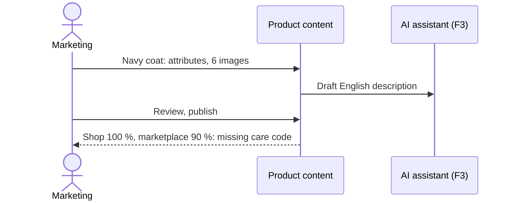

🏠 [Specs](../../../../README.md) › 🧩 [Functional capabilities](../../../README.md) ›
🛍️ [F11 Online shop (plugin)](../../README.md) › 📝 [Use cases](../README.md) ›
📝 [Use cases: FL-F11-08 Product content and listings](README.md) › 📝 UC-F11-23 Enrich product content per channel

# 📝 UC-F11-23 Enrich product content per channel

**Status:** ✅ specified

## Summary

Marketing keeps each product's content in one place: attributes, media, descriptions and translations, with what each
channel (shop, marketplace, B2B catalogue, feed) requires.

## Personas

- [U12 Marketing and communication](../../../../01-users/personas/u12-marketing.md)
- [U04 Purchasing and stock](../../../../01-users/personas/u04-purchasing.md)

## Goal

Complete, consistent product pages everywhere.

## Trigger

A new product or a channel's new requirement.

## Frequency

Daily.

## Preconditions

- The product exists (F7).

## Postconditions

- **Succeeded:** the product is complete for its channels and published.
- **Failed:** missing attributes block a channel.

## Main flow

1. Marketing opens product content
   ([S-F11-23](../../screens/08-product-content-and-listings/s-f11-23-product-content.md)): completeness per channel.
2. They fill the attributes (material, sizes, care), media and descriptions per language.
3. The AI assistant drafts descriptions and translations for review.
4. When a channel's required attributes are complete
   ([BR-F11-18](../../business-rules/br-f11-18-a-channel-shows-only-complete-products.md)), the product publishes there.

## Alternative flows

- 2a. Import from a supplier's file.

## Error flows

- 4e. A required attribute missing: the channel shows what is missing.

## Business rules

- [BR-F11-18 A channel shows only complete products](../../business-rules/br-f11-18-a-channel-shows-only-complete-products.md)

## Entities

- [E-F11-18 Product content](../../data/e-f11-18-product-content.md)
- [E-F11-03 Online product](../../data/e-f11-03-online-product.md)

## Permissions

Marketing and communication for the shop; sales for B2B; accounting for payments; the owner reads.

## Notifications

Marketing: products incomplete for a channel.

## Audit events

Content changed per channel.

## AI involvement

Drafts texts and translations; marked as drafts until reviewed.

## API, MCP and A2A exposure

T5 operations of F11 with the caller's rights; the MCP tool of F11; no A2A skill.

## Screens

- [S-F11-23 Product content](../../screens/08-product-content-and-listings/s-f11-23-product-content.md)

## Flowchart

See [FL-F11-08 Product content and listings](../../flows/fl-f11-08-product-content-and-listings.md#flowchart).

## Sequence diagram

## Acceptance criteria

1. **Given** the navy coat with all shop attributes **when** it is completed **then** it publishes on the shop.
2. **Given** the marketplace requiring a care code **when** it is missing **then** the marketplace shows it missing.
3. **Given** an English description drafted **when** it is reviewed **then** it publishes in English.

## Non-functional notes

None.

## Regulatory references

[CR-FR-065](../../../../10-country-packs/france/consumer/cr-fr-065-online-pre-contract-information.md).

## Related use cases

- [UC-F11-02 Publish the catalogue](../01-build-the-shop/uc-f11-02-publish-the-catalogue.md)
- [UC-F11-24 Publish product feeds to shopping comparators](uc-f11-24-publish-product-feeds-to-shopping-comparators.md)

## Open questions

None.

---

⬅️ [UC-F11-22 Handle a chargeback](../07-payment-risk/uc-f11-22-handle-a-chargeback.md) · ⬆️ [Up](README.md) ·
➡️ [UC-F11-24](uc-f11-24-publish-product-feeds-to-shopping-comparators.md)
