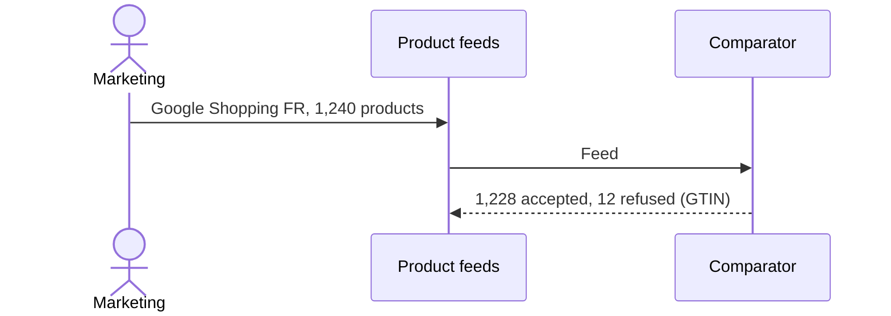

🏠 [Specs](../../../../README.md) › 🧩 [Functional capabilities](../../../README.md) ›
🛍️ [F11 Online shop (plugin)](../../README.md) › 📝 [Use cases](../README.md) ›
📝 [Use cases: FL-F11-08 Product content and listings](README.md) ›
📝 UC-F11-24 Publish product feeds to shopping comparators

# 📝 UC-F11-24 Publish product feeds to shopping comparators

**Status:** ✅ specified

## Summary

Marketing publishes product feeds to Google Shopping and price comparators, with only in-stock items at the shop's
price.

## Personas

- [U12 Marketing and communication](../../../../01-users/personas/u12-marketing.md)

## Goal

Products found where shoppers compare.

## Trigger

Setting up a feed; then daily.

## Frequency

Daily refresh.

## Preconditions

- Products complete for the feed ([UC-F11-23](uc-f11-23-enrich-product-content-per-channel.md)).

## Postconditions

- **Succeeded:** the feed is published and refreshed.
- **Failed:** refused items are listed with the reason.

## Main flow

1. Marketing opens product feeds ([S-F11-24](../../screens/08-product-content-and-listings/s-f11-24-product-feeds.md))
   and adds a feed: destination, products, mapping.
2. The feed is generated with prices including VAT and delivery
   ([BR-F11-04](../../business-rules/br-f11-04-prices-with-taxes-and-delivery.md)).
3. It refreshes daily and when stock or price changes
   ([BR-F11-19](../../business-rules/br-f11-19-feeds-hold-in-stock-items-at-the-shops-price.md)).
4. Items refused by the destination are listed with its reason.

## Alternative flows

- 1a. A feed per country and language.

## Error flows

- 4e. An item refused (missing GTIN): listed.

## Business rules

- [BR-F11-19 Feeds hold in-stock items at the shop's price](../../business-rules/br-f11-19-feeds-hold-in-stock-items-at-the-shops-price.md)
- [BR-F11-04 Prices with taxes and delivery](../../business-rules/br-f11-04-prices-with-taxes-and-delivery.md)

## Entities

- [E-F11-19 Product feed](../../data/e-f11-19-product-feed.md)

## Permissions

Marketing and communication for the shop; sales for B2B; accounting for payments; the owner reads.

## Notifications

Marketing: refused items.

## Audit events

Feeds created and published.

## AI involvement

The AI assistant prepares it for confirmation
([BR-F3-07](../../../f03-assistant/business-rules/br-f03-07-no-deletes-no-irreversible-acts.md)); figures come from
queries ([BR-F3-03](../../../f03-assistant/business-rules/br-f03-03-figures-come-from-queries.md)).

## API, MCP and A2A exposure

T5 operations of F11 with the caller's rights; the MCP tool of F11; no A2A skill.

## Screens

- [S-F11-24 Product feeds](../../screens/08-product-content-and-listings/s-f11-24-product-feeds.md)

## Flowchart

See [FL-F11-08 Product content and listings](../../flows/fl-f11-08-product-content-and-listings.md#flowchart).

## Sequence diagram

## Acceptance criteria

1. **Given** 1,240 in-stock products **when** the feed publishes **then** the comparator gets 1,240 items.
2. **Given** an item sold out **when** the refresh runs **then** it leaves the feed.
3. **Given** 12 items without GTIN **when** the comparator answers **then** they are listed with the reason.

## Non-functional notes

None.

## Regulatory references

[CR-FR-034](../../../../10-country-packs/france/consumer/cr-fr-034-prices-shown-including-vat.md);
[CR-FR-035](../../../../10-country-packs/france/consumer/cr-fr-035-reference-price-for-reductions.md).

## Related use cases

- [UC-F11-23 Enrich product content per channel](uc-f11-23-enrich-product-content-per-channel.md)
- [UC-F11-18 Connect marketplaces and other shops](../06-channels-and-legal/uc-f11-18-connect-marketplaces-and-other-shops.md)

## Open questions

None.

---

⬅️ [UC-F11-23 Enrich product content per channel](uc-f11-23-enrich-product-content-per-channel.md) ·
⬆️ [Up](README.md) · ➡️ [UC-F11-25 Show product safety information](uc-f11-25-show-product-safety-information.md)
