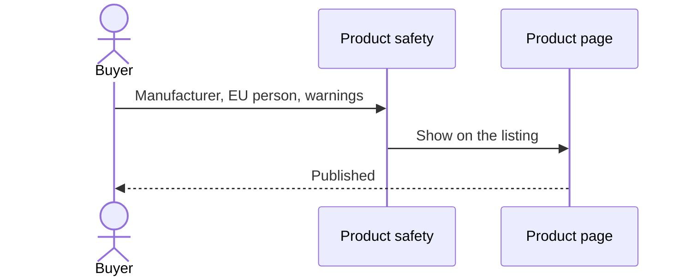

🏠 [Specs](../../../../README.md) › 🧩 [Functional capabilities](../../../README.md) ›
🛍️ [F11 Online shop (plugin)](../../README.md) › 📝 [Use cases](../README.md) ›
📝 [Use cases: FL-F11-08 Product content and listings](README.md) › 📝 UC-F11-25 Show product safety information

# 📝 UC-F11-25 Show product safety information

**Status:** 🔄 waiting for the owner

## Summary

Each listing shows the product safety information the law requires: the manufacturer, the responsible person in the EU,
identifiers, warnings and safety instructions; a listing without it is not published.

## Personas

- [U12 Marketing and communication](../../../../01-users/personas/u12-marketing.md)
- [U04 Purchasing and stock](../../../../01-users/personas/u04-purchasing.md)

## Goal

Every listing compliant with product safety rules.

## Trigger

A product listed or its information changed.

## Frequency

Per product.

## Preconditions

- The product's supplier and manufacturer known (F7).

## Postconditions

- **Succeeded:** the listing shows the safety information.
- **Failed:** it stays unpublished.

## Main flow

1. The buyer records the manufacturer, the responsible person in the EU and identifiers on product safety
   ([S-F11-25](../../screens/08-product-content-and-listings/s-f11-25-product-safety.md)).
2. They add warnings, safety instructions and their images, per language.
3. The listing shows them on the product page
   ([BR-F11-20](../../business-rules/br-f11-20-no-listing-without-its-safety-information.md)).
4. A recall,
   [UC-F7-08](../../../f07-purchasing-and-stock/use-cases/05-count-trace-and-analyse/uc-f07-08-trace-lots-and-serials-recall.md),
   unpublishes the product and informs buyers.

## Alternative flows

- 1a. Imported from the supplier's data.

## Error flows

- 3e. No responsible person in the EU: not published.

## Business rules

- [BR-F11-20 No listing without its safety information](../../business-rules/br-f11-20-no-listing-without-its-safety-information.md)

## Entities

- [E-F11-20 Product safety information](../../data/e-f11-20-product-safety-information.md)
- [E-F11-03 Online product](../../data/e-f11-03-online-product.md)

## Permissions

Marketing and communication for the shop; sales for B2B; accounting for payments; the owner reads. Purchasing records
manufacturers.

## Notifications

Marketing: listings blocked.

## Audit events

Changes.

## AI involvement

The AI assistant prepares it for confirmation
([BR-F3-07](../../../f03-assistant/business-rules/br-f03-07-no-deletes-no-irreversible-acts.md)); figures come from
queries ([BR-F3-03](../../../f03-assistant/business-rules/br-f03-03-figures-come-from-queries.md)).

## API, MCP and A2A exposure

T5 operations of F11 with the caller's rights; the MCP tool of F11; no A2A skill.

## Screens

- [S-F11-25 Product safety](../../screens/08-product-content-and-listings/s-f11-25-product-safety.md)

## Flowchart

See [FL-F11-08 Product content and listings](../../flows/fl-f11-08-product-content-and-listings.md#flowchart).

## Sequence diagram

## Acceptance criteria

1. **Given** a toy with its manufacturer, EU responsible person and warnings **when** it is listed **then** the page
   shows them.
2. **Given** a product without an EU responsible person **when** it is published **then** it is refused.
3. **Given** a recall of a lot **when** it starts **then** the product is unpublished.

## Non-functional notes

Pages load within 2 seconds on a phone (Proposed); accessible
([CR-FR-072](../../../../10-country-packs/france/consumer/cr-fr-072-web-accessibility-eaa.md)).

## Regulatory references

(Proposed) to read: Regulation (EU) 2023/988 (GPSR), article 19;
[CR-FR-062](../../../../10-country-packs/france/products/cr-fr-062-product-recall.md).

## Related use cases

- [UC-F11-23 Enrich product content per channel](uc-f11-23-enrich-product-content-per-channel.md)
- [UC-F7-08 Trace lots and serials, recall](../../../f07-purchasing-and-stock/use-cases/05-count-trace-and-analyse/uc-f07-08-trace-lots-and-serials-recall.md)

## Open questions

None.

---

⬅️ [UC-F11-24](uc-f11-24-publish-product-feeds-to-shopping-comparators.md) · ⬆️ [Up](README.md) ·
➡️ [UC-F11-26](../09-pre-orders-and-b2b-buying/uc-f11-26-take-pre-orders-and-back-in-stock-reservations.md)
