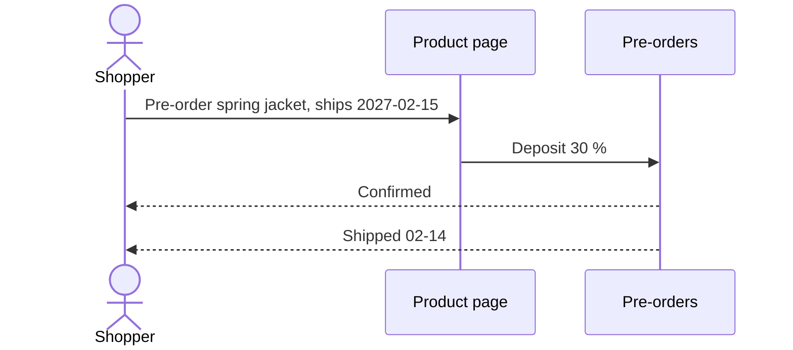

🏠 [Specs](../../../../README.md) › 🧩 [Functional capabilities](../../../README.md) ›
🛍️ [F11 Online shop (plugin)](../../README.md) › 📝 [Use cases](../README.md) ›
📝 [Use cases: FL-F11-09 Pre-orders and B2B buying](README.md) ›
📝 UC-F11-26 Take pre-orders and back-in-stock reservations

# 📝 UC-F11-26 Take pre-orders and back-in-stock reservations

**Status:** ✅ specified

## Summary

Shoppers pre-order items not yet released, with the expected date and payment as set, or reserve a sold-out item to be
held for them when it comes back.

## Personas

- [U09 Customer](../../../../01-users/personas/u09-customer.md)
- [U12 Marketing and communication](../../../../01-users/personas/u12-marketing.md)

## Goal

Sell before stock arrives and keep shoppers who would leave.

## Trigger

A shopper meets an item not in stock.

## Frequency

Daily for new collections.

## Preconditions

- Pre-orders open on the product, or reservations on.

## Postconditions

- **Succeeded:** pre-order recorded with its date; reservation held when stock arrives.
- **Failed:** the shopper is told if the date moves.

## Main flow

1. The shopper opens a product not in stock; the page shows Pre-order with the expected date, or Reserve
   ([S-F11-26](../../screens/09-pre-orders-and-b2b-buying/s-f11-26-pre-order.md)).
2. For a pre-order, they pay as set: in full, a deposit, or at shipping
   ([BR-F11-21](../../business-rules/br-f11-21-pre-orders-show-their-date-and-can-be-cancelled.md)).
3. For a reservation, they leave their email; when stock arrives, they are told and the item is held 48 hours.
4. Pre-orders ship first when stock arrives
   ([UC-F11-07](../02-shop-and-check-out/uc-f11-07-choose-delivery-or-click-collect.md)).

## Alternative flows

- 4a. The date moves: shoppers are told and may cancel at no cost.

## Error flows

- 3e. The reservation not collected in time: released to the next.

## Business rules

- [BR-F11-21 Pre-orders show their date and can be cancelled](../../business-rules/br-f11-21-pre-orders-show-their-date-and-can-be-cancelled.md)
- [BR-F11-06 Stock shown or sold out](../../business-rules/br-f11-06-stock-shown-or-sold-out.md)

## Entities

- [E-F11-21 Pre-order and reservation](../../data/e-f11-21-pre-order-and-reservation.md)

## Permissions

The shopper, as a guest or with an account
([BR-F11-08](../../business-rules/br-f11-08-checkout-as-guest-or-account.md)). Marketing opens pre-orders.

## Notifications

Shoppers: date changes, back in stock.

## Audit events

Pre-orders and reservations.

## AI involvement

None.

## API, MCP and A2A exposure

T5 operations of F11 with the caller's rights; the MCP tool of F11; no A2A skill.

## Screens

- [S-F11-26 Pre-order](../../screens/09-pre-orders-and-b2b-buying/s-f11-26-pre-order.md)

## Flowchart

See [FL-F11-09 Pre-orders and B2B buying](../../flows/fl-f11-09-pre-orders-and-b2b-buying.md#flowchart).

## Sequence diagram

## Acceptance criteria

1. **Given** a spring jacket shipping 2027-02-15 **when** a shopper pre-orders it **then** she pays the 30 % deposit and
   sees the date.
2. **Given** the date moved to 2027-03-01 **when** it is changed **then** pre-order customers are told and may cancel.
3. **Given** a reserved sold-out item back in stock **when** stock arrives **then** the shopper is told and it is held
   48 hours.

## Non-functional notes

Pages load within 2 seconds on a phone; accessible
([CR-FR-072](../../../../10-country-packs/france/consumer/cr-fr-072-web-accessibility-eaa.md)).

## Regulatory references

[CR-FR-066](../../../../10-country-packs/france/consumer/cr-fr-066-delivery-within-30-days.md);
[CR-FR-065](../../../../10-country-packs/france/consumer/cr-fr-065-online-pre-contract-information.md).

## Related use cases

- [UC-F11-04 Browse and search the shop](../02-shop-and-check-out/uc-f11-04-browse-and-search-the-shop.md)
- [UC-F11-14 Recover abandoned carts](../05-grow-the-shop/uc-f11-14-recover-abandoned-carts.md)

## Open questions

None.

---

⬅️ [UC-F11-25](../08-product-content-and-listings/uc-f11-25-show-product-safety-information.md) · ⬆️ [Up](README.md) ·
➡️ [UC-F11-27](uc-f11-27-request-a-quote-or-punch-out-from-a-buyers-system.md)
