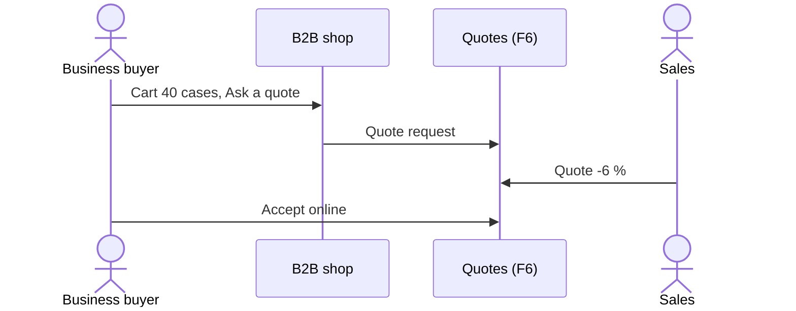

🏠 [Specs](../../../../README.md) › 🧩 [Functional capabilities](../../../README.md) ›
🛍️ [F11 Online shop (plugin)](../../README.md) › 📝 [Use cases](../README.md) ›
📝 [Use cases: FL-F11-09 Pre-orders and B2B buying](README.md) ›
📝 UC-F11-27 Request a quote or punch out from a buyer's system

# 📝 UC-F11-27 Request a quote or punch out from a buyer's system

**Status:** ✅ specified

## Summary

An approved business buyer asks a quote from the cart, which becomes an F6 quote, or shops the catalogue from their own
purchasing system (punch-out) and returns the cart there.

## Personas

- [U09 Customer](../../../../01-users/personas/u09-customer.md)
- [U03 Sales](../../../../01-users/personas/u03-sales.md)

## Goal

Business customers buy the way their company requires.

## Trigger

A B2B buyer needs a quote or buys through their system.

## Frequency

Weekly for B2B customers.

## Preconditions

- The buyer is approved for B2B ([UC-F11-11](../04-special-sales/uc-f11-11-sell-b2b-online.md)).

## Postconditions

- **Succeeded:** a quote is sent, or the cart reaches the buyer's system.
- **Failed:** an expired session asks to start again.

## Main flow

1. The buyer fills the cart at their prices on B2B access
   ([S-F11-11](../../screens/04-special-sales/s-f11-11-b2b-access.md)) and chooses Ask a quote.
2. A quote request reaches sales,
   [UC-F6-03](../../../f06-customers-and-sales/use-cases/01-lead-to-quote/uc-f06-03-create-and-send-a-quote.md), with
   the cart ([BR-F11-22](../../business-rules/br-f11-22-b2b-requests-become-f6-quotes-punch-out-carts-go-back.md)).
3. Sales answer with the quote, which the buyer accepts online,
   [UC-F6-04](../../../f06-customers-and-sales/use-cases/02-quote-to-order/uc-f06-04-accept-or-sign-a-quote.md).
4. Or the buyer arrives from their purchasing system by punch-out, fills the cart and returns it there for their own
   approval; the order comes back as a purchase order.

## Alternative flows

- 4a. The returned order differs from the cart: sales are told.

## Error flows

- 4e. The punch-out session expired: the buyer starts again from their system.

## Business rules

- [BR-F11-22 B2B requests become F6 quotes; punch-out carts go back](../../business-rules/br-f11-22-b2b-requests-become-f6-quotes-punch-out-carts-go-back.md)
- [BR-F11-13 B2B prices for approved customers](../../business-rules/br-f11-13-b2b-prices-for-approved-customers.md)

## Entities

- [E-F11-22 Punch-out session](../../data/e-f11-22-punch-out-session.md)
- [E-F6-03 Quote](../../../f06-customers-and-sales/data/e-f06-03-quote.md)

## Permissions

Approved B2B buyers; sales.

## Notifications

Sales: quote requests.

## Audit events

Requests, punch-out sessions.

## AI involvement

The AI assistant prepares it for confirmation
([BR-F3-07](../../../f03-assistant/business-rules/br-f03-07-no-deletes-no-irreversible-acts.md)); figures come from
queries ([BR-F3-03](../../../f03-assistant/business-rules/br-f03-03-figures-come-from-queries.md)).

## API, MCP and A2A exposure

T5 punch-out endpoints (cXML or OCI) for buyers' systems.

## Screens

- [S-F11-11 B2B access](../../screens/04-special-sales/s-f11-11-b2b-access.md)

## Flowchart

See [FL-F11-09 Pre-orders and B2B buying](../../flows/fl-f11-09-pre-orders-and-b2b-buying.md#flowchart).

## Sequence diagram

## Acceptance criteria

1. **Given** Brasserie du Parc approved for B2B at Distribution Lemoine **when** the buyer asks a quote from a cart of
   40 cases **then** sales get a quote request with the 40 cases.
2. **Given** a punch-out from the buyer's system **when** the cart is returned **then** it arrives in their system.
3. **Given** a punch-out session expired **when** the buyer returns the cart **then** he is asked to start again.

## Non-functional notes

Pages load within 2 seconds on a phone; accessible
([CR-FR-072](../../../../10-country-packs/france/consumer/cr-fr-072-web-accessibility-eaa.md)).

## Regulatory references

[CR-FR-174](../../../../10-country-packs/france/invoicing/cr-fr-174-discounts-on-invoices.md).

## Related use cases

- [UC-F11-11 Sell B2B online](../04-special-sales/uc-f11-11-sell-b2b-online.md)
- [UC-F6-03 Create and send a quote](../../../f06-customers-and-sales/use-cases/01-lead-to-quote/uc-f06-03-create-and-send-a-quote.md)

## Open questions

None.

---

⬅️ [UC-F11-26](uc-f11-26-take-pre-orders-and-back-in-stock-reservations.md) · ⬆️ [Up](README.md) ·
➡️ [UC-F11-28](../10-fulfil-from-stores-and-report/uc-f11-28-fulfil-online-orders-from-a-store.md)
