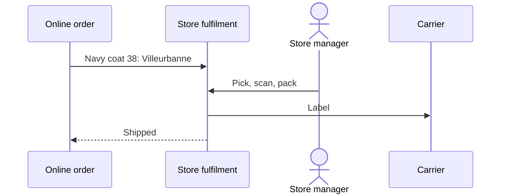

🏠 [Specs](../../../../README.md) › 🧩 [Functional capabilities](../../../README.md) ›
🛍️ [F11 Online shop (plugin)](../../README.md) › 📝 [Use cases](../README.md) ›
📝 [Use cases: FL-F11-10 Fulfil from stores and report](README.md) › 📝 UC-F11-28 Fulfil online orders from a store

# 📝 UC-F11-28 Fulfil online orders from a store

**Status:** 🔄 waiting for the owner

## Summary

When the warehouse lacks an item, an online order is assigned to a store with stock, where it is picked, packed and
shipped or collected.

## Personas

- [U23 Store manager](../../../../01-users/personas/u23-store-manager.md)
- [U15 Warehouse operator](../../../../01-users/personas/u15-warehouse-operator.md)
- [U17 Cashier](../../../../01-users/personas/u17-cashier.md)

## Goal

Ship more orders, faster, from the stock in stores.

## Trigger

An online order the warehouse cannot serve.

## Frequency

Daily in shop chains.

## Preconditions

- Stores are warehouses with ship-from-store on,
  [UC-F7-16](../../../f07-purchasing-and-stock/use-cases/06-benchmark-additions/uc-f07-16-work-with-third-party-warehouses-and-channels.md).

## Postconditions

- **Succeeded:** the order ships from the store or waits for collection.
- **Failed:** it goes back to the warehouse queue.

## Main flow

1. The order is assigned to a store with stock and capacity
   ([BR-F11-23](../../business-rules/br-f11-23-stores-fulfil-only-with-stock-and-capacity.md)); the item is reserved.
2. The store manager sees it on store fulfilment
   ([S-F11-27](../../screens/10-fulfil-from-stores-and-report/s-f11-27-store-fulfilment.md)) with its deadline.
3. A store employee picks and packs it, scanning the item.
4. It ships with a label, or waits for click and collect
   ([UC-F11-07](../02-shop-and-check-out/uc-f11-07-choose-delivery-or-click-collect.md)); the shopper is told.

## Alternative flows

- 1a. Several stores split the order.

## Error flows

- 3e. The item sold at the counter meanwhile: the order goes to the next store.
- 2e. The store over its daily capacity: not assigned.

## Business rules

- [BR-F11-23 Stores fulfil only with stock and capacity](../../business-rules/br-f11-23-stores-fulfil-only-with-stock-and-capacity.md)
- [BR-F11-07 Click & collect only where in stock](../../business-rules/br-f11-07-click-and-collect-where-in-stock.md)

## Entities

- [E-F11-23 Store fulfilment](../../data/e-f11-23-store-fulfilment.md)
- [E-F7-04 Transfer](../../../f07-purchasing-and-stock/data/e-f07-04-transfer.md)

## Permissions

Store managers and staff for their store.

## Notifications

Store: order to pick; shopper: shipped.

## Audit events

Assigned, picked, shipped.

## AI involvement

None.

## API, MCP and A2A exposure

T5 operations of F11 with the caller's rights; the MCP tool of F11; no A2A skill.

## Screens

- [S-F11-27 Store fulfilment](../../screens/10-fulfil-from-stores-and-report/s-f11-27-store-fulfilment.md)

## Flowchart

See [FL-F11-10 Fulfil from stores and report](../../flows/fl-f11-10-fulfil-from-stores-and-report.md#flowchart).

## Sequence diagram

## Acceptance criteria

1. **Given** the warehouse at 0 and Villeurbanne at 2 **when** an online order arrives **then** Villeurbanne gets it and
   one coat is reserved.
2. **Given** the coat sold at the counter before picking **when** the store reports it **then** the order goes to
   Annecy.
3. **Given** a store at its capacity of 20 orders a day (Proposed) **when** the 21st arrives **then** it is not assigned
   there.

## Non-functional notes

Assignment within a minute (Proposed).

## Regulatory references

None.

## Related use cases

- [UC-F11-07 Choose delivery or click & collect](../02-shop-and-check-out/uc-f11-07-choose-delivery-or-click-collect.md)
- [UC-F10-26 Look up and transfer stock between stores](../../../f10-point-of-sale/use-cases/10-clienteling-transfers-and-tax-free/uc-f10-26-look-up-and-transfer-stock-between-stores.md)

## Open questions

None.

---

⬅️ [UC-F11-27](../09-pre-orders-and-b2b-buying/uc-f11-27-request-a-quote-or-punch-out-from-a-buyers-system.md) ·
⬆️ [Up](README.md) · ➡️ [UC-F11-29](uc-f11-29-read-the-funnel-customer-value-and-return-reasons.md)
