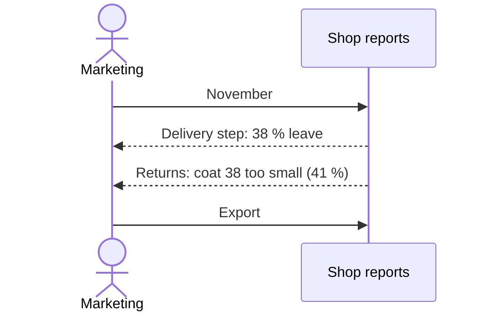

🏠 [Specs](../../../../README.md) › 🧩 [Functional capabilities](../../../README.md) ›
🛍️ [F11 Online shop (plugin)](../../README.md) › 📝 [Use cases](../README.md) ›
📝 [Use cases: FL-F11-10 Fulfil from stores and report](README.md) ›
📝 UC-F11-29 Read the funnel, customer value and return reasons

# 📝 UC-F11-29 Read the funnel, customer value and return reasons

**Status:** 🔄 waiting for the owner

## Summary

Marketing and the owner read the checkout funnel step by step, customers' lifetime value and the reasons for returns.

## Personas

- [U12 Marketing and communication](../../../../01-users/personas/u12-marketing.md)
- [U13 Owner](../../../../01-users/personas/u13-owner.md)

## Goal

Fix where shoppers leave, keep the best customers, reduce returns.

## Trigger

A monthly review.

## Frequency

Monthly.

## Preconditions

- Shop sessions, orders and returns.

## Postconditions

- **Succeeded:** reports read and saved.
- **Failed:** without consent, sessions counted without trackers.

## Main flow

1. Marketing opens shop reports ([S-F11-28](../../screens/10-fulfil-from-stores-and-report/s-f11-28-shop-reports.md)).
2. The funnel shows each checkout step and the share leaving it
   ([BR-F11-24](../../business-rules/br-f11-24-shop-reports-respect-tracker-consent.md)).
3. Customer value shows revenue and margin per customer over their life and by first channel.
4. Return reasons show by product and size; marketing acts (size guide, photos).

## Alternative flows

- 1a. Compare periods and websites.

## Error flows

- 2e. Trackers refused: sessions counted without them
  ([BR-F11-10](../../business-rules/br-f11-10-trackers-wait-for-consent.md)).

## Business rules

- [BR-F11-24 Shop reports respect tracker consent](../../business-rules/br-f11-24-shop-reports-respect-tracker-consent.md)
- [BR-F11-10 Trackers wait for consent](../../business-rules/br-f11-10-trackers-wait-for-consent.md)

## Entities

- [E-F11-05 Checkout](../../data/e-f11-05-checkout.md)
- [E-F11-08 Withdrawal request](../../data/e-f11-08-withdrawal-request.md)

## Permissions

Marketing and communication for the shop; sales for B2B; accounting for payments; the owner reads.

## Notifications

Monthly digest.

## Audit events

Exports.

## AI involvement

The AI assistant prepares it for confirmation
([BR-F3-07](../../../f03-assistant/business-rules/br-f03-07-no-deletes-no-irreversible-acts.md)); figures come from
queries ([BR-F3-03](../../../f03-assistant/business-rules/br-f03-03-figures-come-from-queries.md)).

## API, MCP and A2A exposure

T5 operations of F11 with the caller's rights; the MCP tool of F11; no A2A skill.

## Screens

- [S-F11-28 Shop reports](../../screens/10-fulfil-from-stores-and-report/s-f11-28-shop-reports.md)

## Flowchart

See [FL-F11-10 Fulfil from stores and report](../../flows/fl-f11-10-fulfil-from-stores-and-report.md#flowchart).

## Sequence diagram

## Acceptance criteria

1. **Given** November's checkouts **when** the funnel opens **then** the delivery step shows 38 % leaving.
2. **Given** returns of the navy coat **when** reasons are read **then** "too small" shows 41 %.
3. **Given** a customer since 2023 **when** customer value opens **then** her revenue and margin over 3 years show.

## Non-functional notes

Reports within 3 seconds (Proposed).

## Regulatory references

[CR-FR-070](../../../../10-country-packs/france/data-protection/cr-fr-070-cookie-consent.md).

## Related use cases

- [UC-F11-17 Read shop analytics](../05-grow-the-shop/uc-f11-17-read-shop-analytics.md)
- [UC-F11-09 Withdraw, return and refund](../03-after-the-order/uc-f11-09-withdraw-return-and-refund.md)

## Open questions

None.

---

⬅️ [UC-F11-28 Fulfil online orders from a store](uc-f11-28-fulfil-online-orders-from-a-store.md) · ⬆️ [Up](README.md) ·
➡️ [UC-F11-30](../11-donations-gift-cards-and-cross-border/uc-f11-30-accept-donations-at-checkout.md)
