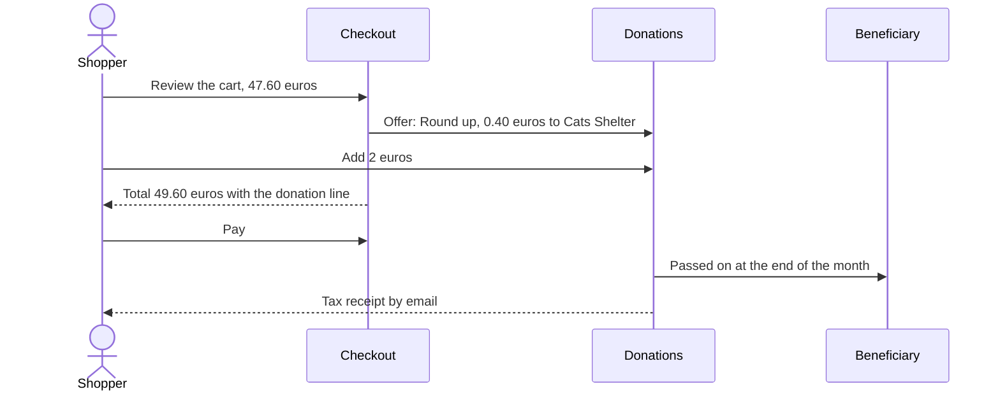

🏠 [Specs](../../../../README.md) › 🧩 [Functional capabilities](../../../README.md) ›
🛍️ [F11 Online shop (plugin)](../../README.md) › 📝 [Use cases](../README.md) › 📝 [Use cases: FL-F11-11](README.md) ›
📝 UC-F11-30 Accept donations at checkout

# 📝 UC-F11-30 Accept donations at checkout

**Status:** ✅ specified

## Summary

The shop offers a donation to a stated beneficiary (an association or a foundation) on the checkout page: preset
amounts, a free amount or a round-up of the basket. The donation is a line apart from the goods, outside the sale and
its VAT, shown to the shopper with the name of the beneficiary. It is passed on to the beneficiary and, when the
beneficiary may issue one, a tax receipt goes to the donor.

## Personas

- [U09 Customer](../../../../01-users/personas/u09-customer.md), the shopper who gives, on a phone
- [U12 Marketing and communication](../../../../01-users/personas/u12-marketing.md), who sets the beneficiary and the
  campaign

## Goal

Shoppers can give at the moment they pay, and every donation reaches the beneficiary named, with the receipt the donor
is due.

## Trigger

A shopper reaches checkout while a donation campaign is on, or marketing sets up a campaign.

## Frequency

On each checkout during a campaign; campaigns, a few times a year.

## Preconditions

- The shop has a donation campaign with a beneficiary ([E-F11-24 Donation](../../data/e-f11-24-donation.md),
  [E-F8-19 Dedicated fund](../../../f08-accounting/data/e-f08-19-dedicated-fund.md)).
- The shop's payment provider is connected ([E-F11-06 Payment provider](../../data/e-f11-06-payment-provider.md)).
- The beneficiary's details and its receipt status are recorded.

## Postconditions

- **Succeeded:** the donation is paid with the order, receipted when due, and passed on to the beneficiary
  ([E-F11-24 Donation](../../data/e-f11-24-donation.md)).
- **Failed:** no donation is taken and the order goes on without it.

## Main flow

1. The shopper reviews the cart on checkout and sees Add a donation
   ([S-F11-29](../../screens/11-donations-gift-cards-and-cross-border/s-f11-29-checkout-donations.md)) with the
   beneficiary's name and what it does.
2. The shopper picks an amount, types another, or rounds up the basket to the next euro.
3. The donation shows as its own line, with no VAT, and the total includes it
   ([BR-F11-04](../../business-rules/br-f11-04-prices-with-taxes-and-delivery.md)).
4. The shopper pays; the donation is recorded as paid with the order
   ([UC-F11-05](../02-shop-and-check-out/uc-f11-05-check-out.md)).
5. The beneficiary is paid from the dedicated fund at the dates set; the donation becomes passed on.
6. When the beneficiary may issue tax receipts, the donor receives the receipt by email
   ([BR-F11-25](../../business-rules/br-f11-25-donations-reach-the-stated-beneficiary-with-a-receipt.md)).

## Alternative flows

- 2a. The shopper gives without an account: the receipt asks for the name and address needed.
- 2b. The shopper chooses no donation: the order goes on, the offer is not repeated in the session.
- 5a. The order is withdrawn within the withdrawal period
  ([UC-F11-09](../03-after-the-order/uc-f11-09-withdraw-return-and-refund.md)): the donation is refunded if not yet
  passed on.

## Error flows

- 4e. The payment fails: no donation is recorded.
- 6e. The donor's address is missing for a receipt: the receipt waits and the donor is asked for it.
- 1e. The campaign has ended: the offer is not shown.
- Any step: a service does not answer; the call is retried first
  ([BR-F3-32](../../../f03-assistant/business-rules/br-f03-32-retry-before-an-error.md)), then the message follows the
  error pattern ([D122](../../../../06-decisions/ux/d122-error-message-standard.md)) and the order stays as it was, with
  no donation.

## Business rules

- [BR-F11-25 Donations reach the stated beneficiary with a receipt](../../business-rules/br-f11-25-donations-reach-the-stated-beneficiary-with-a-receipt.md)
- [BR-F11-04 Prices with taxes and delivery](../../business-rules/br-f11-04-prices-with-taxes-and-delivery.md)
- [BR-F11-02 The order button states the obligation to pay](../../business-rules/br-f11-02-order-button-states-the-obligation-to-pay.md)

## Entities

- [E-F11-24 Donation](../../data/e-f11-24-donation.md): created, paid, receipted, passed on, refunded
- [E-F11-05 Checkout](../../data/e-f11-05-checkout.md): read
- [E-F8-19 Dedicated fund](../../../f08-accounting/data/e-f08-19-dedicated-fund.md): credited
- [E-F11-09 Customer account](../../data/e-f11-09-customer-account.md): read, for the donor

## Permissions

A shopper gives with or without an account. Marketing sets campaigns and beneficiaries; the accountant reads the funds
and receipts.

## Notifications

- The donor, by email: thanks and the tax receipt when due.
- Marketing, in the app: the total given in a campaign.

## Audit events

Campaign created and ended; each donation, its receipt and the payment to the beneficiary with the dates and amounts.

## AI involvement

None: the beneficiary and the amounts are set by people.

## API, MCP and A2A exposure

T5 operations on donations and campaigns; no MCP tool and no A2A skill.

## Screens

- [S-F11-29 Checkout donations](../../screens/11-donations-gift-cards-and-cross-border/s-f11-29-checkout-donations.md)

## Flowchart

See
[FL-F11-11 Donations, wishlists, gift cards and cross-border](../../flows/fl-f11-11-donations-gift-cards-and-cross-border.md#flowchart).

## Sequence diagram

## Acceptance criteria

1. **Given** a campaign for an association **when** the shopper adds 2 euros **then** a donation line appears with no
   VAT.
2. **Given** an order paid **when** the donation was added **then** it is recorded as paid.
3. **Given** a beneficiary that may issue receipts **when** the donation is paid **then** the donor receives a receipt.
4. **Given** an order withdrawn before the donation is passed on **when** the refund is made **then** the donation is
   refunded.
5. **Given** a campaign ended **when** a shopper reaches checkout **then** no donation is offered.

## Non-functional notes

Adding or removing a donation recomputes the total in under 1 second.

## Regulatory references

Tax receipts for gifts and their yearly declaration follow
[CR-FR-124](../../../../10-country-packs/france/non-profit/cr-fr-124-gift-tax-receipts.md).

## Related use cases

- [UC-F11-05 Check out](../02-shop-and-check-out/uc-f11-05-check-out.md)
- [UC-F11-06 Pay online](../02-shop-and-check-out/uc-f11-06-pay-online.md)
- [UC-F11-09 Withdraw, return and refund](../03-after-the-order/uc-f11-09-withdraw-return-and-refund.md)
- [UC-F11-08 Confirm the order and invoice](../02-shop-and-check-out/uc-f11-08-confirm-the-order-and-invoice.md)

## Open questions

None.

---

⬅️ [UC-F11-29](../10-fulfil-from-stores-and-report/uc-f11-29-read-the-funnel-customer-value-and-return-reasons.md) ·
⬆️ [Up](README.md) ·
➡️ [UC-F11-31 Keep wishlists and compare products](uc-f11-31-keep-wishlists-and-compare-products.md)
