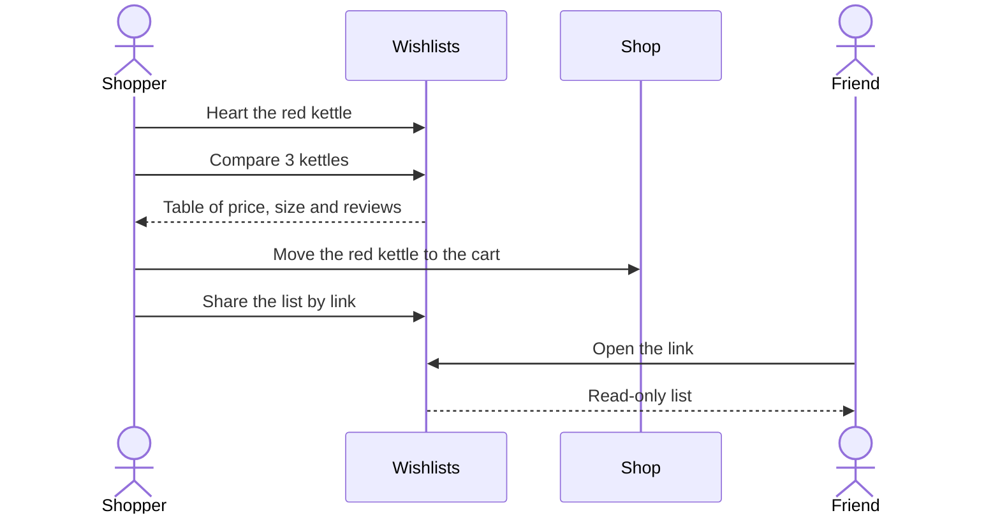

🏠 [Specs](../../../../README.md) › 🧩 [Functional capabilities](../../../README.md) ›
🛍️ [F11 Online shop (plugin)](../../README.md) › 📝 [Use cases](../README.md) › 📝 [Use cases: FL-F11-11](README.md) ›
📝 UC-F11-31 Keep wishlists and compare products

# 📝 UC-F11-31 Keep wishlists and compare products

**Status:** ✅ specified

## Summary

A signed-in shopper keeps one or more wishlists of products they like, moves a product to the cart when ready and is
told when a product is back in stock or drops in price. The shopper can compare up to four products side by side on
their key characteristics. A wishlist is private; the shopper may share it by a link, for a birthday or a wedding, and
stop sharing at any time.

## Personas

- [U09 Customer](../../../../01-users/personas/u09-customer.md), the shopper, on a phone

## Goal

The shopper finds again what they liked, compares before choosing, and can share a list on purpose.

## Trigger

The shopper taps the heart of a product, or opens Compare from a product list.

## Frequency

Many times in a session for shoppers who browse; a few lists per shopper.

## Preconditions

- The shopper has a customer account ([E-F11-09 Customer account](../../data/e-f11-09-customer-account.md)).
- The products are published ([E-F11-03 Online product](../../data/e-f11-03-online-product.md)).

## Postconditions

- **Succeeded:** the product is on the wishlist or the comparison shows its characteristics, and the shopper is told of
  price drops and stock ([E-F11-25 Wishlist](../../data/e-f11-25-wishlist.md)).
- **Failed:** nothing is saved and the shopper is asked to sign in.

## Main flow

1. The shopper taps the heart on a product
   ([S-F11-30](../../screens/11-donations-gift-cards-and-cross-border/s-f11-30-wishlists.md)) and chooses a wishlist, or
   creates one.
2. The wishlist shows each product with its price and whether it is in stock.
3. The shopper picks up to four products and opens Compare; a table shows price, key characteristics and reviews side by
   side.
4. The shopper moves a product to the cart, or removes it.
5. The shopper asks to be told of a price drop or a return to stock
   ([UC-F11-26](../09-pre-orders-and-b2b-buying/uc-f11-26-take-pre-orders-and-back-in-stock-reservations.md)); a message
   is sent when it happens, within the consent given
   ([BR-F11-11](../../business-rules/br-f11-11-cart-reminders-respect-consent.md)).
6. The shopper shares a wishlist by a link, which anyone can read but not change, and stops sharing when they wish.

## Alternative flows

- 1a. A guest who taps the heart is asked to sign in or create an account, and the product is kept after sign-in.
- 3a. The products have different characteristics: the table shows the common ones first and marks the others as not
  given.
- 6a. A shared list is bought from: the shopper sees that a gift was bought without which item.

## Error flows

- 3e. More than four products are picked: the fifth is refused with the limit shown.
- 2e. A product is withdrawn from the shop: it stays on the list marked unavailable.
- 6e. A shared link is opened after sharing stopped: it shows that the list is no longer shared
  ([BR-F11-26](../../business-rules/br-f11-26-wishlists-are-private-unless-shared.md)).
- Any step: a service does not answer; the call is retried first
  ([BR-F3-32](../../../f03-assistant/business-rules/br-f03-32-retry-before-an-error.md)), then the message follows the
  error pattern ([D122](../../../../06-decisions/ux/d122-error-message-standard.md)) and the wishlists stay as they
  were.

## Business rules

- [BR-F11-26 Wishlists are private unless shared](../../business-rules/br-f11-26-wishlists-are-private-unless-shared.md)
- [BR-F11-11 Cart reminders respect consent](../../business-rules/br-f11-11-cart-reminders-respect-consent.md)
- [BR-F11-10 Trackers wait for consent](../../business-rules/br-f11-10-trackers-wait-for-consent.md)

## Entities

- [E-F11-25 Wishlist](../../data/e-f11-25-wishlist.md): created, shared, archived
- [E-F11-03 Online product](../../data/e-f11-03-online-product.md): read
- [E-F11-09 Customer account](../../data/e-f11-09-customer-account.md): read
- [E-F11-04 Cart](../../data/e-f11-04-cart.md): products moved to the cart

## Permissions

A shopper reads and changes only their own lists. Anyone with a shared link reads that list only. Marketing reads counts
of wished products, never the shoppers' names.

## Notifications

- The shopper, by email or push: a wished product back in stock or lower in price, if they agreed.

## Audit events

List created, shared, unshared and archived; each time a shared link is opened (a count, not who).

## AI involvement

The AI assistant of the shop may suggest products to compare; it never shares a list.

## API, MCP and A2A exposure

T5 operations on wishlists for the shop's own front end; no MCP tool and no A2A skill.

## Screens

- [S-F11-30 Wishlists](../../screens/11-donations-gift-cards-and-cross-border/s-f11-30-wishlists.md)

## Flowchart

See
[FL-F11-11 Donations, wishlists, gift cards and cross-border](../../flows/fl-f11-11-donations-gift-cards-and-cross-border.md#flowchart).

## Sequence diagram

## Acceptance criteria

1. **Given** a signed-in shopper **when** they tap the heart **then** the product is on their wishlist.
2. **Given** three products **when** the shopper opens Compare **then** a table shows their characteristics side by
   side.
3. **Given** a wishlist not shared **when** someone opens its address **then** nothing is shown.
4. **Given** a shared list **when** the shopper stops sharing **then** the link shows that it is no longer shared.
5. **Given** a product back in stock **when** the shopper agreed to be told **then** a message is sent.

## Non-functional notes

A wishlist of 100 products opens in under 1.5 seconds on a phone.

## Regulatory references

Messages about stock and prices need the shopper's consent
([BR-F11-11](../../business-rules/br-f11-11-cart-reminders-respect-consent.md)); the shared list shows no personal data
beyond the first name the shopper chose.

## Related use cases

- [UC-F11-04 Browse and search the shop](../02-shop-and-check-out/uc-f11-04-browse-and-search-the-shop.md)
- [UC-F11-10 Use the customer account](../03-after-the-order/uc-f11-10-use-the-customer-account.md)
- [UC-F11-26 Take pre-orders and back-in-stock reservations](../09-pre-orders-and-b2b-buying/uc-f11-26-take-pre-orders-and-back-in-stock-reservations.md)
- [UC-F11-14 Recover abandoned carts](../05-grow-the-shop/uc-f11-14-recover-abandoned-carts.md)

## Open questions

None.

---

⬅️ [UC-F11-30 Accept donations at checkout](uc-f11-30-accept-donations-at-checkout.md) · ⬆️ [Up](README.md) ·
➡️ [UC-F11-32 Sell and redeem gift cards online](uc-f11-32-sell-and-redeem-gift-cards-online.md)
